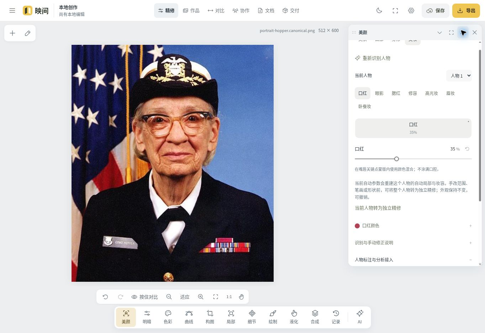

# 映间 · 可扩展的 AI 图像创作基线

“映间”是可替换的初始品牌。项目围绕作品组织精修、草图、AI、多版本和团队工作，个人与团队处于同一个工作台。品牌名称、说明、公开图标由运营配置提供，源码包名不决定产品名称。

当前为 **Recipe v4 / engine 4.0.0、数据库 schema 20 的开发基线**。工作台包含非破坏精修、像素绘制、人像、四角投影、局部修复、区域租约协作、实时语音、云端和公开图片检索、素材记忆与分页用量表。新曲线、压感笔触和保边质感区保存显式算法标识，历史配方仍按原算法重放。版本谱系、指定版本渲染和三类回归见[后端深化工作清单](docs/BACKEND-DEPTH.md)。

此前的后端深化阶段在既有界面布局上补充三档执行授权、服务端预算内编辑、实际候选像素观察、可恢复流式事件、分会话上下文、可审阅的分层记忆、受控动态工作卡片，以及独立版本的导向滤波、纹理补片和连续流形变算法。本轮前端则重构 About、独立账号页面和响应式工作台，并对齐这些既有服务链路。自动化测试使用本地协议夹具。官方模型另做了限量实测。逐项范围与未完成项见 [开发台账](docs/development-ledger.json)，具体契约见各模块文档。

局部修复与质感已接入同一 Agent 候选流程，可新增或回调手动操作并保留保护区、旧算法与供体。新增局部候选的自动保存需通过原尺寸渲染检查。团队语音在作品协作面板开启，成员可以同时说话。邀请 AI 后，每个人可单独授权本轮 AI 收听自己的麦克风。实时语音和字幕留在原对话界面。具体限额与实际验证见 [本轮功能深化记录](docs/verification/depth-20261110.md)。

能力与验证分别记录：人物二维算法不等于商业神经美颜，200MP服务器导入不等于浏览器200MP全量编辑，保留16位/HDR母版不等于全套高位深编辑往返。没有内置演示账户、伪造验证码、假AI回复或默认收费凭据。见[本轮逐项验收](docs/V4-ACCEPTANCE.md)。



默认把空间留给作品，工具按需出现；支持移动和连续调整面板、停靠、专注模式及按屏幕保存布局。上图及[图层绘制](docs/screenshots/v3-paint-desktop.jpg)、[短横屏](docs/screenshots/v3-landscape.jpg)为V3历史截图，不能代替当前版本验证。手机采用独立尺寸的贴底上下文面板与单一主控分层。About 使用真实系统截图连续介绍精修、人像、绘制、AI、项目和交付，核心内容直接滚动可见；打开工作台不会预置宣传素材。209项参考对应、功能边界和本轮逐项修正见[参考审阅](docs/design/reference-209-review.md)及[多轮检查记录](docs/design/reference-209-review-rounds.md)，截图来源与受检版本由[验收证据](docs/design/verification/system-redesign/README.md)分别记录。

## 从这里开始

| 入口                                             | 内容                                                  |
| ------------------------------------------------ | ----------------------------------------------------- |
| [项目总设计](docs/DESIGN.md)                     | 模块、数据、权限、联动、扩展与后续开发边界            |
| [扩展接口与数据链路](docs/EXTENSIONS.md)         | 模块注册、能力发现、适配器、命令、事件与 AI 候选采纳  |
| [功能调研与实现取舍](docs/RESEARCH.md)           | 醒图/美图第一方资料、实现原理及能力边界               |
| [部署、成本与网络](docs/OPERATIONS.md)           | 本地运行、账号配置、部署、代理判断、成本与上线验收    |
| [实现与验证记录](docs/VERIFICATION.md)           | 实际检查范围、结果、未完成的外部实测                  |
| [API 契约](apps/api/API.md)                      | 可直接用于后续开发的真实端点、请求、响应              |
| [图像核心](packages/editor/README.md)            | 数值语义、配方版本、几何与内存预算                    |
| [v3 编辑协议](packages/editor/V3.md)             | 图层、复合蒙版、分组、变换、像素绘制与液化            |
| [人像适配层](packages/portrait/README.md)        | 分析结果、57 项语义控制、多目标与原图绑定             |
| [多模态适配器](packages/multimodal/README.md)    | OpenAI / Ark 生图、Qwen ASR、模型档案、格式及错误分类 |
| [OpenAI 参数契约](packages/multimodal/OPENAI.md) | 按模型映射的参数、依赖、预算与尚未开放的能力          |
| [交互与能力边界](docs/INTERACTION.md)            | 多局部、自由构图、精细调色、响应式和后续扩展          |
| [工作台说明](apps/web/README.md)                 | 响应式交互、本地处理与云端保存                        |
| [V4逐项验收](docs/V4-ACCEPTANCE.md)              | 用户要求、实际代码、证据与未完成边界                  |
| [V4真实API](apps/api/API_V4.md)                  | 多人协作、资源记忆、用量、原件与实时智能体            |
| [V4图像内核](packages/editor/V4.md)              | 单应四角、坐标统一、真实修复与专用质感算子            |
| [实时智能体](packages/assistant/README.md)       | Live/Realtime、工具、候选确认与独立派发证据           |
| [高级媒体](packages/media/README.md)             | RAW/ICC/HDR/CMYK/PSD实际范围与原件/母版/代理分离      |
| [V4部署补充](docs/OPERATIONS-V4.md)              | 新能力配置、代理、成本预算与恢复操作                  |

后续需求、PR 和验收统一使用 [功能对照与验收主表](docs/research/PHOTO-EDITING-FEATURE-MATRIX.md) 的编号。

## 本地运行

需要 Node.js 24（锁定版本见 `.nvmrc`）和 npm。不要把生产数据库用于测试。

```sh
npm ci
npm run vision:prepare
cp .env.example .env
# 在 .env 中设置随机 SESSION_SECRET（至少 32 字符）。不要提交该文件。
npm run dev:lite
```

`dev:lite` 使用持久化的开发 PostgreSQL WASM 数据库，启动 API、独立 AI Worker 与 Vite；默认网页是 `http://localhost:5173`。它适用于本地开发，不能代替原生 PostgreSQL 的并发/生产验收。也可以提供真实 `DATABASE_URL`，运行 `npm run db:migrate` 后使用 `npm run dev`。

首次运营账号通过受控命令行创建：先停止 `dev:lite`，仅在私有 `.env` 中设置 `BOOTSTRAP_ADMIN_PHONE`、`BOOTSTRAP_ADMIN_PASSWORD`、`BOOTSTRAP_ADMIN_NAME`，执行 `npm run admin:lite`，然后从 `.env` 移除这三项并重新启动。原生数据库使用 `npm run admin:create`。命令拒绝替换已有运营账户，不打印密码；这是站点持有者的初次配置，不是用户注册的验证码替代方案。

`vision:prepare` 下载校验过的官方人物模型，并将锁定版本的 WASM 资源复制到同源目录。模型没有装好、浏览器缺少 OffscreenCanvas 或 WebGL 2 时，自动识别明确报告不可用，手动精修仍能使用；不会在用户浏览器临时连接海外模型 CDN。运行条件、资源体积及实际验证边界见部署文档。

未配置短信时，普通注册/验证码入口会明确报告不可用。未配置模型或审核时，AI 入口不会产生假结果，也不会自动调用收费接口。本地图像编辑和草图不依赖账号。

## 核心能力

- **编辑**：版本化v1/v2/v3/v4非破坏配方；全局/局部/组共享色彩块；自由整数像素裁切、0.01°精细旋转/透视/剪切、四角自由投影、可拖曲线、复合蒙版、12个区域与6组调整。V3/V4 径向选区支持旋转与椭圆/矩形/菱形，多边形支持整区移动和按源像素比例旋转。逐像素RGBA绘制、擦除、冻结源仿制、16种混合、8个图像合成层、4种有符号液化及背景保护；新 V4 手动液化使用 `flow-v2` 与有界三次重采样，原有笔触保留算法。V4另有有界谐和填充/梯度域补片和独立质感算子。
- **人像**：独立分析适配器及同源 MediaPipe Worker；按源图哈希、方向、尺寸和算法版本绑定目标。57 项注册控制分为美肤14、面部26、身形10、美妆7；新增眼宽、眼高、眼睑下至、虹膜大小、眉毛位置、嘴宽度、丰上唇和丰下唇八项 V4 控制，按真实轮廓逐项检查可用性。可用项编译为可撤销的普通区域、绘制层和位移操作；V4自动颈长因缺少头颈约束明确停用，旧配方可回放，可转为独立手动精修。自动识别的设备兼容性与真实图像质量需要单独验收，不能由合成关键点单测推定。
- **AI**：保留独立图片模型/参数/尺寸选择、文字/草图/多参考图生图、文本与短语音转录；支持真实PCM双向通话、当前图像共享、私有/公开检索和参数/曲线/生图草案工具。`propose_scene_balance` 按共享画面的实际亮度测量生成曝光/阴影/高光候选；任务图谱连接准备候选、复核像素与推荐。写入仍需用户确认或有效的自动执行授权，并通过租约/版本/配额/审核；不是通用 MCP 执行网关。Live、Realtime、Responses和Images各自用对应协议，结果未知不自动重试。
- **数据**：私人素材、项目、作品、不可变版本、讨论、任务和文档；空间与项目范围内搜索、分页、日期/来源分组；可编辑的声明标题、标签、拍摄时间和手工位置。编辑与元数据保存都有版本比较，冲突不静默覆盖。
- **空间**：个人与团队统一导航；同作品多人会话、游标/姓名/区域、临时草稿和持久操作联动。不相交目标并行，同目标/重叠区域与全局结构互斥，撤销只作用于可安全逆转的本人操作。成员动态、所有权交接、参考授权与独立复制分开控制。
- **媒体**：专业原片经服务器有界子进程处理，保留源字节、16位SDR母版和可用的float32线性HDR母版；浏览器编辑8位代理，原尺寸采用多级瓦片查看。实际格式与像素预算见媒体文档。
- **运营**：账户、注册模式、免费周期权益、套餐目录、模型范围、品牌与图标、带原因的正负额度调整和审计。
- **部署**：同源网页/API、独立 Worker、PostgreSQL、私有存储与发送日志；提供 Docker Compose、环境模板和 GitHub Actions。

详细支持的格式、分辨率与布局以当前版本文档为准。配置存在、适配器测试通过和真实供应商账户完成验收，是三个不同的状态。

## 验证命令

```sh
npm run typecheck
npm run test:lite
npm run build
npm run test:coverage # 须显式设置隔离的 TEST_DATABASE_URL；不读取 .env 或调用付费供应商
npm run verify:lite -- local-round

# 指向隔离的原生测试库后：
npm run verify -- native-round
```

`verify` 包含全工作区严格类型检查、完整自动测试、生产前端构建和生产依赖审计；没有 `TEST_DATABASE_URL` 时拒绝把数据库测试算作通过。报告保存到被 Git 忽略的 `artifacts/verification`。各测试文件串行运行，文件内显式的并发场景继续验证锁和幂等。

`test:coverage` 输出 `artifacts/coverage/native/{inventory.json,summary.json,files.csv,lcov.info}`，记录每个源码文件是否实际加载、行/分支/函数执行数、源码与测试文件哈希。百分比只针对 LCOV 中出现的文件，未加载文件独立列出；浏览器组件、真实设备、照片审美与付费模型质量不能从 Node 覆盖率推定。

## 仓库结构

```text
apps/web          内容优先的浏览器工作台
apps/api          同源 HTTP API、账户、空间、项目与运营
apps/worker-ai    独立的持久任务执行器
packages/editor  版本化配方、数值算法、几何、格式门禁
packages/portrait 人像分析适配、目标校验、语义控制到编辑操作的编译
packages/contracts 模块/能力/坐标帧/任务/采纳的统一版本化契约
packages/db      PostgreSQL 迁移、事务、账本与事件
packages/storage 私有素材接收、安全规范化与有界读取
packages/providers Tencent 短信/文本与图片审核
packages/multimodal OpenAI / Ark 生图、Qwen 语音适配器
packages/assistant Responses工具、实时语音协议与候选编译
packages/media   隔离解码、色彩转换、原件/母版/代理/瓦片
packages/ai      任务编排、冻结输入、计费状态与恢复保护
infra            容器与同源反向代理
scripts          开发、诊断和验证入口
```

后续扩展请先读 [AGENTS.md](AGENTS.md)。新增工具应同时增加数值语义、配方迁移和回归用例；新增模型应实现现有适配器接口；新增收费流程应进入同一个不可变账本，不能直接改余额。
