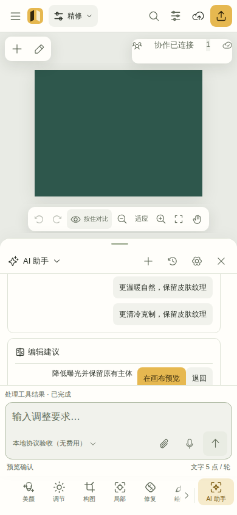

# Web 创作工作台

## 公共入口与语言

访问 `/` 时先检查当前账号会话，已登录进入工作台，访客或会话暂不可读时进入 About 介绍页。可用 `#/` 直接进入 About，`#/studio` 直接打开工作台，`#/login`、`#/register`、`#/reset` 进入对应账号流程。About 使用当前构建的真实桌面、平板与手机界面截图，精修、人像、绘制、AI、项目与交付直接沿文档展开，不需要切换标签或展开正文。打开工作台不会注入宣传素材；旧 `#/sample` 兼容入口单独保留。工作台使用后返回介绍页不会卸载当前作品；正在保存、AI 请求或语音活动时会阻止隐藏工作台。

简体中文、繁體中文与 English 可从介绍页、账号表单和工作台设置切换。语言按需加载，切换完成前保留当前文案，失败可以重试；不会重置编辑器。文案维护、用户内容边界和测试约定见 [i18n/README.md](src/i18n/README.md)。

设计参考、动效约束和真实验证范围见 [官网研究](../../docs/design/official-study-20261111.md) 与 [前端体验验收](../../docs/verification/frontend-experience-20261111.md)。

209项新参考文档的逐项取舍、完整源码证据和组合使用见[参考审阅](../../docs/design/reference-209-review.md)；独立桌面/平板/手机重构与实际问题修正见[多轮检查](../../docs/design/reference-209-review-rounds.md)。历史验收各自绑定原提交，当前改造的测试和截图不能沿用历史结论。

React + TypeScript + Vite 的真实接口前端。本轮以内容优先的 Studio 方向重做 AI 输入、手机工作区、参数控件和跨页面主题，经过 PR #2、PR #3 整合后，继续在最新主线上同步协作会话、历史恢复和验收调度。研究分支、素材处理、供应商用量与图像算法沿用真实主线实现；前端使用对应的 DTO、权限、版本和请求恢复契约，没有独立的假数据业务层。

页面默认品牌来自 `src/lib/brand.ts`；服务端 `/v1/public-config` 的品牌名称、说明和公开图标优先。没有默认用户、演示项目、伪造任务结果或内置私人照片。本轮源码、实际截图与自动验收的对应关系由 [交互重构验收记录](../../docs/verification/frontend-interaction-20261110.md) 汇总，每组证据都标明受检版本及执行范围；实际设备与付费供应商另行记录。

## Studio 界面与快捷操作

浅色、深色、跟随系统是整个页面的外观偏好。`html[data-theme]` 驱动画布、工具、作品、文档、用量与弹窗的共享颜色；偏好独立于视口布局保存在本机，并响应系统变化和同源标签页的存储事件。实现见 [useStudioTheme](src/workspace/useStudioTheme.ts) 与 [theme.css](src/theme.css)。

画布保留主要空间，工具按任务分组。参数面板优先展示当前数值与主滑条，支持精确输入、连续预览和可取消的整次手势。手机将工作视图切换收进独立弹层，让当前内容和操作占据主要区域；短横屏保留内部滚动。面板可以收起、恢复、调节尺寸或主动浮动，专注模式可以一键返回工具。AI 面板设有独立的建议最小高度，最终尺寸服从实际工作区上限；极短可用区域需单独检查输入与操作可达性。

作品与素材库提供真实结果数量、清除筛选、显示密度、完整构图缩略图与读取失败提示。协作区区分讨论、任务和完成进度，文档区区分新建、选中、未保存及版本冲突；共享、任务、文档和评论入口跟随当前项目角色，服务端仍做最终权限校验。交付页展示当前编辑预览，导出弹窗将格式、质量、准备状态与实际下载分开呈现。

云端历史按摘要分页，显示已载入数量，失败后沿原游标重试；打开旧版本时再读取完整配方和冻结原图。读到更高云端 head 后，历史仍可查看，恢复需先重新打开作品。每个版本的“版本详情与操作”已接入真实 `render-info` / `render` 和 `fork-revision`：先查看渲染尺寸、来源与预算，再下载该版本 PNG，或创建独立作品。分支请求失去回执时保留原版本、名称和幂等 key；拒绝放弃当前草稿后仍保留已创建回执，不重复创建。已保存 AI 候选的 `applied:true` 回执不再触发本地重复预览。实现见 [RevisionTools](src/components/RevisionTools.tsx) 与 [版本 API](../api/API_V4.md#7-artwork-revisions-branching-and-reference-rendering)。

| 操作           | 快捷方式或入口                   | 行为                                                                                     |
| -------------- | -------------------------------- | ---------------------------------------------------------------------------------------- |
| 查找工具与操作 | `Ctrl / ⌘ K` 或顶部搜索按钮      | 支持中文关键词，搜索工具、工作视图、导入、保存和导出；未满足前置条件的操作仍显示禁用状态 |
| 选择搜索结果   | `↑ / ↓`、`Home / End`、`Enter`   | 在结果中移动并打开；中文输入法组字期间不把确认候选误作执行                               |
| 撤销 / 重做    | `Ctrl / ⌘ Z`、`Ctrl / ⌘ Shift Z` | 对编辑器执行撤销 / 重做；在输入框中保留文本编辑本身的行为                                |
| 专注画面       | `F` 或顶部专注按钮               | 收起工作区干扰，再次触发恢复；输入文字时不劫持字母键                                     |
| 返回画面       | `Esc`                            | 按当前弹窗与工作区状态关闭覆盖界面、退出比较或专注                                       |
| 切换当前参数   | 参数项或手机参数选择器           | 显示对应主滑条与精确数值，保留同一套参数范围与操作语义                                   |



上图来自本轮 Chromium 验收中的真实应用，使用一次性测试账号和本地协议服务。输入、消息、主操作与费用信息各有位置；原始截图与报告的受检版本见 [证据索引](../../docs/verification/evidence/frontend-interaction-20261110/README.md)。

## 开发

从仓库根目录使用已经安装的 npm workspaces：

```sh
npm run dev -w @ai-xiutu/web -- --host 0.0.0.0
npm run typecheck -w @ai-xiutu/web
npm run build -w @ai-xiutu/web
```

在仓库根目录用 `npm run dev` 同时启动前端、API 和 worker。`WEB_PORT` 设置网页端口（默认 5173），`PORT` 设置 API 端口（默认 3001）；两个值从进程环境或根目录的 `.env` 读取。开发和本地构建预览的 `/v1` 与 `/health` 都走同一个本地 API。`npm run dev` 根据网页端口生成默认 localhost Origin；自定义主机名或独立启动服务时设置精确的 `APP_ORIGIN`。端口被占用时会报错，避免前端悄悄切到另一个入口。生产环境使用同源路由及真实域名的 Origin allowlist。

`qa-responsive.html?focus=390` 是开发验收页面，提供 320、390、768、844×390横屏、1024、1440px 的真实工作台 iframe。它没有加入 Vite 生产构建入口，也不是产品导航的一部分。iframe 只检验布局，不模拟手机内存、指针类型、真实网络或麦克风权限。

## 实际工作流

- 绘制、橡皮、克隆和选区笔刷读取实际 `getCoalescedEvents()` 中间轨迹，单个事件批次只生成一次不可变预览；抬笔末端独立保留，取消/撤销仍以整笔为单位。无该接口时使用真实事件坐标，不把预测点写进配方。输入采样与真实硬件的压感、倾斜及触控表现需分别验收，不能由鼠标或合成事件测试推定。
- “绘制”中的妆容笔可用一个开关切换自动定位和手动笔触。九个区域按色系各提供 24–48 个色样和自定义色。图标栏一次打开一个参数。自动模式用源图绑定的人脸关键点和分割选区定位，强度与颜色 Alpha 独立，眉眼、唇、底妆等使用各自遮罩。手动直径最小 0.5 源像素，覆盖率按 4×4 子采样计算。颜色、Alpha、透明度、饱和度、柔边和混合方式随笔画写入 V3/V4 配方。选中已画笔画可调整这些值，修改可以整次撤销。妆效按底图明暗和指定混合方式渲染，预览与导出共用引擎。
- 人像的美肤、面部、身形和妆容提供自动定位及对应手动入口。发际线需要发丝分割与面部轴的多个可信交点。手动液化支持自由、横向和纵向推移，作用范围可以使用已建立的局部选区。每笔保留自己的范围，触控和鼠标沿画面坐标操作，触控笔可传入实际压力。受支持预算内实时和静止预览使用同一原图栅格，滑动中不切换到低分辨率代理。
- 本地图片编辑不要求登录。导入前读取受限文件头，检查格式、动画、像素与边长，再解码。预检支持 PNG、JPEG、WebP、受限 BMP、可完整检查的静态 GIF 和直接主图 AVIF，仍需浏览器实际解码；本地文件上限 128 MiB。触控且宽度不超过 959px 的设备默认 4,194,304 像素，桌面默认 16,777,216。用户可在导入设置明确选择预算；新建 V4 工作流最高 16,777,216 像素、单边 8192px。40MP/64MP 仅属于已存在 V1/V2 旧配方的独立预算，不能作为 V3/V4 新图处理能力。超过预算明确拒绝，不偷偷缩小原件。素材库和导入设置的“原片与专业格式”是单独的服务端导入流程，保留原件、母版和可编辑代理；实际格式与大文件可用性取决于服务器的解码器、任务预算和检查结果，不代表浏览器能直接以原尺寸或原位深编辑。这些预算不是设备性能实测保证。
- 符合设备导入预算且最多 16,777,216 像素的源图和合成素材在工作台按原尺寸渲染。拖动、松手、裁切和对比使用同一工作栅格。交互 Worker 保留每条队列最新的设置，使用参考引擎生成真实像素；在预算内的空间算子使用分块和局部缓存。旧版配方可导入的更大源图使用固定代理，原尺寸导出按 512px 图块执行参考引擎。缩放值相对适合画布的比例，保留母版面板提供 1:1 窗口。人像推理使用独立分析图。实现见 [useEditor](src/editor/useEditor.ts)、[预览预算](src/editor/previewBudget.ts)。
- 新图使用 EditorRecipe v4 / engine 4.0.0，继承 V3 的 13 项基础调整、色阶、连续 HSL、分级、纹理/清晰度、颗粒、曲线、0.01°精细构图、降噪/色散、12 个完整局部、6 个组、组合蒙版、24 个绘制层、8 个图像层和 64 次有符号液化。V4 加入真正的凸四边形投影、独立纹理融合/平滑修复、版本化局部质感处理。旧版本保持原解释器，用户明确升级才迁移；V4 不能降级为 V3 并丢弃字段。各层共用有限笔触、点数、蒙版和内存预算，不能简单按人物数倍增。兼容基础见 [V3协议](../../packages/editor/V3.md)，V4 字段和限制由 `packages/editor/src/v4-types.ts`、`v4-recipe.ts` 定义。
- 四角变换使用画布中的可拖拽把手和数值微调。手势开始时冻结坐标参考框，避免输出边界变化使把手漂移；键盘方向键按 1px 调节，Shift 为 10px，Alt 为 0.1px，Esc/失焦/多指冲突取消当前未提交手势。奇异、交叉或翻折四边形被拒绝并保留上一份有效预览。绘制命中还经过每个构图阶段的裁切检查；原图真实透明像素仍可落笔。
- 修复工具将笔刷目标、保护范围和可选供体位置保存为独立操作。纹理修复的目标及周边必须不透明，目标不超过 262,144px、工作区不超过 1,048,576px，迭代也有工作预算；超过预算明确报错。它是有界的纹理/边界融合，不冒称神经去物、自动痘斑检测或任意大面积生成填补。
- 美颜为顶层工具，按真实分析目标生成确定性的皮肤、面部、身体和美妆操作。V4 人物处理将保边平滑、色度均匀、有符号肌理和细纹衰减保存到独立 retouch 区域，不把每个选项都实现为同一种模糊。模型资源同源部署，WebGL2/OffscreenCanvas 不足时明确失败；允许导入绑定当前图像摘要的真实分析结果。原生 CPU 成功不能代替浏览器自动识别验收。自动人物可整体转成独立精修，保留像素与追溯，重调不会静默覆盖手工修改。专门痘斑/皱纹检测、神经修复和发丝重建没有伪造为已实现。
- 草图板支持鼠标/触控笔画、完整色谱、HEX/RGB/HSV/透明度、笔宽、橡皮、撤销/重做、白底PNG导出。画布按实际显示bbox保持比例，拒绝替换原照片的确认时不会关闭并丢弃草图。照片参数面板包含真实RGB直方图，颜色工具可取画面像素并读取/复制色值。草图可以打开为本地图片，也可以在 AI 生图中作为显式参考；确认生成之前不会自动上传。单板有本地坐标点数/笔画预算，达到时提示先保存。
- 云端保存先处理底图与全部合成层来源：本地素材上传，已知云素材跨项目走受授权且幂等的复制；拒绝复制后不会偷偷重上传绕过政策。再创建作品/不可变版本，修订保存当时真实源图及全部图层依赖；更新携带 `expectedVersion`。发生版本冲突时保留本地草稿，可另存独立作品，不强制覆盖。保存中阻止换图和空间切换。
- 作品与素材按实际个人/团队空间或受邀项目查询，支持服务端名称/标签搜索、来源筛选、入库日期筛选、项目/日期/来源分组以及游标分页。分组数量仅指已载入结果，不伪称空间总量。标题、标签、拍摄时间和地点使用独立 annotationVersion 做 CAS 更新；拍摄时间与地点由用户声明，未自动提取 EXIF/GPS。缩略图展示原始素材，点击对应作品版本才恢复编辑配方。
- 个人空间、团队空间、成员邀请、共享给我的项目、参考/复制授权、独立复制、版本讨论、任务、项目文档使用真实 API。团队设置显示成员变更记录，并支持带期望所有者校验的所有权交接。复制与授权仍由服务器检查当前权限/策略；已经完成的独立副本不会因撤销来源授权而消失。
- 连续参数预览采用独立交互 / 正式两条 Worker 通道，每条最多一个在途任务和一个最新待执行任务；交互帧按顺序提供反馈，正式结果只接受当前源图和最新配方，已完成的正式帧不会被旧交互帧替换。缩小预览前仍验证原图输出尺寸，不能用小预览放行无法导出的变换。此结构降低队列积压，不构成所有设备的帧率保证。
- 采用内容优先布局：默认收起空间导航和检查器，没有固定横向三栏。画布通过 ResizeObserver 按实际可用区域完整 fit，放大后的平移仅在画布内发生。手机工具栏贴底，上方直接连接上下文面板；明暗、色彩、曲线和细节归入“调节”再逐层展开，当前主滑条优先展示。桌面/平板保留更宽的工具选择和独立面板尺寸。三端均可连续调宽高、移动、停靠或主动浮动，手机底部标题拖动用于连续调高度，其他停靠/浮动位置可自由移动；三类视口与横竖屏分别保存偏好。停靠默认让位，不自动遮挡照片；用户可主动选浮动/最大化来遮挡部分画面精调，随时收起看全图/恢复。对比支持并排或分别查看原图/当前版本。支持 F 专注、全局外观模式及重置布局。

### 局部质感、抠图、文字与动图

- **局部质感**：手工新建区域使用 `guided-v4`“纹理与斑点分离”，可在当前工具中明确选择旧算法。斑点色度处理和纹理细节有独立参数；已有配方保留原算法与语义，不自动升级。它是确定性的图像算子，不等于专用痘斑 / 皱纹检测或商业神经美颜；效果质量需独立实图审阅。
- **人物透明素材**：真实人物分析与当前原图哈希、尺寸匹配后，“从原图提取人物素材”执行边缘细化和去色污染。来源属于当前可写项目时调用 `POST /projects/:id/derived-assets` 创建 PNG 素材；本地图片走同一抠图内核下载透明 PNG。提取基于原图及主体分割，不会自动继承画布里全部编辑，也不把粗分割冒称发丝重建。
- **OCR 与表格**：素材入口的“识别文字与表格”先读取实际安装的语言包和像素能力，调用 `/assets/:id/recognitions` 保存或读取 Tesseract 结果。支持英文、简体中文和已安装语言的组合；版面可选自动、连续段落、零散文字、对齐表格。表格根据文字坐标推断，可能返回空；文字、置信度和位置仍由服务端保存。删除识别结果同时移除对应搜索贡献，原图保留。
- **本地拼图**。在编辑器工具栏打开“拼图”，混排普通照片、浏览器可解码的动图和实况。选择多张照片或打开动态素材也可进入同一工具。模板按素材数量提供最多 18 种布局和 15 种固定画幅，也可自定比例、横拼或长拼。可以从文件、当前画布和项目素材追加，换图时保留格位和构图，继续编辑或撤销。位移以 PNG 画幅像素表示，支持 0.1 px 输入。移动抠出的前景可以覆盖相邻格，自动人像依赖已安装的本地模型，手动描边适用于其他主体。动态素材根据选区内的颜色和边缘跟随主体平移，形变与完全遮挡需要重新调整选区。
- **拼图与 AI 候选**。拼图中的 AI 图标打开生图任务，已登录且具备项目权限时可用当前拼图作参考。提交前仍需确认模型、参数与费用。任务中的图片候选可追加到拼图或替换打开 AI 时选中的格子，两种操作都可撤销。返回拼图保留该工作区中的合成状态。
- **实况与输出**。支持 Android Motion Photo 的 JPEG、AVIF、HEIC 输入和浏览器可解码的配对视频。HEIC 封面编解码能力不足时可从可播放的视频读取画格。同名照片和视频可以一起添加，也可显式配对。GIF、APNG 和动画 WebP 依赖浏览器的 `ImageDecoder`。本地拼图可下载 PNG 或按当前设备预算生成编辑副本，动态输出为 MP4 或 WebM，能录制 MP4 时可生成带动态内容的 JPEG。预览可开关选中素材的原声，动态合成输出为无声视频。手机相册的识别、保存及厂商专有格式另需设备验证。 [Apple Live Photos](https://support.apple.com/zh-cn/104966) · [Android Motion Photo 格式](https://developer.android.com/media/platform/motion-photo-format)
- **云端派生拼图**。项目素材中的“拼图与 GIF”可设置画布、列数、间距、适应方式与透明背景，通过 `derived-assets` 保存独立 PNG。服务端核对来源与输出预算，保存可追溯的来源和参数。
- **GIF**：通过项目动画上传接口保留真实 GIF，读取帧数、尺寸、延时与循环次数；“GIF 帧编辑”可重排 / 选取帧、设置时长与循环，并应用明确上传的编辑配方。结果另存新的 GIF 及首帧 PNG，可预览、下载。界面帧编号从 1 开始，提交前转换为 API 的 0 基索引。格式、帧数、单帧 / 总像素和文件大小受服务端能力约束，不能据此声称支持视频剪辑或所有动画格式。

这些入口使用真实 API；可用性仍取决于实际解码器、OCR 语言文件、权限与资源预算。共享契约与边界见 [素材处理 API](../api/API_V4.md#asset-processing-and-provider-usage) 和 [AssetTools](src/components/AssetTools.tsx)。

## 同作品协作、资源与用量

已保存且有权限的作品通过 `useCollaboration` 接入真实会话、长轮询、临时预览和不可变命令提交。游标和租约范围使用原图坐标，经过同一份构图/液化映射呈现；不可投影位置被跳过。参数、曲线、既有局部或图层可申请窄范围租约；结构增删、自由变换和整体配方需文档租约。单个目标未被其他人改变时，服务器可重放到最新版本；目标已改变则明确冲突，不能最后写入者静默覆盖。撤销只反转当前窗口已确认的自身操作，保留他人不相关修改。

连续预览与光标有节流，提交后才产生版本。会话过期保留同一来源的本地草稿再连接；失效租约重新申请，未知提交只能用原幂等键重试，不能另起新提交猜测结果。同作品协作的命令草稿与未知命令只保留在当前页面内存，本轮没有实现浏览器重启后的离线命令恢复；AI 付费请求的恢复资料另见下节。AI 采纳/历史恢复前释放自己的租约，其他人的活动租约仍由服务器阻挡。权限变化不会把未发送的本地像素直接清掉，可导出或另存到有权限的项目。

最新主线在 `pagehide` 时取消旧连接并尽力释放当前协作会话；从浏览器前进 / 后退缓存恢复时，重新加入当前作品并保留同来源的内存草稿。这与完整重载后的草稿持久化是不同能力。释放请求只针对本页的会话，不删除其他成员的会话；新增 QA 分别检查旧会话移除、独立编辑者仍在线，以及已停止的助手请求不重复派发。

素材库可切换项目素材、跨可访问空间搜索与“长期素材”。长期素材标题、标签、笔记是本账号显式选择的私有标注，不修改团队素材公开信息，也不会自动发送给 AI；删除标注不删除原文件。专业导入的素材可打开原件查看器，独立下载原件/母版，查看元数据与分级图块。一般缩略图和编辑代理不是高位深回写结果。

最新主线的团队语音以当前已保存作品为房间。加入成员通话、开启麦克风和邀请付费 AI 是不同操作；邀请需明确确认，每个成员还需逐轮决定是否允许 AI 听自己的麦克风。AI 上下文变化时暂停相关音频转发与输出，等待邀请者同步确认。团队邀请的未决状态由 App 中的连接 hook 持有，收起协作面板不会丢失观察；切换账号、作品或连接会使原连接证明失效并保留原请求。切换到作品、文档或其他视图时，持续通话条保留麦克风、离开和返回编辑入口，不会因切换视图而静默挂断；返回编辑仍经过未保存文档的确认。人声交流可以继续使用，付费邀请仍受下面的恢复保护约束。

个人、团队和运营用量分别调用授权范围不同的接口，提供上海时区日期筛选、按日 / 月聚合、服务点变动与分布、明细分页和 CSV 导出。预占、实际消耗和释放分开呈现，当前钱包余额单列，不把持有 / 释放重复计入消耗。缺失金额显示“未知”，不替换成 0。报告分页沿服务器冻结快照读取，钱包余额可能更新，两者不是同一时点总账。CSV 使用完整固定筛选与快照，只输出一个表头，任一页失败即不生成残缺文件；本机文件预算 64 MiB，超过后需缩小日期范围。

从有任务 ID 的账本记录可打开“任务调用与费用”，通过 `/usage/jobs/:id`（运营为 `/ops/usage/jobs/:id`）查看任务 / 预占状态、供应商调用阶段、分支、回执 token、派发时间与服务点流水。总 token 采用回执总量，不重复叠加缓存输入或推理输出等子集；本地素材 / 画面研究没有供应商 token 阶段。按派发时冻结费率得到的 USD 数值只作公开估算，与平台服务点及供应商实际账单分开，缺失回执、计量项或适用费率都标为不完整。公开费率独立从 `/usage/model-prices` 读取，不能套用当前费率补造历史调用金额。任务详情绑定打开它的账本身份，切换账号、范围或筛选后撤下旧结果。实现见 [UsageJob](src/usage/UsageJob.tsx) 与 [计量汇总](src/usage/providerBilling.ts)。

## AI 任务契约

AI 面板默认进入文字助手，也可从紧凑任务入口切换参数建议、图片生成、文案和录音转文字。顶部只保留任务 / 模式、新会话、记录与设置；中间是唯一消息滚动区，底部是常驻且按可用高度适配的输入框和发送动作。模型、规格、执行授权、共享范围、记忆和历史进入独立受控弹窗，关闭后保留未发送草稿；费用与未知请求提醒仍靠近输入区可见。普通 Enter 换行，`Ctrl / ⌘ Enter` 发送，输入法组字确认不触发发送。所有任务通过同源服务器调用，前端不保存供应商密钥。

文字助手保留分会话历史、创作方向、三档执行授权、可恢复流式文本 / 工具进度、上下文来源、显式记忆审阅和受控工作卡片。活跃文字请求或实时通话收起面板、切换工作视图后继续由同一挂载实例持有；顶部活动条按真实连接 / 通话 / 静音 / 结束状态显示，提供返回、可用时静音和结束操作，不以隐藏界面当作挂断。回执到达时，文档页面或未保存编辑不会被静默切走；服务端已保存的结果与本地草稿分别保留。图像生成的流式 / 渐进输出能力仍由独立适配器决定，不能以对话 SSE 冒充图片生成流式输出。

| 任务             | 请求的附加内容                                                                  | 结果如何进入项目                                                                                                       |
| ---------------- | ------------------------------------------------------------------------------- | ---------------------------------------------------------------------------------------------------------------------- |
| `edit-plan`      | prompt、artworkId、expectedVersion、recipe                                      | 显式预览候选，可依原版本CAS采纳或另存；不能把旧建议覆盖新编辑                                                          |
| `generate-image` | prompt、width、height、按模型能力的 imageOptions、可选参考图数组及互斥遮罩/标注 | 服务端生成独立素材和作品；用户可另存、替换当前图、加入合成层或拒绝，均记录来源与决定                                   |
| `generate-text`  | prompt、可选已保存父任务及项目文档版本                                          | 可修改生成标题/正文，再明确存为项目文档                                                                                |
| `transcribe`     | 16kHz 单声道 PCM16 WAV 的 base64                                                | 显示可编辑文字；明确填入调整/生图/文案输入框，不自动执行第二次任务；noSpeech成功空识别说明没有清晰语音与该任务结算状态 |

模型必须同时满足运营目录、当前任务 `availableOperations`、具体模型 `runtimeAvailable=true`，以及该任务包含于 `runtimeOperations`。目录 `enabled` 不等于供应商已开放。图像尺寸支持常用和自定义宽高，同时遵守运营宽高及服务器返回的模型/平台交集 `minPixels/maxPixels/maxDimension/minAspectRatio/maxAspectRatio`；不写死4MP限制。不支持4K的模型不会把4K显示为可执行尺寸。模型未配置时呈现真实状态，不制造任务结果。

“转文字”保留最多 30 秒录音，停止后转为受限 WAV 并试听；用户再点击发送识别。“实时语音”是独立的双向音频链路，使用服务端代理的 WebSocket 会话、后端模型与语音模型配置，提供静音、中断、停止和状态提示，不以录音转文字冒充通话。通话额度、时长与模型可用性由服务器决定，不自动重拨未知会话。浏览器系统朗读仍属于独立的 `speechSynthesis` 工具。麦克风、音频工作线程和真实通话质量依赖 HTTPS、权限、设备与供应商；无账号/设备实测时不能把 UI 或协议测试写成真实通话成功。

AI 默认只取得当前任务允许的文字/参数上下文。主动选择共享画面时，App 从已经渲染完成的照片像素生成最长边 1024px 的 JPEG，包含当前未保存配方但不含 UI、队员游标、评论或文件名；等待期间来源、版本或配方改变会拒绝该快照。实时通话中的画面更新也遵循显式共享开关。只建议模式不写入，预览确认模式由用户明确采纳；预算内自动执行需当前有效的明确授权，并由服务端核验版本、租约、范围和预算。资源范围、私有长期标注和公开搜索也是独立授权选择。

请求使用安全随机客户端幂等键，发送前冻结请求体及哈希。`unknown` 任务不自动重发；显式核对未确认请求时保持原 key 和原请求体，已知任务编号则只读回原结果。真实已保存任务以服务端 threadId / parentJobId 关联；续接图片必须明确选中父结果，续接文案只使用实际冻结的父结果与所选文档，不声称包含整个可见聊天历史。

模型参数取自 `/models` 的 parameterCapabilities，并与顶层运行时状态、尺寸和 batchLimits 批次预算共同检查：质量、背景、编码、压缩、数量、复杂度、参考数量、遮罩/标注、尺寸倍数和边界均只暴露实际开放项。图像供应商的流式、渐进预览、输入保真、SVG / GIF 输出是否开放，以能力说明为准；这与素材库独立的 GIF 导入 / 编辑不同。输出批次逐张显示，所有图片都经过服务端完整审核并发布后才可见。报价取 pricing 中质量对应的每张服务点乘输出数量，不混用人民币；整批像素为宽×高×张数，整批服务点还受服务端单次100000点上限约束。供应商JPEG/WebP输出也会规范化为项目PNG，不能声称原容器保留。

调整建议先校验作品/版本及本地快照，再显示基础和 V2/V3/V4 注册参数的实际差异；局部/分组/层/液化/四角/修复等结构变化另列。普通调整任务的模型写入白名单仍来自真实注册表，其余字段完整保留；实时 Agent 的工具也独立校验候选与当前快照。可先明确进入本地草稿，也可通过真实决定接口在原基准版本采纳或另存分支；脏草稿、错误项目或过时版本不能静默覆盖。历史 V1 建议只经明确确认合并基础调整，不丢失扩展。

图片候选的拒绝不代表供应商退款。已完成结果的另存、替换、合成图层和文本另存/更新均经过幂等决定与版本校验。queued任务只有服务器确认未发送且当前账号有权时才可取消并释放预占；已发送、状态不明或正在执行时不能客户端猜退款。

历史 `fork-revision`、`render-info` / `render` 已有“版本详情与操作”入口。候选专用 `/commit` 目前仍未新增独立 UI，现有显式候选预览后走普通版本化编辑 / 保存的路径继续保留；收到 `applied:true` 的已保存决定只回读结果，不再重放本地预览。不能把服务端存在某端点写成所有前端流程都已改用它。

### 研究分支与来源

“助手设置 → 共享范围”可显式填写第一 / 第二项公开查询，在“本轮分工”中指定已授权空间的素材查询，或检查明确共享的当前画面。连同主公开查询，每轮最多四个分支，其中公开查询最多两个；模型也可在已授权范围内委派私有素材和画面检查。公开分支只接收批准的字面查询，不把私有项目描述当作公共搜索词。

对话区的研究分工图根据 `branch.changed` 事件和 `GET /assistant-turns/:id/branches` 展示执行、汇合与终态，历史读回仍核验当前账号、项目和来源权限。停止后未结束的节点可能显示“已中断”，读取未同步时保留最近记录；它只反映进度，不是结算依据。`research` 与原提示词、scope、授权、画面共同冻结进同一请求体，核对未知请求时不会重建分支或另起 key。实现见 [ResearchGraph](src/ai/ResearchGraph.tsx)、[助手契约](../../packages/contracts/src/assistant.ts) 和 [研究 API](../api/API_V4.md#research-branches-and-usage)。

### 请求恢复与本机存储范围

恢复记录按账号归属，并保留原项目。切换项目或账号不会把旧请求换成当前画布的新内容。恢复资料不等于完整离线作品，也不构成跨标签页、跨设备的原子去重或收费锁。

| 内容                              | 存储位置                                         | 实际保存范围与恢复边界                                                                                                                                                                                      |
| --------------------------------- | ------------------------------------------------ | ----------------------------------------------------------------------------------------------------------------------------------------------------------------------------------------------------------- |
| 普通 AI 任务、文字 Agent 未决请求 | 当前标签页的 `sessionStorage`，按账号区分        | 保存请求 key、哈希、状态、项目、提示词、编辑起点等恢复资料；无原始媒体时还保存完整非媒体请求体，可能包含配方、模型、参考素材 ID、授权、范围和研究分支。支持同一标签页刷新与面板重开；新标签页没有同一份记录 |
| 个人实时语音未决请求              | 同源浏览器的 `localStorage`，按账号区分          | 保存请求 / 会话标识、状态、哈希、项目及非媒体恢复资料；`editorKey` 含编辑起点，未共享原始画面时请求体还可包含模型、音色、配方与 scope。其他标签页通过存储事件获知变化，但它不是跨标签或跨设备的原子受理锁   |
| 团队 AI 邀请未决请求              | 同源浏览器的 `localStorage`，按账号区分          | 保存原 key、作品、模型、哈希、状态及房间邀请 ID 等；无媒体时也保存严格团队 schema 的请求体。个人与团队语音互查未决记录，同页通过事件同步，其他标签页通过存储事件同步                                        |
| 含原始共享画面或录音的请求体      | 当前页面内存 Map                                 | 整个含媒体请求体不写入上述浏览器存储；关面板后仍可在同页恢复，刷新或关闭页面后不可重放。语音连接 ticket 不进入恢复记录                                                                                      |
| 未发送的 AI 文本草稿与选择项      | 当前页面内存，按账号 / 项目区分                  | 支持面板重开与任务切换中的草稿保留，不保证刷新、关闭标签页或跨设备恢复                                                                                                                                      |
| 历史版本分支恢复                  | 同源浏览器的 `localStorage`，按账号 / 原作品区分 | 保存原版本身份、标题、幂等 key 和已创建回执；不保存源图。核对沿用原请求，用户保留当前草稿时不会丢掉创建回执；不是跨设备原子锁                                                                               |
| 工作台布局与外观偏好              | 设备侧 `localStorage`                            | 布局保存视口类别、面板位置 / 尺寸 / 展开等信息；全局外观单独保存 light / dark / system，不上传图片                                                                                                          |

已知普通 AI 任务编号后，结果恢复仍读取 `/projects/:id/ai-jobs` 的最近 100 条并定位原任务；新 `/usage/jobs/:id` 提供任务状态和计量明细，不能代替完整生成结果的单项 / 游标恢复。已知文字助手轮次后，读取 `/assistant-turns/:id` 与原轮次事件流。未取得编号但仍持有完整原请求时，只有用户明确选择才按原 key 核对；不重新抓取画面、不换模型、不续建授权后冒充原请求。

新用量 API 已可按已知语音任务 ID 查看 `state`、`holdState` 和供应商阶段；访问者需是有空间权限的本人或对应团队 owner / admin，运营走独立接口。但前端语音恢复状态机尚未使用这些详情自动核验并释放本机记录，后端也没有按原幂等 key 查回语音身份或补取连接 ticket 的用户接口。同 key 再准备仍返回 `409 VOICE_ALREADY_PREPARED`，不能重新取得 ticket。已准备、未知或无法确认的通话因此保守锁定新拨号；原媒体离开内存后不能生成替代内容重试。

团队邀请的 POST 只返回状态，不返回计费会话 ID；房间 `invitationId` 是当轮麦克风同意使用的 lease 标识。只有原连接连续观察到自身原邀请真实进入 `active`、随后收到明确结束 / 失败，且未发生断线、未知结果或邀请更换时，才可自动解除本机记录。`connecting → failed`、重新加入看到房间为空、结束按钮返回成功，都不能证明旧请求已经结算；目前不提供团队邀请重发入口。个人与团队语音互相检查本浏览器的未决记录，不能通过换一个语音入口绕开。

**管理员核验之后，用户可以在有权限且已知 ID 的用量详情中查看已记录状态；前端仍不会据此自动清除个人 / 团队语音恢复记录。**目前只有原绑定连接等已实现的明确终态证明路径会释放本机记录，不能把删除存储或新 key 当作核对流程。

后续应把已知语音 ID 的只读核验正式接入恢复流程，并补齐原 key → 稳定会话身份查询、团队计费会话 / 邀请终态关联、普通 AI 完整结果的单项 / 游标查询，以及账号级未终态请求读回。当前服务端准备语音时的活动检查只包含 `prepared / connecting / active`，不包含 `unknown`；阻止未核验请求另起新 key 还需服务端事务 / 账号锁中的明确准入规则，本机存储检查不能代替它。旧恢复设计与历史测试见 [Studio 恢复记录](../../docs/verification/frontend-studio-20261110.md#5-请求恢复数据范围与后端交接)，最新接口边界以本节和本轮交互验收为准。

## 运营与品牌

运营面板使用真实权限接口，支持用户状态/待验证邀请、品牌图标和文案、注册方式、免费权益政策、套餐目录、模型供应商和任务范围、带原因的额度调整、审计列表。额度调整先搜索用户、选择个人/拥有的团队空间并查看真实可用/占用/累计消费，再提交正负调整；只在高级入口保留手工ID。在线支付没有在这里伪造为可用。品牌图标上传后，要保存配置才成为公开站点标志；界面明确说明公开范围。

模型运营可从服务端提供的供应商档案选择OpenAI标识，并配置目录范围与按质量的每张服务点。档案认识某模型、执行环境已配置和账号实测通过是不同状态；新目录默认停用，不将账号权限标为已验证。

实时 Agent/语音模型使用独立的运营页签和能力字段，不覆盖图像模型目录；未知通话与 Agent 结果有独立核验入口。运营用量看板与用户用量看板共享展示语义，授权仍由各自服务端端点决定。

向严格 schema 回写时只发送可修改字段，不把 `logoUrl`、policy 元数据、`version`、`pointsPerPlan` 等只读返回值回传。

## 账号入口、会话与文档恢复

访客工作台提供明确的登录和注册入口，本地导入仍可直接使用。认证表单区分密码登录、短信登录、两步注册与密码重置；注册成功后显示真实个人空间和继续编辑 / 新建项目入口。账号中心按“概览、登录与安全、服务点、数据与退出”分区，分别适配桌面侧栏、手机标签条和短横屏。短信冷却按规范化手机号共享，回执未知时保留状态并提供只读核对，不重复发送注册、登录或短信请求。

后台会话读取、显式登录、重置和退出都有身份与请求顺序保护。重置只撤销目标手机号对应账号的旧登录，当前浏览器身份以真实 `/session` 观察为准；不能因重置了另一个本人手机号而清空当前账号。退出前检查正在保存、AI 请求、语音通话和未保存文档；结果不明时先核对会话，确认退出后才清理原账号临时文档。账号切换或团队成员资格变化会撤下不再有效的云端上下文，当前本地照片保留。

未保存文档按账号和项目临时保留在当前页面内存中，最多 24 份，不写浏览器存储、不自动上传、不淘汰已有草稿。重新登录原账号后可以显式恢复；恢复保留原始版本号，遇到云端并发修改仍需处理冲突。保存成功回执必须与提交的文档 ID、正文、标题和下一版本完全对应；迟到回执只结算同一保存，不能覆盖之后的输入。创建结果未知时阻止普通重复创建，提供核对云端与导出。账号数据页也提供本账号保留草稿的独立出口，项目失权不阻止导出自己的本页内容。关闭页面仍会丢失未导出的内存草稿。

在线购买、订单、订阅取消、自助注销及注销后手机号复用没有当前可调用的完整后端契约。界面展示真实能力状态和现有的账本、照片导出、退出 / 登录操作，不把退出当注销，不造价格、订单或完成回执。接口事实与后续后端交接见 [账号契约](../../docs/design/account-contract-20261110.md)。

认证、账号、计费、危险操作、导出等 14 种弹层分别定义宽度、留白、桌面 / 平板 / 手机路径和退出时长；命令菜单、选择器和账号标签使用自己的布局与状态。文字、金额、验证码、照片不做模糊，背景只用有限模糊，支持减少动态效果。非首屏的文档、协作、对比、交付、素材、资源搜索、账本和账号等模块按需加载，局部加载失败保留工作区并提供重试。十一站的实际观察、源码许可和代码落点见 [参考研究](../../docs/design/reference-study-20261111.md) 与 [组件来源](../../docs/design/component-sources-20261110.md)。

## 验证口径

PR #2 与 PR #3 已整合，后续前端修正持续保留并行工作流的主线更新。受测提交、代码树、实际命令、失败修正、截图和运行结果统一写入 [交互重构验收记录](../../docs/verification/frontend-interaction-20261110.md)，当前主线的完整状态以 [GitHub Actions](https://github.com/hxjyaohaohaode/AI-xiutu/actions?query=branch%3Amain) 中对应提交为准。

完整检查包含仓库测试、14 个类型项目、生产构建与审计、连续预览、六轮工作台、助手、团队语音、真实照片推理和容器。独立 AI 交互快检提前运行同一份助手及语音脚本，完整主线检查按提交隔离保留。统计时分别列出独立场景、重复轮次、参数采样与布局测量，不能把它们混加为测试总数。已归档的版本证据见 [证据索引](../../docs/verification/evidence/frontend-interaction-20261110/README.md)。

| 证据类别       | 本轮需分别确认的内容                                                                                                       |
| -------------- | -------------------------------------------------------------------------------------------------------------------------- |
| 静态与自动门槛 | 对本轮合并源码执行类型检查、前端 / 原生数据库测试、构建、审计及容器检查，并绑定实际源码范围                                |
| 工作台浏览器   | 桌面、平板、窄手机、短横屏；主题切换、控件可达性、内部与根页面滚动、精确输入、双 Worker 连续预览、历史与导出               |
| AI / 协作协议  | 真实 HTTP / 数据库结合明确注入的本地 SSE / WebSocket 夹具；草稿保留、原请求恢复、活跃实例收起 / 返回、迟到回执与跨视图保护 |
| 素材与算法     | OCR / 表格、拼图、GIF、抠图和 `guided-v4` 的运行条件、实际像素与独立视觉效果；不能由有入口或类型通过推定全部可用           |
| 外部与设备     | 真机、物理麦克风、短信、生产账号和付费供应商需独立记录；本地夹具、模拟音频、iframe 或匿名预览不能替代                      |

上一阶段基线 `01b0d7e`、发布源码 `30abd1ba` 及其 CI `42853424180` 的通过数字属于历史。完整报告和前两轮 CI 发现的触控裁切 / 聚焦位移仍保存在 [Studio 历史验收](../../docs/verification/frontend-studio-20261110.md)、[机器证据](../../docs/verification/frontend-studio-evidence.json) 与 [发布映射](../../docs/verification/frontend-studio-publication.md)，不覆盖本轮的新主题、AI 布局、双 Worker 或新增素材工具。

## 本轮实现边界

布局状态只保存于设备的 localStorage，不上传草图或图像。大原件列表优先使用带ACL的thumbnailUrl，打开编辑时才取完整规范化PNG。无供应商凭据、没有实机资源验证时，不能把目录开关、编译通过或iframe布局验收写成已验证云端生成/高分辨率手机处理。高分辨率仍有原件、输出与编码器内存开销，分块不意味着无限制。

## 交互与动效

交互沿用 `src/motion/registry.ts` 的角色体系，并统一使用 `MotionDetails`、`MotionDisclosure`、`MotionSwitch`、受控 `Modal` 和 `ChoiceSelect` 处理展开、退出和选择。关闭中的内容立即退出交互与焦点序列，需保留草稿的子树继续挂载；确认框处理重复请求、卸载取消与迟到结果，业务操作在确认后再次检查账号、项目、作品和草稿身份。各功能使用对应 SVG，避免把颜色或装饰图标作为唯一状态信息。主画布和照片容器不做模糊过渡；输入和拖动立即响应，减少动态偏好跳过非必要动画。基础组件实现见 [Presence](src/motion/Presence.tsx)、[Ui](src/components/Ui.tsx)、[ConfirmationDialog](src/components/ConfirmationDialog.tsx)。

桌面 / 平板面板提供拖缩与键盘尺寸控制，手机贴底面板按实际空间调整高度；失焦、丢失指针或页面隐藏会结束或取消相应手势。参数面板把当前控制与数值优先露出，AI 按“消息区 → 输入区”的正常 DOM 顺序阅读，不靠 CSS `order` 反转层级。手机主要文字输入使用 16px，主要操作维持 40–44px 触达范围，短面板减少非核心装饰与留白以腾出输入空间；辅助按钮可能更紧凑，不据此宣称每个控件都完成真机触达验收。

## 继续扩展

公共模块、能力、参数、来源帧、分析/渲染适配器和AI采纳协议见 [EXTENSIONS.md](../../docs/EXTENSIONS.md)。`GET /v1/editor-contract`从实际内核注册表派生范围，不维护前端第二套硬编码；`GET /v1/modules`区分执行器存在、需要适配器和仅有契约。

既有 [V3 浏览器记录](../../docs/verification/v3-browser.md)、[V4 前端复核](../../docs/verification/v4-ui-review.md) 和 [Studio 历史验收](../../docs/verification/frontend-studio-20261110.md) 保留各自版本的证据。本轮继续开发与最终交付以 [交互重构验收记录](../../docs/verification/frontend-interaction-20261110.md) 及对应 GitHub Checks 为准。
