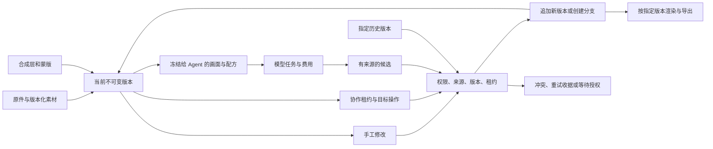

# 后端深化工作清单

基线为 GitHub `main` 的 `5e6c994d94a3c45e2847b4871641640d838aa375`。需求源为本聊天的原始 V4 要求和后续补充、引用聊天《开源项目参考》、[V4 要求表](V4-ACCEPTANCE.md)与[逐项开发台账](development-ledger.json)。继续覆盖全部需求。前端界面由另一个项目推进，本轮只修改后端、共享执行器、契约和验证。只有对应实现与验证都获得证据才勾选，历史基线单列。

## 需求与验收

| 编号 | 需求和跨功能依赖 | 本轮验收条件 |
| --- | --- | --- |
| B01 | 手改、局部笔触、AI、协作、合成和历史恢复共用版本与源图约束 | 多轮交替修改中，每次提交冻结底图、图层、配方和操作来源。冲突不能覆盖。断线重试保持一次写入。 |
| B02 | 历史拓扑、回退、分支、同图继续修改、跨项目副本 | 长历史可遍历。旧图、原分支、新分支与恢复源均可核查。历史恢复后的后续编辑保留独立路径。 |
| B03 | 图像读取、预览、服务端版本导出与前端引擎一致 | 保持当前请求契约。新服务读取冻结版本，拒绝跨项目图层。对照几何、透明度、色彩和局部算子，检查实际像素。 |
| B04 | 大图与小图、宽图、竖图、透明、边缘、极值与异常文件 | 预算根据像素、解码字节、图层、几何输出和算法工作量计算。超预算、取消和格式不支持都有可验证状态。 |
| B05 | RAW、ICC、HDR、高位深、CMYK、PSD、原件与代理之间的联动 | 从导入到版本、AI、母版与出口分别验证。区分代理渲染、母版输出和高位深应用配方。 |
| B06 | 美肤、五官、身形、妆容、消除、单条皱纹、发丝和遮挡 | 真实肖像按主体、纹理、遮挡与保护范围分场景。修改范围与坐标可追溯，超出执行器能力明确记录。 |
| B07 | 提示词、模型和参数、参考图、生成与采纳 | 明示意图、保留与避免项、审批、参考权限、冻结内容、生成候选、按版本采纳和后续再编辑。 |
| B08 | Agent 工具、上下文、记忆、摘要、过程与流恢复 | 处理编辑继续进行、权限撤回、候选过期、记忆改正、工具失败和刷新。验证每次派发和状态因果关系。 |
| B09 | 只建议、预览确认、预算内自动执行 | 作用域、当前版本、授权、用途、额度、幂等和付费未知收据均有服务端关口。 |
| B10 | 同作品多人、区域竞争、恢复、个人/团队素材、退出与清理 | 两账号交错提交。撤销后其他人的修改保留。成员撤权不能越过任一旧入口或缓存。 |
| B11 | 个人、团队、运营账本、额度到期、调额、归属和报表 | 对照真实事务与账本总额。并发失败、撤销、未知回执和退款语义独立检查。 |
| B12 | 成员语音、单人 AI、多人 AI、字幕、网络与预算 | 保留已有用法。作为跨域回归，独立验证语音上下文、授权和费用。 |
| B13 | 现有前端联通、输入输出兼容和分层状态 | 冻结当前前端源码。用现有浏览器入口和 API 契约查找联动断点。 |
| B14 | 正向、反向、侧向回归与 GitHub | 正向走用户反复编辑闭环，反向打权限、失败、资源极值，侧向打顺序交错、重试、同域外部和旧版本。按同一源码验证并核对最终远端。 |

## 开工检查

- [x] 核对本聊天的原始目标、V4 长消息、后续修正、引用聊天与远端分支。
- [x] 核对项目总设计、扩展契约、V4 验收、模块源码清单与历史报告。历史报告用来定位证据，当前改动单独验收。
- [x] B01–B02 统一写入和历史来源。组合场景通过交错修改、断线重试、回退和分支，并跨新增提交遍历 105 个历史版本。
- [x] B03 在原有编辑器引擎上增加指定版本 PNG 渲染。核对合成、局部调整、投影和 alpha 的像素，验证历史渲染、源摘要篡改及访问隔离。
- [x] B04 以格式、面积、长边、解码、磁盘、图块和输出约束分别判断。实测 1×1、2048×1、1×2049、27×33 和 16000×13000。
- [x] B05 分开验证保留媒体代理、版本渲染和高位深母版导出。
- [ ] B05 整套高位深和 HDR 配方往返、CMYK 印前编辑、PSD 可编辑往返。
- [x] B06 对照连续细线、斑点、硬边、三种肤色的反光、极值、保护区和 alpha。基于源像素蒙版边界优化局部扫描。
- [ ] B06 在更多真实肖像、肤色、头发和遮挡场景中验证神经修复、发丝重建和三维处理。
- [x] B07–B09 验证素材与版本上下文、三档授权、用量、撤销及断线恢复。一次真实 OpenAI 草案、生成、合成采纳闭环已运行。
- [ ] B07–B09 跨风格的真实模型对照、多人真实工作负载和长会话质量评估。
- [x] B10–B12 组合回归涵盖区域租约、素材权限、成员筛选、晚提交账本事务、合成麦克风和本地协议的团队语音。
- [ ] B12 跨公网和真实移动设备的多人长通话实测。
- [x] B13–B14 本地 PostgreSQL 全量 670 项，0 失败、0 跳过。类型检查与生产构建通过。API、共享代码、测试和文档是本轮修改范围。
- [ ] B14 按最终提交核对 GitHub 全部检查。远端 `work/frontend-studio-v2` 为并行前端分支，保留其工作并单列分支收敛。

每组改动前后回读对应行。补测按正向、反向、侧向分类，单项通过只说明该项证据。每次阶段性记录保留仍打开的需求。

## 数据拓扑

主要场景从带透明图层和局部调整的作品开始。先手调、再生成、用候选作为图层、继续局部编辑、并行协作、尝试旧 AI 候选、恢复早期版本、分支并再次编辑。反向替换成员、租约、来源、尺寸和任务状态。侧向交错插入重复请求、断线、历史分页、另一作品、复用参考图及费用查询。

## 验收证据

| 路径 | 检查内容 | 可复核入口 |
| --- | --- | --- |
| 正向 | 手工编辑、AI 合成、另一账号提交、继续手工编辑、恢复、另起分支、再次渲染。恢复图与来源版本 PNG 逐字节相等，渲染输出与编辑器参考实现逐通道相等。 | [版本组合用例](../apps/api/test/backend-topology.test.ts) |
| 反向 | 使用过期版本、非编辑角色、占用租约、撤销授权、篡改图层字节、错配画面和超预算输入。已派发且有供应商回执的结果留待对账。 | [Agent 实际 SQL 回归](../apps/api/test/assistant.test.ts) · [生图回执](../packages/ai/test/openai.test.ts) |
| 侧向 | 重复保存、独立分支继续编辑、长历史翻页、新提交插入、账本低 ID 晚提交、现有前端浏览器入口、团队音频和字幕。 | [协作回归](../apps/api/test/realtime-collaboration.test.ts) · [用量快照](../apps/api/test/resources-usage.test.ts) · [浏览器回归脚本](../scripts/qa/workspace-v4.browser.mjs) |
| 像素 | 多种宽高比与蒙版形态，保留逐像素 alpha；去反光按三组已知线性参考检查，细线按 0、25、50、75、100 对照。208 MP JPEG 在配置提高后生成 1127 个图块并导出 uint16 TIFF，中心及两个角 RGB 取样一致。 | [质感测试](../packages/editor/test/guided-retouch.test.ts) · [蒙版及 V4 像素测试](../packages/editor/test/v4.test.ts) · [原件测试](../packages/media/test/media.test.ts) |
| 真实 OpenAI 小样 | GPT-5.4 Mini 两次 Responses 请求，GPT Image 2.6 Flare 一次 1024×1024 生图。生成素材入库、保留来源并作为独立图层采纳。输入为合成测试场景，审核为测试注入。按返回用量和公开费率约 0.032 美元。 | [OpenAI GPT-5.4 Mini](https://developers.openai.com/api/docs/models/gpt-5.4-mini) · [OpenAI GPT Image 2.6 Flare](https://developers.openai.com/api/docs/models/gpt-image-2.6-flare) |

复核顺序是先核对需求和版本拓扑，再核对像素与 Agent 的交叉影响，再核对真实授权、
账本和现有前端请求。真实照片验收的分割和姿态依赖公开固定样本。测试分数和几个样本
只用于描述本次验证的场景，商业级出片率需要独立的样本集和人工评审。

## 实际读取的对照来源

- Snapseed Stacks 支持重访旧步骤、重放后续步骤和局部刷应用。对应 B01–B03 的不可变版本、恢复与局部坐标验证。 [Google 官方帮助](https://support.google.com/snapseed/answer/6155543/stacks)
- darktable 区分编辑历史与实际像素管线顺序。对应 B02–B05 的历史拓扑、几何依赖、遮罩及分辨率预算。 [darktable 像素管线与历史](https://docs.darktable.org/usermanual/4.6/en/darktable_user_manual.pdf)
- libvips 区分需求驱动局部图像与需要整图驻留的输入。对应 B04–B05 的单独解码与输出预算。 [libvips 开发清单](https://www.libvips.org/API/current/developer-checklist.html)
- 醒图、调色、小米和 OPPO 的第一方说明用于核对场景和能力矩阵。实际效果以本项目样本验证。 [醒图开发者页面](https://apps.apple.com/cn/app/id1500526240) · [美图秀秀调色](https://www.meituxiuxiu.com/zh-Hans/academy/color-adjustment) · [小米 HyperAI](https://www.mi.com/global/brand/ai/xiaomi-hyperai/) · [OPPO ColorOS 15](https://www.oppo.com/en/coloros15/)
- LangGraph 持久化、DeepAgents 历史摘要和 AI SDK 续传分别用于核对状态、来源和流恢复。 [LangGraph](https://docs.langchain.com/oss/javascript/langgraph/persistence) · [DeepAgents](https://github.com/langchain-ai/deepagentsjs/blob/main/libs/deepagents/src/middleware/summarization.ts) · [AI SDK](https://ai-sdk.dev/docs/ai-sdk-ui/chatbot-resume-streams)
