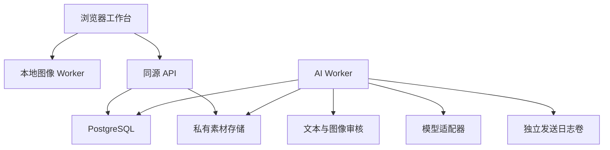
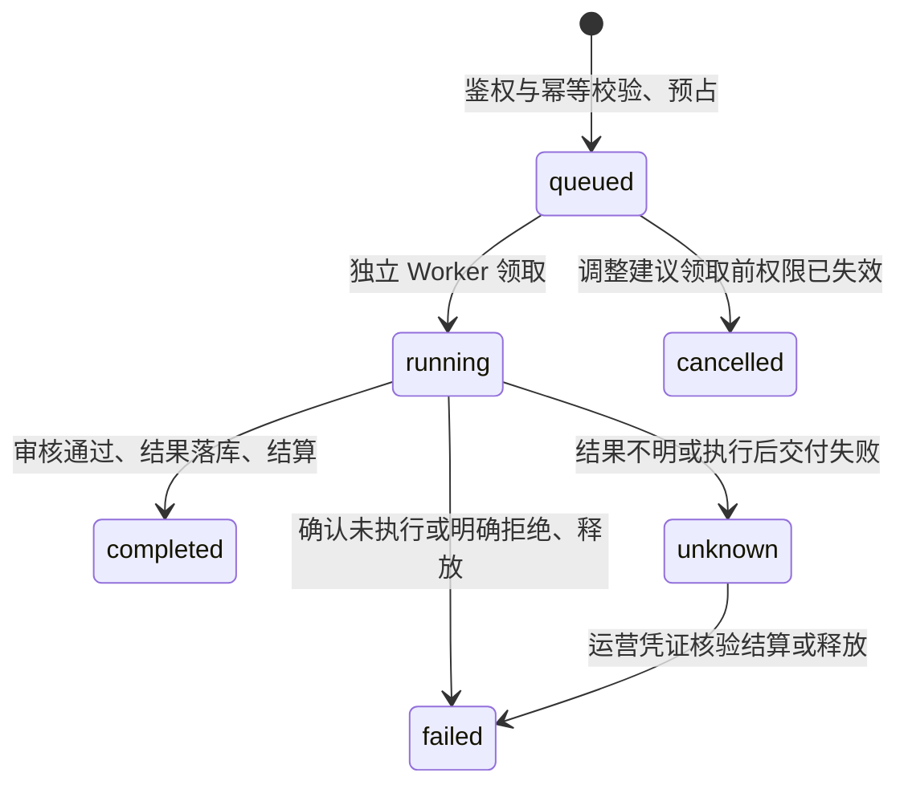

# 项目总设计与开发基线

版本：0.1。本文描述仓库中的实际架构，并单独标出扩展工作。产品暂名“映间”，名称与图标可在运营端更换。

## 1. 产品定位与默认体验

产品围绕当前作品以及它关联的想法、素材、版本、讨论和交付组织。用户可以独立精修，也可以把草图交给 AI、请 AI 提出参数建议、生成文案、用语音整理要求，随后邀请团队参与。图片不是聊天消息的附件，聊天也不是修改图片的唯一入口。

最新设计基线是**内容优先**：默认收起空间导航，画面占据主要视区。参数和 AI 在需要时出现；桌面/平板的面板支持移动、调节尺寸和停靠，提供专注与布局恢复。手机用紧凑工具和可展开面板，使当前画面及当前操作有明确的空间分配。响应式布局应按真实工作区尺寸适配，而不是把桌面三个固定栏整体缩小。

布局偏好属于设备侧状态，不改变作品配方。换设备后根据视口恢复合适的布局；异常/越界的本地布局应校正，随时可恢复默认。照片的“适合画布”取决于可用区域与照片比例，滚动参数不应要求滚动整张页面才能找到保存或返回入口。缩放查看细节与全图适配是两个明确动作。

## 2. 架构和模块边界

使用 TypeScript npm workspaces。React/Vite 承担浏览器交互，Fastify 提供同源 API，PostgreSQL 持久化业务对象；图像内核作为独立纯函数包运行于 Worker，供应商调用由独立后台 Worker 完成。

| 模块       | 当前责任                                         | 不承担的责任               | 扩展方式                                 |
| ---------- | ------------------------------------------------ | -------------------------- | ---------------------------------------- |
| editor     | 配方校验、像素计算、几何映射、直方图、文件头门禁 | 网络、账号、收费           | 新算法与配方版本，保持旧语义可重放       |
| web        | 内容交互、录音/草图、本地预览与确认              | 供应商密钥、权威权限和价格 | 可复用面板与能力目录，保持服务器最终校验 |
| api        | 身份、ACL、数据变更、额度申请、运营              | 长时间模型执行             | 按领域增加服务和显式事务                 |
| db         | 迁移、事务、不可变记录、权益批次与事件           | 发送短信或模型 HTTP        | 新迁移与新领域对象，禁止改历史事实       |
| storage    | 有界接收、校验、转码、私有文件                   | 决定谁可查看文件           | 实现相同存储语义后替换为私有对象存储     |
| providers  | 腾讯短信及审核协议、签名、错误分类               | 决定项目业务状态           | 注入接口；真实实现与测试适配器隔离       |
| multimodal | 生图/ASR 的实际 HTTP、模型档案与限制             | 直接发布作品或结算         | 增加供应商实现和契约测试                 |
| ai         | 任务冻结、审核、调用、状态、账本结算             | 自动修改用户当前作品       | 新 operation 保持统一授权和状态协议      |

目前采用单机器私有文件卷和 PostgreSQL 任务队列，不要求额外 Redis 或常驻 GPU。模块边界留出对象存储、独立渲染队列、WebGPU/WASM 加速和多 Worker 扩容位置；这些扩容能力没有被写成已经实现。

## 3. 权限与空间

每个活跃普通用户有唯一个人空间。团队是相同空间模型的另一种类型，列表放在同一导航。空间归属决定数据权限与付费钱包，当前打开哪个工作视图不会改变所属关系。

| 身份/角色 | 权限边界                                                                       |
| --------- | ------------------------------------------------------------------------------ |
| 平台运营  | 管理账户状态、注册政策、品牌、模型、套餐、额度与核验；不自动获得私人项目访问权 |
| owner     | 管理自身空间、成员和分享策略，创作与查看                                       |
| admin     | 管理普通成员和项目；不能把 owner 移除或越权提升同级                            |
| editor    | 创作与保存、执行允许的 AI、编辑任务/文档                                       |
| reviewer  | 查看、讨论与反馈；不能用查看权执行收费编辑                                     |
| viewer    | 查看获准内容                                                                   |

API 每次按当前数据库检查账号状态和资源的真实所属空间。文件不是公网目录，猜中 UUID 也不获得读取权。退出团队、撤销分享、封禁账号后，后续请求必须重新鉴权。运营角色与空间角色分开，避免“可充值”自然扩张成“可读所有照片”。

团队邀请有角色、有效期、次数和撤销状态；注册邀请码单独用于准入，不等价于团队成员资格。运营添加的用户是待验证账户，用户仍要完成真实手机号验证；从封禁恢复也不能绕过这一条件。

## 4. 数据对象与版本

| 对象                       | 作用与关键关系                                     |
| -------------------------- | -------------------------------------------------- |
| User / Session / OTP       | 身份、验证、会话和持久限流                         |
| Space / Membership         | 个人/团队边界、成员角色、分享策略                  |
| Project                    | 同一个工作主题，关联图像、文档、任务、讨论         |
| Asset                      | 不可变的规范化图像字节；所属项目、哈希、尺寸、来源 |
| Artwork                    | 对素材的一个编辑分支，持有当前 headVersion         |
| Revision                   | 不可变完整配方快照、作者、父版本和版本号           |
| Document / DocumentVersion | 项目文字与不可变历史；按版本更新                   |
| Comment                    | 项目/作品/版本锚定的讨论与解决状态                 |
| Task                       | 待办、进行中、完成、负责人和版本                   |
| Grant / ProjectCopy        | 可撤销来源授权和已完成的独立副本                   |
| AIJob                      | 冻结输入、任务类型、模型、状态、输出与对应预占     |
| QuotaLot / Hold / Ledger   | 周期额度和人工调整的来源、占用、结算历史           |
| Event / Audit              | 持久通知游标和运营/敏感动作审计                    |

图片调整写入 Recipe，而不是覆盖素材。保存携带 `expectedVersion`，服务器只允许基于当前版本前进。冲突返回 409，前端保留本地配方，用户可以查看最新版本或另存作品。这个基线提供安全的共同工作，不声称多个用户同时拖同一参数时已经支持 CRDT 自动合并。

事件使用空间内有序持久游标，发送序号在事务提交前序列化，避免先收到大序号、后提交的小序号永远被漏掉。长轮询通知前重新验证空间成员资格；事件不传整段私人正文。

## 5. 确定性编辑与高分辨率

配方明确记录 `schemaVersion`、`engineVersion`、全局参数、曲线、几何和局部调整。浏览器新导入默认采用 Recipe v2；当前云端 AI 生成作品的初始修订为 v1，可由用户显式升级。既有 v1 配方继续原样校验和重放，不会因打开旧文件而偷偷改变数学语义。配方是 JSON 数据，不是脚本。校验拒绝未知字段、非有限数、原型污染和不支持的版本，禁止默默忽略无法理解的操作。

当前基础工具包含曝光、亮度、对比度、高光、阴影、黑白色阶、饱和度、自然饱和度、色温、色偏、锐化和柔化。前十一项围绕中性值提供向两侧的调整；锐化与柔化是不同数学操作，各自有非负强度，不把“负磨皮”伪装成一个等价锐化算法。

曲线支持 RGB 主曲线及 R/G/B 通道，每条 2–16 个可拖控制点、精确坐标、键盘操作和独立重置；函数始终维持横坐标严格递增。用户可任意改变控制点的输出值，包括反相，不支持垂直多值曲线。几何支持任意整数像素矩形、8 个边角手柄、整体移位、90° 倍数旋转和输出坐标轴镜像，比例只是快捷入口。图像编辑的自由尺寸与 AI 模型允许的生成尺寸分别校验，裁切后的作品不需要满足某个模型的固定比例。

v2 在保留 v1 流水线的基础上增加输入/输出色阶、8 色段连续插值 HSL、阴影/中间调/高光分级、纹理/清晰度、黑白混合、褪色、暗角和确定性颗粒，共 52 条注册数值路径。颜色选择器覆盖连续 HSV/HSL/RGB 与 RGBA8 alpha；快捷色板不是系统能够识别的全部颜色。

v2 最多容纳 8 个独立命名区域，各自有启用、透明度、顺序、蒙版与 13 项基础调整。支持径向、线性渐变、多边形、加减笔刷、栅格 RLE 与连续颜色范围。旧 v1 单区域仍保留原语义，不因新增区域被覆盖。蒙版保存在源图坐标中，裁切/旋转后的交互通过同一几何映射回源图；颜色范围固定参照未调整原图，避免调色后选区漂移。渲染、导出与保存使用同一份配方，缩小预览只是明确标注的近似。

单像素笔刷使用半像素半径、硬边并将指针吸附到原图像素中心。它精确控制选择权重及所选像素的调整，并不等于已经实现直接逐点覆写任意 RGBA 的像素画编辑器。栅格蒙版可在配方中精确表示权重；界面支持读取、反选和强度，不提供无限大栅格画板。总笔刷点数、RLE 长度、区域数及处理邻域有公开预算，复制区域也必须先通过全配方校验。

高分辨率的三个数值必须分开：输入原图像素、交互预览像素和完整导出像素。预览可以按设备与显示大小减小运算，但不能把预览偷偷当作原尺寸导出。分块渲染控制浮点工作缓冲，保留滤镜邻域与全图蒙版坐标；原始/输出 RGBA 缓冲仍需要内存，因此 64MP 算法上限不代表所有手机都能处理 64MP。质量/预算由设备提示和明确选择管理，超限时说明原因。

当前工作色彩是 sRGB/RGBA8；即使文件容器能承载 16-bit/HDR，浏览器工作台也没有宣称保留完整 HDR 或 CMYK 印刷色彩。相关专业能力需要高位深缓冲、色彩管理和导出协议一起扩展。

### 人像与更深编辑的扩展次序

本版本的边缘感知柔化和局部蒙版可用于手工局部调整，但它们不是自动人脸/皮肤识别。后续不要简单添加一排“瘦脸/大眼”按钮却共享同一全局滤镜。

1. **选区基础**：v2 已实现六类选区、命名、独立区域和版本。后续增加几何与颜色选区的布尔组合、独立蒙版资产和复杂长笔触存储；多人物目标继续独立存储。
2. **人像分析**：引入可替换的人脸关键点、皮肤/头发/衣物/背景分割；分析结果绑定素材哈希、模型版本和方向信息，允许用户纠正。
3. **纹理与皮肤**：祛瑕、去痘、皱纹强弱、肤色明暗/冷暖、细节恢复，各有独立 mask/保护区/强度，保证未选区域稳定。
4. **几何重塑**：眼、鼻、嘴、轮廓、头身与姿态使用显式位移场/网格；双向值、局部固定点、背景保护、边缘质量与撤销同时成立。
5. **图层与联动**：原图层、调整层、文本/矢量、蒙版和图像引用形成有版本的依赖图；级联更新要有影响预览和用户选择，不能自动覆盖关联作品。

第 1 项列出的 v2 基础已经实现，其余分析、专门祛瑕、形变、图层与依赖图属于后续工作。顶层“美颜”目前是手动指定人物区域后的柔化、锐化、明暗与肤色调整，没有自动人脸/皮肤/妆容识别，也没有眼鼻嘴或身形位移场。下一次语义扩展须继续保留 v1/v2 解码与重放，并先增加迁移及数值测试。

## 6. 草图、模型、文字与语音联动

所有 AI 入口经过同一项目和钱包，不分别实现四套身份或扣费逻辑。

| 任务           | 明确输入                         | 审核与完成结果                                                | 用户下一步                           |
| -------------- | -------------------------------- | ------------------------------------------------------------- | ------------------------------------ |
| edit-plan      | 文字、完整配方、作品及基准版本   | 审核实际发送文本，严格校验返回参数，再审核；仅产出候选        | 预览可撤销地应用，明确保存并检查版本 |
| generate-image | 文字、尺寸、可选项目参考图/草图  | 输入文本/参考图审核；模型返回后规范化并审核将被保存的精确字节 | 新建独立素材/作品，打开继续精修      |
| generate-text  | 指令，可选显式文档及版本         | 输入与输出文本审核；标题/正文/说明候选                        | 修改后存为项目文档                   |
| transcribe     | 最长30秒、16kHz、单声道PCM16 WAV | ASR 后审核转录文本；移除任务中的原音频                        | 先改文字，再填入目标任务输入框       |

语音不是“听到就自动连续收费”。浏览器录音先在本机试听，用户提交后执行一次识别；识别文字需要再次确认才能触发修图、生图或文案。静音/无可识别语音是明确的成功空结果，显示未识别到语音，不冒充网络未知状态；已发生的识别任务按约定点数结算。浏览器朗读是用户点击后的可选功能，未实现实时全双工通话。

模型目录由运营管理；服务器还维护实际供应商、已启用模型 ID、对应能力档案和执行开关。前端取其交集，按当前任务选择模型及参数。自定义宽高也要满足模型的最小/最大像素、比例、单边、运营范围和平台预算。某个截图里的模型名称或“4K”选项不能被当作所有账号可用的 API 事实。

OpenAI Images 使用服务器侧固定官方端点及精确模型白名单。质量、背景、编码、压缩、数量、复杂度和参考图限制由能力档案返回，不按模型名称猜测。当前实现的 8 个 ID 和尚未开放的 SVG/GIF/流式等范围见 [OpenAI 契约](../packages/multimodal/OPENAI.md)。图片迭代必须真实引用父任务产出的素材，文字迭代实际冻结父文案；不会只在聊天界面串联消息却丢掉模型上下文。

v2 的 `edit-plan` 支持原有 13 项加 52 条注册数值路径。模型只得到当前全局可写数值及用户文字，不会假装已经看过图像、人脸或妆容。返回路径必须在精确白名单中，联合色阶约束整体校验，前端展示真实 before/after 后确认。建议不能任意增删选区或改写图片、曲线、几何、权限。旧排队任务继续按冻结协议执行。

素材注释与图像字节分离：标题、标签、声明的带时区拍摄时间和手工位置使用独立 `annotationVersion`。上传时间由服务器记录，不能被拍摄时间覆盖。空间/项目搜索和每一页查询都重新检查权限，分页游标绑定用户、范围与筛选。复制项目保留当时注释快照；修改原项目不改变副本。默认不提取或写出 EXIF GPS。

## 7. 付费任务、审核与恢复

多模态任务在领取后的执行前校验发现权限失效时标记 failed；该路径未调用模型并释放预占。若供应商调用后才发现权限失效，则不发布结果，并按 unknown 保留预占等待核验。

冻结范围按任务协议区分：调整建议冻结实际文本请求与端点、完整基础配方和作品版本；文案生成冻结实际文本请求与端点、显式文档版本及父文案上下文。新 OpenAI 图像任务还绑定完整供应商 JSON 的规范摘要、固定端点、参考字节摘要和整批报价。旧 Ark 任务保留原参数清单与参考图摘要语义。ASR 冻结音频摘要与规格、模型和任务归属，没有将完整 ASR 外呼端点与传输 JSON 纳入其冻结清单。各类任务都绑定模型、项目与用户，不能把新协议的保护范围追溯套用于旧任务。

执行前及必要的异步审核之后重新检查权限、模型和参考图状态。生成图片只有在最终规范化文件审核通过、ACL 再确认并成功提交事务后才建立可访问素材。

额度是整数服务点，不是现金。每笔预占分配到原始额度批次；月度免费发放按亚洲/上海月份与用户唯一，不因创建多个团队或修改免费政策重复发放。到期只让可用部分到期，占用保持原批次；释放时判断该批次是否已过期，不能把上月点数洗成新额度。

同一个幂等键和相同请求返回原任务；不同内容复用键被拒绝。网络中断、超时、不完整返回及无法确认的结果进入 unknown，保留预占，不自动重发收费请求。运营以原因与凭证引用核验，终态不会伪造一个作品。

发送日志使用独立持久卷与 fsync，记录任务ID、摘要与发送意图；恢复出的数据库缺少日志对应任务时停下新外发。这保护单机试运行的恢复边界，但不等同异地、跨存储故障下的商业账务一致性。原始队列音频、未完成任务、日志和孤立文件还需要部署方的保留/清理策略。

## 8. 分享与独立副本

空间分享策略分别控制参考、复制、活跃授权数、复制素材数。参考读取继续受来源授权、有效期、来源空间策略与项目状态影响；独立复制必须由用户明确触发，并检查目标空间写入权。

复制在一致性快照里复制当前素材引用、作品当前配方与文档；不偷偷复制讨论、成员名单、历史版本和待办。字节可以复用同一不可变私有存储对象，新的 Asset 有独立目标 ACL。撤销来源授权会阻止新的来源访问，不能收回已明确允许并完成的独立副本。

发布失败清理与原发布事务使用相同 storage key 的事务锁。只有等待原事务结束并确认不存在任何资产记录引用后才能删除；检查包含已标记删除但仍保留的记录及完成复制的引用。提交结果或查库结果不明时保留私有文件，待后续引用感知维护处理，不能把清理程序当作已实现的完整保留策略。

## 9. 后续开发的硬性契约

- 新增工具：定义单位、负向/正向、中性值、像素域、蒙版适用性、版本迁移和跨分块边界测试，再暴露 UI。
- 新增模型：实现能力描述、参数校验、有界响应、真实错误分类和固定/受控端点，不把任意用户URL交给 Worker。
- 新增工作类型：复用 Project/Document/Task/Comment，不把团队固定为“只能修同一张图片”。
- 真正同时共同编辑：先增加操作日志、幂等操作ID、撤销归属与冲突规则，再决定 CRDT/OT；当前 CAS 仍是保存底线。
- 商业支付：订单、支付通知验签、幂等回调、订单版本、退款与对账独立完成后才能启用。套餐目录与人工赠额不构成自动支付。
- 更多媒体：每种格式要明确解码器、动画/页面/图层、方向、色彩、高位深和元数据策略，不能仅扩展文件选择器后缀。

完整端点和最新实现边界以 `apps/api/API.md`、各包 README 和验证记录为准。每个后续里程碑都应交付可运行的联动流程和实际验证结果。
