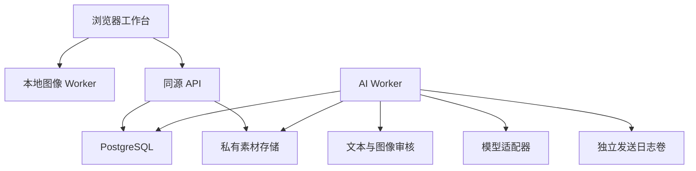
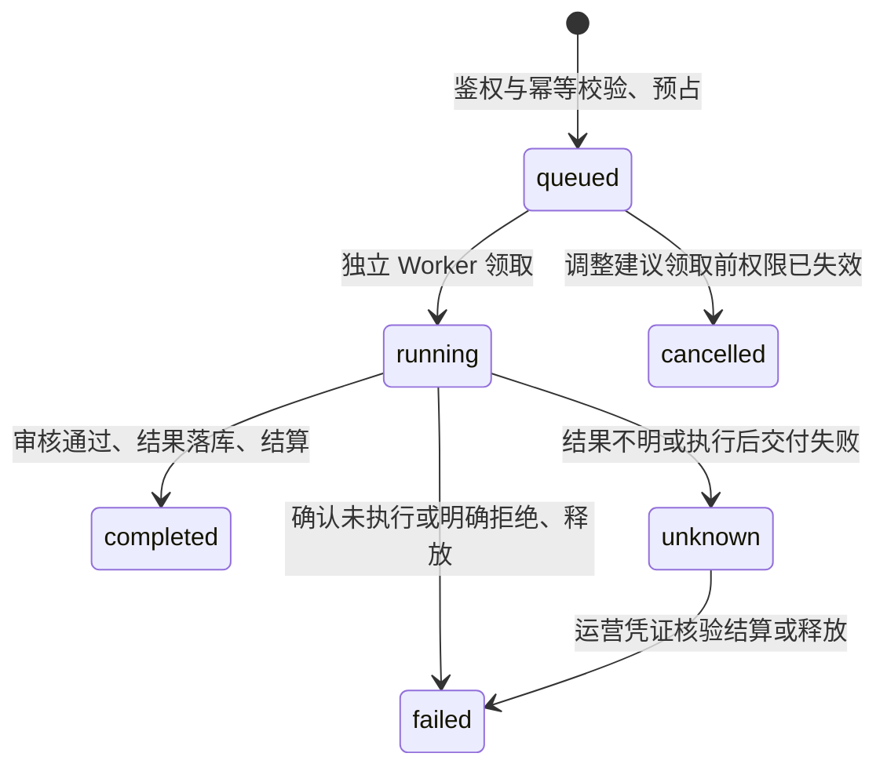

# 项目总设计与开发基线

业务协议版本：0.1；编辑协议：Recipe v3 / engine 3.0.0。本文描述仓库中的实际架构，并单独标出扩展工作。产品暂名“映间”，名称与图标可在运营端更换。

## 1. 产品定位与默认体验

产品围绕当前作品以及它关联的想法、素材、版本、讨论和交付组织。用户可以独立精修，也可以把草图交给 AI、请 AI 提出参数建议、生成文案、用语音整理要求，随后邀请团队参与。图片不是聊天消息的附件，聊天也不是修改图片的唯一入口。

最新设计基线是**内容优先**：默认收起空间导航，画面占据主要视区。参数和 AI 在需要时出现；桌面/平板的面板支持移动、调节尺寸和停靠，提供专注与布局恢复。手机用紧凑工具和可展开面板，使当前画面及当前操作有明确的空间分配。响应式布局应按真实工作区尺寸适配，而不是把桌面三个固定栏整体缩小。

布局偏好属于设备侧状态，不改变作品配方。换设备后根据视口恢复合适的布局；异常/越界的本地布局应校正，随时可恢复默认。照片的“适合画布”取决于可用区域与照片比例，滚动参数不应要求滚动整张页面才能找到保存或返回入口。缩放查看细节与全图适配是两个明确动作。

## 2. 架构和模块边界

使用 TypeScript npm workspaces。React/Vite 承担浏览器交互，Fastify 提供同源 API，PostgreSQL 持久化业务对象；图像内核作为独立纯函数包运行于 Worker，供应商调用由独立后台 Worker 完成。

| 模块       | 当前责任                                                   | 不承担的责任                 | 扩展方式                                    |
| ---------- | ---------------------------------------------------------- | ---------------------------- | ------------------------------------------- |
| contracts  | 版本化模块、能力、数值/坐标、分析/渲染端口、命令和候选契约 | 执行未知远程插件或授权       | 通过共享注册器校验依赖、状态和协议          |
| portrait   | 真实分析结果校验、人物语义参数到普通编辑操作的编译         | 人物身份识别、容貌评分、账单 | AnalysisAdapter + 当前拓扑转换 + 新语义版本 |
| editor     | 配方校验、像素计算、几何映射、直方图、文件头门禁           | 网络、账号、收费             | 新算法与配方版本，保持旧语义可重放          |
| web        | 内容交互、录音/草图、本地预览与确认                        | 供应商密钥、权威权限和价格   | 可复用面板与能力目录，保持服务器最终校验    |
| api        | 身份、ACL、数据变更、额度申请、运营                        | 长时间模型执行               | 按领域增加服务和显式事务                    |
| db         | 迁移、事务、不可变记录、权益批次与事件                     | 发送短信或模型 HTTP          | 新迁移与新领域对象，禁止改历史事实          |
| storage    | 有界接收、校验、转码、私有文件                             | 决定谁可查看文件             | 实现相同存储语义后替换为私有对象存储        |
| providers  | 腾讯短信及审核协议、签名、错误分类                         | 决定项目业务状态             | 注入接口；真实实现与测试适配器隔离          |
| multimodal | 生图/ASR 的实际 HTTP、模型档案与限制                       | 直接发布作品或结算           | 增加供应商实现和契约测试                    |
| ai         | 任务冻结、审核、调用、状态、账本结算                       | 自动修改用户当前作品         | 新 operation 保持统一授权和状态协议         |

目前采用单机器私有文件卷和 PostgreSQL 任务队列，不要求额外 Redis 或常驻 GPU。模块边界留出对象存储、独立渲染队列、WebGPU/WASM 加速和多 Worker 扩容位置；这些扩容能力没有被写成已经实现。

## 3. 权限与空间

每个活跃普通用户有唯一个人空间。团队是相同空间模型的另一种类型，列表放在同一导航。空间归属决定数据权限与付费钱包，当前打开哪个工作视图不会改变所属关系。

| 身份/角色 | 权限边界                                                                       |
| --------- | ------------------------------------------------------------------------------ |
| 平台运营  | 管理账户状态、注册政策、品牌、模型、套餐、额度与核验；不自动获得私人项目访问权 |
| owner     | 管理自身空间、成员和分享策略，创作与查看                                       |
| admin     | 管理普通成员和项目；不能把 owner 移除或越权提升同级                            |
| editor    | 创作与保存、执行允许的 AI、编辑任务/文档                                       |
| reviewer  | 查看、讨论与反馈；不能用查看权执行收费编辑                                     |
| viewer    | 查看获准内容                                                                   |

API 每次按当前数据库检查账号状态和资源的真实所属空间。文件不是公网目录，猜中 UUID 也不获得读取权。退出团队、撤销分享、封禁账号后，后续请求必须重新鉴权。运营角色与空间角色分开，避免“可充值”自然扩张成“可读所有照片”。

团队邀请有角色、有效期、次数和撤销状态；注册邀请码单独用于准入，不等价于团队成员资格。运营添加的用户是待验证账户，用户仍要完成真实手机号验证；从封禁恢复也不能绕过这一条件。

## 4. 数据对象与版本

| 对象                                           | 作用与关键关系                                           |
| ---------------------------------------------- | -------------------------------------------------------- |
| User / Session / OTP                           | 身份、验证、会话和持久限流                               |
| Space / Membership                             | 个人/团队边界、成员角色、分享策略                        |
| Project                                        | 同一个工作主题，关联图像、文档、任务、讨论               |
| Asset                                          | 不可变的规范化图像字节；所属项目、哈希、尺寸、来源       |
| Artwork                                        | 对素材的一个编辑分支，持有当前 headVersion               |
| Revision / RevisionSource / RevisionImageLayer | 不可变完整配方、底图与全部图层来源；作者、父版本和版本号 |
| AIResultDecision                               | 候选采纳/拒绝、操作者、幂等键、目标与返回快照            |
| Document / DocumentVersion                     | 项目文字与不可变历史；按版本更新                         |
| Comment                                        | 项目/作品/版本锚定的讨论与解决状态                       |
| Task                                           | 待办、进行中、完成、负责人和版本                         |
| Grant / ProjectCopy                            | 可撤销来源授权和已完成的独立副本                         |
| AIJob                                          | 冻结输入、任务类型、模型、状态、输出与对应预占           |
| QuotaLot / Hold / Ledger                       | 周期额度和人工调整的来源、占用、结算历史                 |
| Event / Audit                                  | 持久通知游标和运营/敏感动作审计                          |

图片调整写入 Recipe，而不是覆盖素材。保存携带 `expectedVersion`，服务器只允许基于当前版本前进。冲突返回 409，前端保留本地配方，用户可以查看最新版本或另存作品。这个基线提供安全的共同工作，不声称多个用户同时拖同一参数时已经支持 CRDT 自动合并。

事件使用空间内有序持久游标，发送序号在事务提交前序列化，避免先收到大序号、后提交的小序号永远被漏掉。长轮询通知前重新验证空间成员资格；事件不传整段私人正文。

## 5. 确定性编辑、人物适配与像素控制

新导入默认 Recipe v3，版本和算法均显式保存。既有 v1/v2 继续按原解释器重放；升级通过 `migrateRecipeToV3`，新增阶段中性时与旧配方逐字节相同。配方只包含有界纯数据，拒绝未知字段、访问器、循环、原型污染、非有限数和未知版本。完整数学顺序、参数及预算见 [V3.md](../packages/editor/V3.md)，不在 UI 另维护一份不一致的参数范围。

### 统一处理路径

源图 → 兼容的旧色彩阶段 → 全局光学处理 → 组共享色彩 → 独立局部色彩 → 图像层 → 绘制层 → 液化位移 → 整数裁切/90°旋转/镜像 → 精细投影变换。

预览、导出、撤销、保存、历史恢复与 AI 参数建议共享这份配方。UI 的工具组不是另一套算法；任何控件必须改变可校验的数据，并由相同渲染器生成结果。

| 模块           | 实际实现                                                                                                                     | 语义与边界                                                                                 |
| -------------- | ---------------------------------------------------------------------------------------------------------------------------- | ------------------------------------------------------------------------------------------ |
| 明暗/色彩/细节 | 13 项基础调整、输入输出色阶、连续 HSL、4 路曲线、三路分级、纹理/清晰度、黑白、褪色、颗粒、暗角、明度/色度降噪、红/蓝通道色散 | 正负参数逐项定义；柔化与锐化有各自非负强度；不声称负柔化能恢复丢失细节                     |
| 自由构图       | 任意整数像素矩形、8 手柄、移动；精细角度/透视/剪切、双轴缩放与位移                                                           | 角度建议步长 0.01°，可精确输入；奇异矩阵、越界输出预算明确拒绝；二维投影不等于恢复三维     |
| 多局部         | 12 个 v3 区域、6 个组；每区域/组共用完整 ColorBlockV3                                                                        | 组在所有启用成员的 max-union 上只处理一次，交叠不会重复叠加组效果；成员仍能各自调整        |
| 蒙版           | 径向、渐变、多边形、加减笔刷、栅格 RLE、连续颜色范围；union/intersection/subtract/xor 复合树                                 | 所有坐标归一到完整源图；复合深度/节点/采样有公开预算；不能无限递归                         |
| 曲线           | 全局/区域/组的 RGB、R、G、B 各 2–16 点，添加/拖动/删除/精确坐标                                                              | x 严格递增、y 自由变化，允许反相；线性插值，不伪称多值贝塞尔曲面                           |
| 绘制/修补      | 1 像素硬边 RGBA 落笔、连续画笔、擦除、冻结源仿制、16 种混合、独立层与蒙版                                                    | 擦除仅影响当前绘制层；clone 是仿制，尚无自动瑕疵定位或泊松修补                             |
| 图像合成       | 8 个独立图像层、位置/尺寸/旋转/镜像/强度/混合/蒙版/次序                                                                      | 只接收调用者解析的 sourceId；缺图明确失败；图像层固定在绘制层之前，没有任意交错 PSD 图层树 |
| 液化           | 推移、收缩、膨胀、旋转；有符号强度、半径、羽化、背景保护                                                                     | 统一逆向位移一次取样；不是三维人体模型，极端叠加仍可能失真                                 |

图像编辑尺寸与 AI 模型允许的生成尺寸分别验证。裁切后的图片不需要满足模型固定比例；发给某模型作参考时，才检查该供应商自己的输入规则。

### 人物分析与语义控制

`packages/portrait` 定义 `PortraitAnalysis`，绑定完整原图 RGBA 哈希、方向、尺寸、算法版本。浏览器驱动使用同源的 MediaPipe face/pose/segmentation 模型，真正执行后生成目标；不硬编码人物点位，也不以目标标签推断身份。面部与身体是分别检测的目标，不按编号假设属于同一个人。

46 项皮肤、面部、身形与美妆控制编译成普通区域、绘制层和 warp。每个人物有独立参数、妆色与来源记录；重调只替换该人物拥有的操作。用户选择“转为独立精修”后，保留像素效果并脱离自动操作所有权，后续自动调节作为新效果叠加，避免重建时覆盖手工修改。

自动分析要求资源已安装、OffscreenCanvas 和可用 WebGL 2；当前 JS 输入路径即使选择 CPU 推理仍依赖 WebGL。缺少条件时明确失败并保留手动入口。支持导入/导出严格同图绑定的人物标注，以连接外部分析适配器；导入标注不会显示“自动识别成功”。当前语义编译依赖 MediaPipe 点序拓扑，替换模型需要拓扑转换，不能任意塞入另一组点位。

皮肤分割是粗分割蒙版，按人物轮廓相交并排除五官；不是毛孔、发丝或妆容的逐像素真值。皮肤柔化、细节、提亮、眉妆等有实际参考算法，但自动祛痘/专门祛皱、发丝重建、学习型高质量修补与三维一致性尚未达到商用品质验收。详见 [portrait README](../packages/portrait/README.md) 的逐工具实现说明。

### 坐标、分辨率与资源预算

框架坐标通过同一投影矩阵正/逆变换；液化后的实际内容坐标再叠加逆位移。渲染完成的坐标键包含生效的变形与保护区，画面仍旧时不能按新坐标落笔。含透明角落的画幅中，画笔与源取色拒绝没有源像素的位置，不夹到边缘误涂。复杂蒙版/合成层编辑可显示明确标注的液化前源坐标视图，返回其他工具后显示最终形变效果。

完整原图、预览、导出是三个独立尺寸。v3 浏览器硬上限为 16,777,216 源/输出像素；低内存手机默认更小。交互输出预算 4,194,304 像素，扩展旋转会先进一步缩小预览输入，保留导出原图和配方不变。完整导出走分块参考渲染；仍需要多个整图字节缓冲，不能声称 16MP 在所有手机上都流畅。

浏览器合成素材合计另限 16,777,216 像素，含撤销保留引用；核心包支持的更大上限不自动成为网页设备预算。当前工作精度为 sRGB/RGBA8，不宣称保留相机 RAW、高位深 HDR、Display P3 或 CMYK 印刷色。缩小预览的像素邻域、细颗粒、色散与完整输出存在尺度近似，像素级验收以原尺寸导出为准。

### 统一扩展标准

新增模块先使用 `ModuleRegistry` 声明 ID、版本、依赖、能力状态、权限和输入输出；`GET /v1/modules` 提供实际目录，`GET /v1/editor-contract` 从执行注册表导出参数。模块状态分为已实现、需适配器、仅契约；声明能力不授予权限，也不执行任意外部插件。

图像算法、人物分析、媒体解码、任务编排和数据存储有各自端口。新增算法必须同时补数据语义、迁移/旧版本重放、实际像素测试与 UI 状态；不能只注册按钮。开发步骤和实际文件入口见 [EXTENSIONS.md](EXTENSIONS.md)。

## 6. 草图、模型、文字与语音联动

所有 AI 入口经过同一项目和钱包，不分别实现四套身份或扣费逻辑。

| 任务           | 明确输入                         | 审核与完成结果                                                | 用户下一步                           |
| -------------- | -------------------------------- | ------------------------------------------------------------- | ------------------------------------ |
| edit-plan      | 文字、完整配方、作品及基准版本   | 审核实际发送文本，严格校验返回参数，再审核；仅产出候选        | 预览可撤销地应用，明确保存并检查版本 |
| generate-image | 文字、尺寸、可选项目参考图/草图  | 输入文本/参考图审核；模型返回后规范化并审核将被保存的精确字节 | 新建独立素材/作品，打开继续精修      |
| generate-text  | 指令，可选显式文档及版本         | 输入与输出文本审核；标题/正文/说明候选                        | 修改后存为项目文档                   |
| transcribe     | 最长30秒、16kHz、单声道PCM16 WAV | ASR 后审核转录文本；移除任务中的原音频                        | 先改文字，再填入目标任务输入框       |

语音不是“听到就自动连续收费”。浏览器录音先在本机试听，用户提交后执行一次识别；识别文字需要再次确认才能触发修图、生图或文案。静音/无可识别语音是明确的成功空结果，显示未识别到语音，不冒充网络未知状态；已发生的识别任务按约定点数结算。浏览器朗读是用户点击后的可选功能，未实现实时全双工通话。

模型目录由运营管理；服务器还维护实际供应商、已启用模型 ID、对应能力档案和执行开关。前端取其交集，按当前任务选择模型及参数。自定义宽高也要满足模型的最小/最大像素、比例、单边、运营范围和平台预算。某个截图里的模型名称或“4K”选项不能被当作所有账号可用的 API 事实。

OpenAI Images 使用服务器侧固定官方端点及精确模型白名单。质量、背景、编码、压缩、数量、复杂度和参考图限制由能力档案返回，不按模型名称猜测。当前实现的 8 个 ID 和尚未开放的 SVG/GIF/流式等范围见 [OpenAI 契约](../packages/multimodal/OPENAI.md)。图片迭代必须真实引用父任务产出的素材，文字迭代实际冻结父文案；不会只在聊天界面串联消息却丢掉模型上下文。

v2/v3 的 `edit-plan` 支持原有 13 项加 52 条注册数值路径。模型只得到当前全局可写数值及用户文字，不会假装已经看过图像、人脸或妆容。返回路径必须在精确白名单中，联合色阶约束整体校验，前端展示真实 before/after 后确认。建议不能任意增删选区或改写图片、曲线、几何、权限。旧排队任务继续按冻结协议执行。

素材注释与图像字节分离：标题、标签、声明的带时区拍摄时间和手工位置使用独立 `annotationVersion`。上传时间由服务器记录，不能被拍摄时间覆盖。空间/项目搜索和每一页查询都重新检查权限，分页游标绑定用户、范围与筛选。复制项目保留当时注释快照；修改原项目不改变副本。默认不提取或写出 EXIF GPS。

### AI 候选的完整采纳链路

生成成功只是产生候选。`POST /v1/ai-jobs/:id/decisions` 接收版本化决定：拒绝、另存、替换底图、作为合成图层、应用参数建议、保存文案。每次都检查当前 ACL、候选类型/来源、目标版本及幂等键，结果写入不可变决定与审计。

替换底图追加新源绑定修订，旧底图和旧配方仍可恢复；加入图层保留底图和现有调整；未采用不伪造已经发生的供应商费用退款。文案可修改后另存为项目文档，原输出与采纳正文分别保存。历史恢复同时恢复源图、图层引用和配方，并追加新版本。

当前本地未保存编辑不会被晚到的下载、AI 结果或恢复操作覆盖。打开流程冻结源身份、配方对象与项目代次；用户继续编辑后旧请求取消提交。云保存冻结本次快照，同时保留用户继续产生的草稿。

## 7. 付费任务、审核与恢复

多模态任务在领取后的执行前校验发现权限失效时标记 failed；该路径未调用模型并释放预占。若供应商调用后才发现权限失效，则不发布结果，并按 unknown 保留预占等待核验。

冻结范围按任务协议区分：调整建议冻结实际文本请求与端点、完整基础配方和作品版本；文案生成冻结实际文本请求与端点、显式文档版本及父文案上下文。新 OpenAI 图像任务还绑定完整供应商 JSON 的规范摘要、固定端点、参考字节摘要和整批报价。旧 Ark 任务保留原参数清单与参考图摘要语义。ASR 冻结音频摘要与规格、模型和任务归属，没有将完整 ASR 外呼端点与传输 JSON 纳入其冻结清单。各类任务都绑定模型、项目与用户，不能把新协议的保护范围追溯套用于旧任务。

执行前及必要的异步审核之后重新检查权限、模型和参考图状态。生成图片只有在最终规范化文件审核通过、ACL 再确认并成功提交事务后才建立可访问素材。

额度是整数服务点，不是现金。每笔预占分配到原始额度批次；月度免费发放按亚洲/上海月份与用户唯一，不因创建多个团队或修改免费政策重复发放。到期只让可用部分到期，占用保持原批次；释放时判断该批次是否已过期，不能把上月点数洗成新额度。

同一个幂等键和相同请求返回原任务；不同内容复用键被拒绝。网络中断、超时、不完整返回及无法确认的结果进入 unknown，保留预占，不自动重发收费请求。运营以原因与凭证引用核验，终态不会伪造一个作品。

发送日志使用独立持久卷与 fsync，记录任务ID、摘要与发送意图；恢复出的数据库缺少日志对应任务时停下新外发。这保护单机试运行的恢复边界，但不等同异地、跨存储故障下的商业账务一致性。原始队列音频、未完成任务、日志和孤立文件还需要部署方的保留/清理策略。

## 8. 分享与独立副本

空间分享策略分别控制参考、复制、活跃授权数、复制素材数。参考读取继续受来源授权、有效期、来源空间策略与项目状态影响；独立复制必须由用户明确触发，并检查目标空间写入权。

复制在一致性快照里复制当前素材引用、作品当前配方与文档；不偷偷复制讨论、成员名单、历史版本和待办。字节可以复用同一不可变私有存储对象，新的 Asset 有独立目标 ACL。撤销来源授权会阻止新的来源访问，不能收回已明确允许并完成的独立副本。

发布失败清理与原发布事务使用相同 storage key 的事务锁。只有等待原事务结束并确认不存在任何资产记录引用后才能删除；检查包含已标记删除但仍保留的记录及完成复制的引用。提交结果或查库结果不明时保留私有文件，待后续引用感知维护处理，不能把清理程序当作已实现的完整保留策略。

## 9. 后续开发的硬性契约

- 新增工具：定义单位、负向/正向、中性值、像素域、蒙版适用性、版本迁移和跨分块边界测试，再暴露 UI。
- 新增模型：实现能力描述、参数校验、有界响应、真实错误分类和固定/受控端点，不把任意用户URL交给 Worker。
- 新增工作类型：复用 Project/Document/Task/Comment，不把团队固定为“只能修同一张图片”。
- 真正同时共同编辑：先增加操作日志、幂等操作ID、撤销归属与冲突规则，再决定 CRDT/OT；当前 CAS 仍是保存底线。
- 商业支付：订单、支付通知验签、幂等回调、订单版本、退款与对账独立完成后才能启用。套餐目录与人工赠额不构成自动支付。
- 更多媒体：每种格式要明确解码器、动画/页面/图层、方向、色彩、高位深和元数据策略，不能仅扩展文件选择器后缀。

完整端点和最新实现边界以 `apps/api/API.md`、各包 README 和验证记录为准。每个后续里程碑都应交付可运行的联动流程和实际验证结果。
