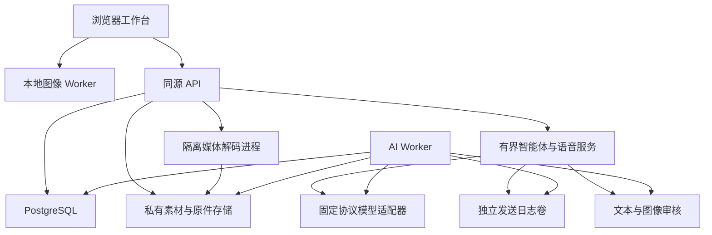
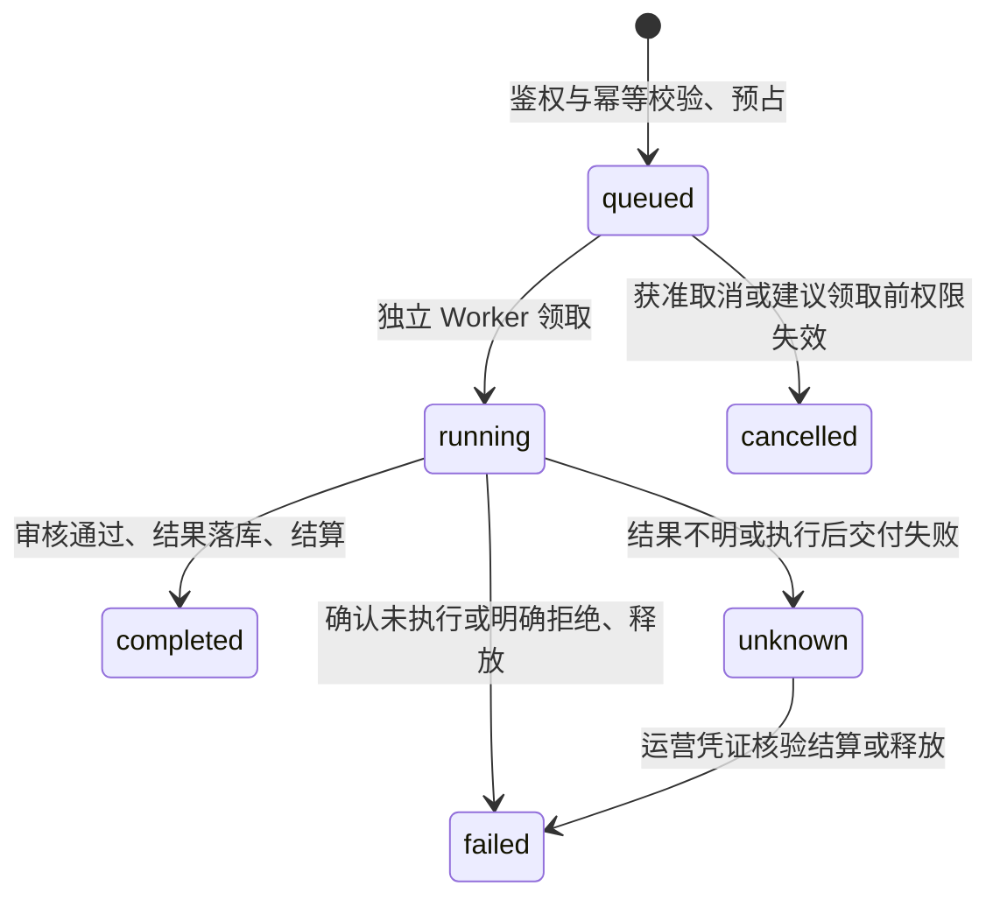

# 项目总设计与开发基线

本轮设计基线为 V4。本文描述仓库中的实际实现与接口边界，不把能力登记、已配置适配器、测试夹具和真实外部服务验收混为一谈。产品暂名“映间”，名称与图标可在运营端更换。

| 版本对象            | 当前值                         | 兼容与检查位置                                                                   |
| ------------------- | ------------------------------ | -------------------------------------------------------------------------------- |
| 编辑配方 / 像素算法 | Recipe v4 / engine 4.0.0       | 浏览器新建/导入默认 V4；既有 v1/v2/v3 及旧 AI 工作流继续兼容；`packages/editor`  |
| 数据库              | 迁移 1～20                     | `LATEST_SCHEMA_VERSION` 从实际迁移清单导出；不能用 Recipe 版本判断数据库是否就绪 |
| 协作操作            | `protocolVersion:1`            | 租约、栅栏令牌、操作、预览和事件；`packages/contracts/src/collaboration.ts`      |
| 原件描述            | `media-v1`                     | 原编码、母版、代理图、瓦片及转换事实；`packages/media`                           |
| 公共能力目录        | 模块版本与能力状态各自显式记录 | `/v1/modules` 与 `/v1/editor-contract`；不授予项目权限或自动启用外部模型         |

本轮新增的实时协作、资源检索与个人记忆、用量、上下文智能体、连续语音和保留原件 API 见 [API_V4.md](../apps/api/API_V4.md)。新模块开发入口见 [EXTENSIONS.md](EXTENSIONS.md)，图像数学与预算见 [V4.md](../packages/editor/V4.md)。数据库版本、编辑版本、协作协议版本彼此独立，后续升级应分别迁移与验证。

## 1. 产品定位与默认体验

产品围绕当前作品以及它关联的想法、素材、版本、讨论和交付组织。用户可以独立精修，也可以把草图交给 AI、请 AI 提出参数建议、生成文案、用语音整理要求，随后邀请团队参与。图片不是聊天消息的附件，聊天也不是修改图片的唯一入口。

最新设计基线是**内容优先**：默认收起空间导航，画面占据主要视区。参数和 AI 在需要时出现；桌面/平板的面板支持移动、调节尺寸和停靠，提供专注与布局恢复。手机用紧凑工具和可展开面板，使当前画面及当前操作有明确的空间分配。响应式布局应按真实工作区尺寸适配，而不是把桌面三个固定栏整体缩小。

布局偏好属于设备侧状态，不改变作品配方。换设备后根据视口恢复合适的布局；异常/越界的本地布局应校正，随时可恢复默认。照片的“适合画布”取决于可用区域与照片比例，滚动参数不应要求滚动整张页面才能找到保存或返回入口。缩放查看细节与全图适配是两个明确动作。

## 2. 架构和模块边界

使用 TypeScript npm workspaces。React/Vite 承担浏览器交互，Fastify 提供同源 API，PostgreSQL 持久化业务对象。图像内核作为独立纯函数包运行于浏览器 Worker。现有生图、文案、短录音识别及传统参数建议继续由独立 AI Worker 领取持久任务；新增上下文智能体和连续语音由 API 进程中的有界服务执行，语音通过同源 WebSocket 转接固定供应商协议。原件导入由 API 管理持久任务与容量预占，再调用独立、受资源限制的解码子进程。三种执行模式复用权限、额度和来源规则，但不共享一套虚构的任务状态机。

| 模块              | 当前责任                                                                  | 不承担的责任                                       | 扩展方式                                                                    |
| ----------------- | ------------------------------------------------------------------------- | -------------------------------------------------- | --------------------------------------------------------------------------- |
| contracts         | 版本化模块、能力、数值/坐标、分析/渲染端口、协作命令、资源和用量 DTO      | 执行未知远程插件或授权                             | 通过共享注册器校验依赖、状态和协议                                          |
| portrait          | 真实分析结果校验、人物语义参数到普通编辑操作的编译                        | 人物身份识别、容貌评分、账单                       | AnalysisAdapter + 当前拓扑转换 + 新语义版本                                 |
| editor            | 配方校验、像素计算、几何映射、直方图、文件头门禁                          | 网络、账号、收费                                   | 新算法与配方版本，保持旧语义可重放                                          |
| web               | 内容交互、录音/草图、本地预览与确认                                       | 供应商密钥、权威权限和价格                         | 可复用面板与能力目录，保持服务器最终校验                                    |
| api               | 身份、ACL、事务、额度、运营；接线协作、智能体、语音和媒体服务             | 无界推理、任意外部 URL 或脚本                      | 按领域增加服务、预算、状态机与显式事务                                      |
| collaboration     | 同作品会话、游标、租约、临时预览、命令收据、版本提交与重连快照            | 无约束全配方覆盖、CRDT 自动合并                    | `realtime-collaboration.ts` 与严格操作协议；旧写入同时受数据库守卫保护      |
| assistant         | 有界 Responses 工具循环、明确上下文、候选；两种连续语音协议和独立发送日志 | 自动把建议变成作品、任意代理工具、默认读取个人资料 | `packages/assistant` + `apps/api/src/assistant`；新增协议须补用量与恢复边界 |
| media             | 原编码保留、颜色归一化、16 位 SDR 母版、代理图、瓦片和受限格式转换        | 将浏览器配方完整重放为高位深/200MP 输出            | `packages/media` + `media-import.ts`；格式能力以运行时探测和真实样本为准    |
| resources / usage | 跨有权项目搜索、私有记忆、成员动态；服务点明细和时间聚合                  | 向团队默认公开私有记忆、现金对账、物理垃圾回收     | 共享 DTO、当前 ACL、分页游标与同一额度账本                                  |
| db                | 迁移、事务、不可变记录、权益批次与事件                                    | 发送短信或模型 HTTP                                | 新迁移与新领域对象，禁止改历史事实                                          |
| storage           | 有界接收、校验、转码、私有文件                                            | 决定谁可查看文件                                   | 实现相同存储语义后替换为私有对象存储                                        |
| providers         | 腾讯短信及审核协议、签名、错误分类                                        | 决定项目业务状态                                   | 注入接口；真实实现与测试适配器隔离                                          |
| multimodal        | 生图/ASR 的实际 HTTP、模型档案与限制                                      | 直接发布作品或结算                                 | 增加供应商实现和契约测试                                                    |
| ai                | 任务冻结、审核、调用、状态、账本结算                                      | 自动修改用户当前作品                               | 新 operation 保持统一授权和状态协议                                         |

目前采用单机器私有文件卷和 PostgreSQL 任务队列，不要求额外 Redis 或常驻 GPU。协作的跨进程变化靠短周期数据库检查补齐；本机即时唤醒不能被描述为已有分布式消息总线。智能体、语音连接和媒体执行都有限流与并发预算，部分计数器按 API 进程计数，不能直接相加后当作全局限额。对象存储、独立渲染集群、WebGPU/WASM 加速及完整分布式调度仍是明确的扩展方向。

## 3. 权限与空间

每个活跃普通用户有唯一个人空间。团队是相同空间模型的另一种类型，列表放在同一导航。空间归属决定数据权限与付费钱包，当前打开哪个工作视图不会改变所属关系。

| 身份/角色 | 权限边界                                                                       |
| --------- | ------------------------------------------------------------------------------ |
| 平台运营  | 管理账户状态、注册政策、品牌、模型、套餐、额度与核验；不自动获得私人项目访问权 |
| owner     | 管理自身空间、成员和分享策略，创作与查看                                       |
| admin     | 管理普通成员和项目；不能把 owner 移除或越权提升同级                            |
| editor    | 创作与保存、执行允许的 AI、编辑任务/文档                                       |
| reviewer  | 查看、讨论与反馈；不能用查看权执行收费编辑                                     |
| viewer    | 查看获准内容                                                                   |

API 每次按当前数据库检查账号状态和资源的真实所属空间。文件不是公网目录，猜中 UUID 也不获得读取权。退出团队、撤销分享、封禁账号后，后续请求必须重新鉴权。运营角色与空间角色分开，避免“可充值”自然扩张成“可读所有照片”。

团队邀请有角色、有效期、次数和撤销状态；注册邀请码单独用于准入，不等价于团队成员资格。运营添加的用户是待验证账户，用户仍要完成真实手机号验证；从封禁恢复也不能绕过这一条件。

团队成员退出、被移除或实际角色变化时，同一事务清除其协作会话、租约和临时预览；离开团队同时取消其待办负责人关系。已经归属团队的素材、版本和文档保留，不随作者离开消失。成员动态记录加入、改权、退出和所有权移交；历史迁移只补当前事实，不编造过去的操作。团队 owner 可基于 `expectedOwnerId` 将所有权交给现有活跃成员，原 owner 成为 admin；个人空间不能交接，最后一位 owner 不能直接删除。

共享参考与当前团队成员是不同授权。参考授权可以使用户读取许可范围内的素材，但不会自动授予同作品实时编辑或执行智能体的权限。智能体的跨空间上下文还需要用户显式勾选范围，并逐次核对当前成员资格。后台付费派发和媒体发布在事务内锁定相应权限事实，避免异步处理结束时按已经撤销的权限发布新内容。

## 4. 数据对象与版本

| 对象                                             | 作用与关键关系                                                                |
| ------------------------------------------------ | ----------------------------------------------------------------------------- |
| User / Session / OTP                             | 身份、验证、会话和持久限流                                                    |
| Space / Membership                               | 个人/团队边界、成员角色、分享策略                                             |
| Project                                          | 同一个工作主题，关联图像、文档、任务、讨论                                    |
| Asset                                            | 不可变的规范化图像字节；所属项目、哈希、尺寸、来源                            |
| Artwork                                          | 对素材的一个编辑分支，持有当前 headVersion                                    |
| Revision / RevisionSource / RevisionImageLayer   | 不可变完整配方、底图与全部图层来源；作者、父版本和版本号                      |
| AIResultDecision                                 | 候选采纳/拒绝、操作者、幂等键、目标与返回快照                                 |
| Document / DocumentVersion                       | 项目文字与不可变历史；按版本更新                                              |
| Comment                                          | 项目/作品/版本锚定的讨论与解决状态                                            |
| Task                                             | 待办、进行中、完成、负责人和版本                                              |
| Grant / ProjectCopy                              | 可撤销来源授权和已完成的独立副本                                              |
| AIJob                                            | 冻结输入、任务类型、模型、状态、输出与对应预占                                |
| QuotaLot / Hold / Ledger                         | 周期额度和人工调整的来源、占用、结算历史                                      |
| Event / Audit                                    | 持久通知游标和运营/敏感动作审计                                               |
| CollaborationSession / Lease / Preview / Command | 临时在线状态、有 TTL 的目标租约、未提交操作及不可变命令收据；绑定真实登录会话 |
| ResourceMemory / MembershipActivity              | 用户自己的长期标注与私有笔记；团队成员变动事实，两者权限和公开范围分开        |
| AssistantTurn / Dispatch / Candidate             | 冻结上下文与配置、有界工具调用派发、带基准版本的待确认建议和独立预占          |
| VoiceSession / AssistantModelConfig              | 单次语音票据、协议、时长/委派预算、连接与结算状态；独立于旧 AI 模型配置       |
| MediaImport / MediaObject / MediaSource          | 原件导入状态、不可变原件文件树、显式素材归属链接及独立留存计费                |
| SpaceStorageAccount                              | 普通素材、保留原件与在途媒体预占的同一空间容量门禁                            |

图片调整写入 Recipe，而不是覆盖素材。旧保存接口继续携带 `expectedVersion` 并严格比较当前版本。新协作接口用目标租约、`baseVersion` 和明确的单个操作提交；只有受影响目标、底图、配方版本与几何基准均未改变时，才允许将这一个操作应用到新 head。整配方替换及结构变化必须取得 document 租约并使用当前版本。不能合并时返回 409，前端保留本地草稿，让用户查看最新版本或另存作品，不采用全配方最后写入覆盖。

事件使用空间内有序持久游标，发送序号在事务提交前序列化，避免先收到大序号、后提交的小序号永远被漏掉。长轮询通知前重新验证空间成员资格；事件不传整段私人正文。

### 4.1 同作品同步与锁定边界

作品协作事件另有作品内游标，不与空间通知游标混用。用户加入房间取得 60 秒会话，再对注册参数、曲线、局部、组、图像层、绘制层或整个文档申请 30 秒租约。建议每 10 秒续约；栅栏令牌和事件游标用十进制字符串传输，避免 JavaScript 整数精度损失。临时游标每 250ms、操作预览每 300ms 至多接受一次，并受序号、字节、会话数和目标范围预算约束。

租约冲突既检查相同目标，也检查源坐标中的保守影响包围盒；反相/全局蒙版保护整图。扩大蒙版必须重新验证范围，不能借一份旧租约侵占另一人的编辑区。四角透视、修复、质感、液化、结构增删及整段撤销按文档级操作处理。复杂形状的保守范围可能产生误冲突，这不等于逐像素无冲突协作。

预览只改变临时房间状态，不生成修订、不扣 AI 点数。正式命令在同一事务校验当前身份、租约、栅栏、操作范围、版本和全部图层引用，追加不可变 Revision 与命令收据。相同操作者、幂等键及内容可重放返回原结果，不创建第二个版本。旧保存、改名、历史恢复及 AI 替换/加层/参数采纳同样受数据库租约守卫约束，不能从另一条 API 绕过正在编辑的人。

同进程事件立即唤醒长轮询；其他进程或 Worker 的提交按 350ms 间隔检查。等待期间不持有数据库事务，每轮复核当前会话与成员权限。房间保留最近 1000 个传输事件；游标过期或领先时返回权威快照与 `resetRequired`。快照可能已经比当前事件页更新，客户端不能再把旧预览覆盖到新 head。持久版本与命令收据不会随临时事件清理而消失。离线后保留的本地草稿需要重新核验版本和租约，不能默认重播全部旧动作。

### 4.2 资源、上下文与版本的共同数据链

| 发起动作        | 输入冻结与校验                                        | 持久结果                                                | 后续用途                                 |
| --------------- | ----------------------------------------------------- | ------------------------------------------------------- | ---------------------------------------- |
| 上传/保留原件   | 文件字节、尺寸、所属项目、当前写权及容量              | 普通 Asset；高级导入另有 MediaObject 与明确 MediaSource | 代理编辑、原件/母版查看下载、显式参考    |
| 用户或团队编辑  | 不可变底图、完整 Recipe、来源引用、版本；协作时附租约 | 追加 Revision 与来源快照                                | 撤销、对比、恢复与下一次 AI 上下文       |
| 智能体/语音建议 | 当前基准版本、配方哈希、显式图像/参考、当前授权范围   | 私有候选及来源、派发与用量事实                          | 用户预览、拒绝、确认后走正常编辑命令     |
| AI 图像生成     | 冻结模型/参数/参考字节、审核、预占                    | 独立候选素材与任务结果                                  | 另存、替换底图或加为合成层；决定单独记账 |
| 跨项目独立复制  | 明确来源 ID、复制授权、目标写权、目标容量             | 新 Asset/作品与来源审计；原件链接必须显式复制           | 独立编辑；来源撤权不收回已完成副本       |

任何一条链都不能仅凭图片哈希相同就继承另一份私有原件。浏览器本地草稿、协作预览、已保存作品和供应商候选是四种不同状态，UI 与开发接口必须保留这种区别。

## 5. 确定性编辑、人物适配与像素控制

新导入默认 Recipe v4，版本和算法均显式保存。既有 v1/v2/v3 继续按原解释器重放；升级通过 `migrateRecipeToV4`，新增 `projective/healing/retouch` 为中性，未启用新阶段时走旧渲染路径。`migrateRecipeToV3` 拒绝丢弃 V4 字段；不能为兼容旧插件擅自降级用户作品。配方只包含有界纯数据，拒绝未知字段、访问器、循环、原型污染、非有限数和未知版本。V4 保留的旧数学见 [V3.md](../packages/editor/V3.md)，新增阶段、完整顺序和预算见 [V4.md](../packages/editor/V4.md)。UI 从执行注册表获得数值范围，不另维护一份漂移的定义。

这里的默认值指浏览器新建/导入会话。现有排队生图工作流仍用中性 V3 创建原始产物，图像候选的另存/明确替换底图也从中性 V3 开始；打开时按保存版本解释，不能声称所有服务器新建记录都已是 V4。对已有 V4 作品加合成层、应用数值建议及保存则保留其 V4 字段，使用新增 V4 工具时由编辑路径显式迁移。

### 统一处理路径

源图 → 兼容的全局/局部色彩与光学阶段 → V4 修复 → V4 质感区域 → 图像层 → 绘制层 → 液化位移 → 整数裁切/90°旋转/镜像 → 合并的精细变换与四角单应变换。区域组仍在成员蒙版并集上只处理一次；旧阶段内部顺序保持原版本定义。修复 donor 使用修复所在阶段的来源，不把后加图层倒灌为原图。

预览、导出、撤销、保存、历史恢复与 AI 参数建议共享这份配方。UI 的工具组不是另一套算法；任何控件必须改变可校验的数据，并由相同渲染器生成结果。

| 模块           | 实际实现                                                                                                                         | 语义与边界                                                                                                          |
| -------------- | -------------------------------------------------------------------------------------------------------------------------------- | ------------------------------------------------------------------------------------------------------------------- |
| 明暗/色彩/细节 | 13 项基础调整、输入输出色阶、连续 HSL、4 路曲线、三路分级、纹理/清晰度、黑白、褪色、颗粒、暗角、明度/色度降噪、红/蓝通道色散     | 正负参数逐项定义；柔化与锐化有各自非负强度；不声称负柔化能恢复丢失细节                                              |
| 自由构图       | 任意整数像素矩形、8 手柄、移动；精细角度/透视/剪切、双轴缩放与位移；V4 四角真实单应变换                                          | 角度建议步长 0.01°；四角坐标独立于源图坐标；拒绝交叉、凹形、坍缩与越界预算；二维投影不恢复三维                      |
| 多局部         | 12 个 v3 区域、6 个组；每区域/组共用完整 ColorBlockV3                                                                            | 组在所有启用成员的 max-union 上只处理一次，交叠不会重复叠加组效果；成员仍能各自调整                                 |
| 蒙版           | 径向、渐变、多边形、加减笔刷、栅格 RLE、连续颜色范围；union/intersection/subtract/xor 复合树；V3/V4 径向另有旋转与椭圆/矩形/菱形 | 所有坐标归一到完整源图；径向旋转按源像素顺时针 −180…180°，省略新字段保留旧椭圆；复合深度/节点/采样有公开预算        |
| 曲线           | 全局/区域/组的 RGB、R、G、B 各 2–16 点，添加/拖动/删除/精确坐标                                                                  | x 严格递增、y 自由变化，允许反相；线性插值，不伪称多值贝塞尔曲面                                                    |
| 绘制/仿制      | 1 像素硬边 RGBA 落笔、连续画笔、擦除、冻结源仿制、16 种混合、独立层与蒙版                                                        | 擦除仅影响当前绘制层；仿制源与画笔结果有明确区别，不假称语义消除                                                    |
| V4 局部修复    | 最多 16 个独立操作；调和填充或梯度域补片；手选 donor / 有界邻域搜索、蒙版、保护、强度、迭代                                      | 单次目标至多 262,144 像素；目标邻域和 donor 透明度/预算要求明确；大物体与复杂纹理可能失败或留接缝                   |
| V4 质感区域    | 最多 12 区；保边平滑、双向纹理、匀肤、油光压制、离散噪点与暗细线抑制                                                             | 独立信号算子；中性精确；不能把中值脉冲检测称为痘痘识别，不能声称重建真实皮肤结构                                    |
| 图像合成       | 8 个独立图像层、位置/尺寸/旋转/镜像/强度/混合/蒙版/次序                                                                          | 只接收调用者解析的 sourceId；缺图明确失败；图像层固定在绘制层之前，没有任意交错 PSD 图层树                          |
| 液化           | 推移、收缩、膨胀、旋转；有符号强度、半径、羽化、背景保护；新 V4 手动笔触采用 `flow-v2` 与 `bounded-cubic-v1`                     | 复合逆向位移一次取样，旧笔触保留各自算法；全配方128笔，超过64笔另验半径平方和；不是三维人体模型，极端叠加仍可能失真 |

图像编辑尺寸与 AI 模型允许的生成尺寸分别验证。裁切后的图片不需要满足模型固定比例；发给某模型作参考时，才检查该供应商自己的输入规则。

### 人物分析与语义控制

`packages/portrait` 定义 `PortraitAnalysis`，绑定完整原图 RGBA 哈希、方向、尺寸、算法版本。浏览器驱动使用同源的 MediaPipe face/pose/segmentation 模型，真正执行后生成目标；不硬编码人物点位，也不以目标标签推断身份。面部与身体是分别检测的目标，不按编号假设属于同一个人。

57 项注册控制分为美肤14、面部26、身形10、美妆7。可用项编译成普通区域、绘制层、warp 及 V4 质感区域，其中包含独立的油光、斑点与色斑控制。八项新增 V4 精细控制为眼宽、眼高、眼睑下至、虹膜大小、眉毛位置、嘴宽度、丰上唇和丰下唇；分别由实际轮廓导出作用范围，采用 `flow-v2` 与 `bounded-cubic-v1`，不足时明确不可用。虹膜缩放不等于瞳孔独立重建，上下唇二维调整不等于三维体积恢复。

V4 自动颈长缺少可靠头颈分区和刚性约束，当前明确停用，已有旧操作可回放和显式清除；不再以圆形推移冒充精准颈长。V4 下重新调节人物时，磨皮、肌理、匀肤与细纹使用明确的 `portrait.basic.v2` 运算；新质感区域采用 `guided-v4`，已有区域保留其算法。只迁移旧配方不会偷偷更换已有 primitive 的算法。每个人物有独立参数、妆色与来源记录；重调只替换该人物拥有的操作。用户选择“转为独立精修”后，保留像素效果并脱离自动操作所有权，后续自动调节作为新效果叠加，避免重建时覆盖手工修改。

自动分析要求资源已安装、OffscreenCanvas 和可用 WebGL 2；当前 JS 输入路径即使选择 CPU 推理仍依赖 WebGL。缺少条件时明确失败并保留手动入口。支持导入/导出严格同图绑定的人物标注，以连接外部分析适配器；导入标注不会显示“自动识别成功”。当前语义编译依赖 MediaPipe 点序拓扑，替换模型需要拓扑转换，不能任意塞入另一组点位。

皮肤分割是粗分割蒙版，按人物轮廓相交并排除五官；不是毛孔、发丝或妆容的逐像素真值。皮肤柔化、细节、提亮、眉妆和局部修复有实际参考算法，但自动祛痘/专门祛皱、发丝重建、学习型高质量修补与三维一致性尚未达到商用品质验收。`createPortraitPixelAdapter` 提供真实神经执行器所需的模型版本、权重摘要、许可、图像绑定、保护区及取消校验；这个接口本身不等于已经部署神经美颜模型。详见 [portrait README](../packages/portrait/README.md) 的逐工具实现说明。

### 坐标、分辨率与资源预算

框架坐标通过同一投影矩阵正/逆变换；液化后的实际内容坐标再叠加逆位移。渲染完成的坐标键包含生效的变形与保护区，画面仍旧时不能按新坐标落笔。含透明角落的画幅中，画笔与源取色拒绝没有源像素的位置，不夹到边缘误涂。复杂蒙版/合成层编辑可显示明确标注的液化前源坐标视图，返回其他工具后显示最终形变效果。

编辑源图、交互预览、编辑导出是三个独立尺寸；高级导入还额外保留原编码及高位深母版。V3/V4 浏览器硬上限为 16,777,216 源/输出像素；低内存手机默认更小。完整编辑预览的输出预算为 4,194,304 像素，扩展旋转会先进一步缩小预览输入，保留编辑源图和配方不变。常规拖动使用可恢复的有界自适应栅格；手动液化通过独立 `previewQuality:'warp'` 通道保留完整编辑预览，并缓存液化前的色彩、局部修复及图层结果。完整编辑预览仍可能小于原图，不等于任意原图尺寸的1:1实时液化。编辑导出走分块参考渲染；仍需要多个整图字节缓冲，不能声称 16MP 在所有手机上都流畅。

浏览器合成素材合计另限 16,777,216 像素，含撤销保留引用；核心包支持的更大上限不自动成为网页设备预算。浏览器工作精度为 sRGB/RGBA8，不能把浮点中间计算或服务器保留原件表述为高位深/HDR 浏览器编辑。缩小预览的像素邻域、细颗粒、色散与完整输出存在尺度近似，像素级验收以编辑源图尺寸的实际导出为准。

### 原编码、母版与大图查看

高级导入需要显式启用 `media` 服务及真实可用的 Linux 解码环境。普通 raster 的最大接收预算是 200MP / 512MiB，不代表所有格式都可处理到这个尺寸：相机 RAW 全传感器上限 64MP，EXR/Radiance 数据窗口上限 50MP，PSD 上限 16,777,216 像素与 128MiB；是否可用还取决于实际解码器。原编码逐字节保留，方向与明确色彩转换后产生 16 位 sRGB SDR 母版、至多 4MP 的编辑代理图及 Deep Zoom 查看瓦片。HDR 支持范围另保留线性 EXR；不伪造未识别的色彩空间。格式与元数据处理矩阵见 [media README](../packages/media/README.md)。

原件哈希、代理图哈希和实际编辑源图哈希各自有含义，不能互换。瓦片用于原尺寸查看，现有浏览器配方仍绑定它实际加载的 RGBA8 源图。母版导出是格式转换，明确返回 `X-Editor-Recipe-Included:false`；尚未把 V4 配方完整重放到 16 位/200MP 母版。浏览器代理上的修图结果与未应用该配方的高位深母版必须在界面和 API 中分别命名。

导入先预占输入字节，按连续 4MiB 以内分块接收并校验重试内容；完成后有界解码，发布事务重新锁定当前写权与项目，原子释放预占并计入原件/母版/瓦片和代理图的真实逻辑容量。处理中取消可返回 `cleanupPending:true`：没有确认原工作进程停止前，不提前释放容量或删除其目录。就绪原件通过回收站删除。恢复期为 48 小时，期间仍计入保留容量。到期后释放对应逻辑容量，系统清理已无保留引用的文件。

### 统一扩展标准

新增模块先使用 `ModuleRegistry` 声明 ID、版本、依赖、能力状态、权限和输入输出；`GET /v1/modules` 提供实际目录，`GET /v1/editor-contract` 从执行注册表导出参数。模块状态分为已实现、需适配器、仅契约；声明能力不授予权限，也不执行任意外部插件。

图像算法、人物分析、媒体解码、任务编排和数据存储有各自端口。新增算法必须同时补数据语义、迁移/旧版本重放、实际像素测试与 UI 状态；不能只注册按钮。开发步骤和实际文件入口见 [EXTENSIONS.md](EXTENSIONS.md)。

## 6. 草图、模型、文字与语音联动

所有 AI 入口经过同一项目和额度账本。旧任务与新智能体/语音有各自协议和生命周期，使用同一权限事实与额度批次，不在客户端另外扣费。

| 任务           | 明确输入                                                   | 审核与完成结果                                                                 | 用户下一步                                                 |
| -------------- | ---------------------------------------------------------- | ------------------------------------------------------------------------------ | ---------------------------------------------------------- |
| edit-plan      | 文字、完整配方、作品及基准版本                             | 审核实际发送文本，严格校验返回参数，再审核；仅产出候选                         | 预览可撤销地应用，明确保存并检查版本                       |
| generate-image | 文字、尺寸、可选项目参考图/草图                            | 输入文本/参考图审核；模型返回后规范化并审核将被保存的精确字节                  | 新建独立素材/作品，打开继续精修                            |
| generate-text  | 指令，可选显式文档及版本                                   | 输入与输出文本审核；标题/正文/说明候选                                         | 修改后存为项目文档                                         |
| transcribe     | 最长30秒、16kHz、单声道PCM16 WAV                           | ASR 后审核转录文本；移除任务中的原音频                                         | 先改文字，再填入目标任务输入框                             |
| assistant-turn | 文字、明确作品/版本/本地配方、用户分享的截图与授权资源范围 | 有界工具循环、输入输出审核、候选和供应商派发事实；写入须通过确认或有效执行授权 | 参数预览确认或授权内应用；生图建议再选择模型并确认独立任务 |
| realtime-voice | 单次连接票据、语音模型/后端模型、时长块与明确上下文        | 实时 PCM 转接、转录/音频、有限后端委派、使用量和候选                           | 可静音、打断、停止；作品变更遵循确认/执行授权与版本校验    |

`propose_scene_balance` 是应用内函数工具：只有支持图像输入的模型、用户实际共享的当前图像、冻结配方和服务端检查回调同时存在时才提供。它按实际渲染的亮度/通道余量测量，在平衡明暗、打开暗部、保留高光或保留夜景四种意图下生成全局曝光、阴影和高光候选，其余参数不变；不能恢复已缺失的细节。候选仍须像素检查并在后续轮次评审，提名只是进入已有授权、成本、协作租约和版本校验，不等于保存。分支事件增加 `candidate`、`pixel-review`、`nomination`，由 `dependsOn` 连接工作图谱。现有分支 API 继续使用，本次没有新增通用 MCP 发现/执行端点或任意外部 skill 安装能力。

短录音入口保留原有行为：先在本机试听，用户提交后执行一次识别；识别文字再次确认后触发修图、生图或文案。静音/无可识别语音是明确的成功空结果，显示未识别到语音；已发生的识别任务按约定点数结算。浏览器朗读是独立的、用户主动触发的能力。

连续语音是新增入口，需要运营启用并配置实际语音模型、后端模型、审核器、时长与点数。准备连接时预占一个明示的固定时长块，浏览器经同源 WebSocket 传送单声道 24kHz PCM16，收到音频/转录/候选。GPT-Live 与 Realtime 使用两个独立适配器，不能把模型 ID 换一下就共用端点或假造相同图像能力；仅在协议支持且用户明确分享时发送图像，其他图像推理由后端模型处理。原始麦克风音频不落入应用数据库或应用文件日志，供应商自己的数据处理政策另行适用。

语音连接包含 Origin、真实登录会话、一次性短期票据和当前项目/上下文权限校验；票据通过子协议传输，不放 URL。连接期间定期检查登录、模型、权限与心跳，后端委派前再次复核；撤权是有界检测，不声称跨网络瞬时终止。存在音频速率、出站背压、文本并发、响应次数与委派预算，重连不会自动再次预占或重新发送付费任务。详细协议、单位与错误状态见 [API_V4.md §6](../apps/api/API_V4.md#6-contextual-assistant-and-continuous-voice)。

模型目录由运营管理；服务器还维护实际供应商、已启用模型 ID、对应能力档案和执行开关。前端取其交集，按当前任务选择模型及参数。新智能体与语音使用独立 `assistant_model_configs`，同一上游模型可同时用于旧文案任务与智能体而不覆盖彼此预算；配置修改带内容哈希 CAS。自定义宽高也要满足模型的最小/最大像素、比例、单边、运营范围和平台预算。某个截图里的模型名称或“4K”选项不能被当作所有账号可用的 API 事实。

OpenAI Images 使用服务器侧固定官方端点及精确模型白名单。质量、背景、编码、压缩、数量、复杂度和参考图限制由能力档案返回，不按模型名称猜测。当前实现的 8 个 ID 和尚未开放的 SVG/GIF/流式等范围见 [OpenAI 契约](../packages/multimodal/OPENAI.md)。图片迭代必须真实引用父任务产出的素材，文字迭代实际冻结父文案；不会只在聊天界面串联消息却丢掉模型上下文。

v2/v3/v4 的传统 `edit-plan` 仍只开放原有 13 项加 52 条注册数值路径，保留 V4 的新字段。这个入口只发送当前全局可写数值及用户文字，不假装已经看过图像、人脸或妆容。返回路径必须在精确白名单中，联合色阶约束整体校验，前端展示真实 before/after 后确认。传统建议不能任意增删选区或改写图片、曲线、几何、权限；旧排队任务继续按冻结协议执行。

新增智能体入口通过独立工具白名单读取参数目录、查询获准资源、提出编辑或生图候选。可选截图由用户明确分享，服务器有界解码、规范化并审核；配方绑定保存基准版本与当前本地配方哈希。跨空间范围、参考素材、联网搜索、使用个人记忆分别授权，默认不打开；参考检索仅返回元数据，图像输入需要显式选择且后端模型支持。每次普通 turn 至多 4 次 Responses 请求；父 turn 只带入紧邻的一对问答，并非无限历史记忆。新智能体与传统 `edit-plan` 的工具范围不同，不能把一个入口的能力档案套给另一个。

智能体 turn、语音会话和候选在当前用户及当前项目编辑权限下读取，不自动成为全团队可见的聊天记录。个人记忆是私有的显式标注，授权进入一次 AI 上下文也不改变其数据库可见性。

素材注释与图像字节分离：标题、标签、声明的带时区拍摄时间和手工位置使用独立 `annotationVersion`。上传时间由服务器记录，不能被拍摄时间覆盖。空间/项目搜索和每一页查询都重新检查权限，分页游标绑定用户、范围与筛选。复制项目保留当时注释快照；修改原项目不改变副本。默认不提取或写出 EXIF GPS。

### AI 候选的完整采纳链路

生成成功只是产生候选。`POST /v1/ai-jobs/:id/decisions` 接收版本化决定：拒绝、另存、替换底图、作为合成图层、应用参数建议、保存文案。每次都检查当前 ACL、候选类型/来源、目标版本及幂等键，结果写入不可变决定与审计。

替换底图追加新源绑定修订，旧底图和旧配方仍可恢复；加入图层保留底图和现有调整；未采用不伪造已经发生的供应商费用退款。文案可修改后另存为项目文档，原输出与采纳正文分别保存。历史恢复同时恢复源图、图层引用和配方，并追加新版本。

新智能体候选另用 `POST /v1/assistant-candidates/:id/decision` 标记预览或拒绝，返回 `applied:false`。预览要求原保存版本与完整本地基准配方哈希一致；过期、被拒绝或基准改变不能静默套用。预览通过后仍由用户确认，取得所需协作租约，并通过正常编辑命令追加版本。生图候选只是一组提示与获准参考，用户还须选定图像模型、参数和独立报价，才能进入真正生成任务。候选本身没有任意执行、改权或绕过审核的能力。

当前本地未保存编辑不会被晚到的下载、AI 结果或恢复操作覆盖。打开流程冻结源身份、配方对象与项目代次；用户继续编辑后旧请求取消提交。云保存冻结本次快照，同时保留用户继续产生的草稿。

## 7. 付费任务、审核与恢复

多模态任务在领取后的执行前校验发现权限失效时标记 failed；该路径未调用模型并释放预占。若供应商调用后才发现权限失效，则不发布结果，并按 unknown 保留预占等待核验。

上图只描述原有排队 AI 任务。队列任务可由有权用户显式取消，运营停用能力后仍可走取消路径；服务器首先核验任务确实未领取且没有派发证据，再释放预占。已 running/unknown 的任务不能用取消入口退款或重试。恢复扫描不依赖是否仍有启用的供应商，避免停用全部模型后无人处理遗留状态。

普通智能体 turn 使用 running/completed/failed/unknown；语音另有 prepared/connecting/active/closed/failed/unknown。未连接且没有发送证据的过期准备可释放；有可能发送过的连接或委派，在丢失结果、服务重启、超时或无法确认最终收据时保留 unknown。前端停止播放、WebSocket 关闭、供应商返回一条用量记录和供应商最终账单是不同事实。不能把关闭页面当成未消费，也不能把传输正常关闭当成供应商最终账单已确认。

冻结范围按任务协议区分：调整建议冻结实际文本请求与端点、完整基础配方和作品版本；文案生成冻结实际文本请求与端点、显式文档版本及父文案上下文。新 OpenAI 图像任务还绑定完整供应商 JSON 的规范摘要、固定端点、参考字节摘要和整批报价。旧 Ark 任务保留原参数清单与参考图摘要语义。ASR 冻结音频摘要与规格、模型和任务归属，没有将完整 ASR 外呼端点与传输 JSON 纳入其冻结清单。各类任务都绑定模型、项目与用户，不能把新协议的保护范围追溯套用于旧任务。

执行前及必要的异步审核之后重新检查权限、模型和参考图状态。生成图片只有在最终规范化文件审核通过、ACL 再确认并成功提交事务后才建立可访问素材。

额度是整数服务点，不是现金。每笔预占分配到原始额度批次；月度免费发放按亚洲/上海月份与用户唯一，不因创建多个团队或修改免费政策重复发放。到期只让可用部分到期，占用保持原批次；释放时判断该批次是否已过期，不能把上月点数洗成新额度。

同一个幂等键和相同请求返回原任务；不同内容复用键被拒绝。网络中断、超时、不完整返回及无法确认的结果进入 unknown，保留预占，不自动重发收费请求。运营以原因与凭证引用核验，终态不会伪造一个作品。

发送日志使用独立持久卷与 fsync，记录任务 ID、摘要与发送意图，不存私密提示、照片或音频。原有任务使用其队列发送日志；新增智能体/语音使用独立 `AssistantJournal`，按 DB 派发标记提交 → 文件与目录 fsync → 再次校验付费记录状态及当前权限 → 才发送的顺序执行。日志已有同一派发不是再次发送许可。恢复出的数据库缺少日志对应记录或摘要不一致时，付费入口返回 `ASSISTANT_RECOVERY_REQUIRED` 并阻断外发；这是需要核对原始日志和备份的恢复故障，不是删除日志或普通退点就能解决的 unknown 任务。

运营核验必须提供原因与证据引用，锁定 unknown 记录后结算或释放一次。智能体/语音按配置的服务点 turn/时长块结算，供应商 tokens/seconds 单独记录；两者不能混为人民币成本或伪造精确 token 计价。这保护单机试运行的恢复边界，但不等同异地、跨存储故障下的商业账务一致性，也无法检测数据库与发送日志一起丢失的所有事实。原始队列音频、未完成任务、日志和孤立文件仍需部署方的保留与恢复策略。

## 8. 分享与独立副本

空间分享策略分别控制参考、复制、活跃授权数、复制素材数。参考读取继续受来源授权、有效期、来源空间策略与项目状态影响；独立复制必须由用户明确触发，并检查目标空间写入权。

复制在一致性快照里复制当前素材引用、作品当前配方与文档；不偷偷复制讨论、成员名单、历史版本和待办。字节可以复用同一不可变私有存储对象，新的 Asset 有独立目标 ACL。撤销来源授权会阻止新的来源访问，不能收回已明确允许并完成的独立副本。

单素材复制与整项目复制都先核验来源读权/复制政策及目标写权；需要外部复制授权时检查实际 grant。保留原件只从明确的 `sourceAssetId` 复制其合法 MediaSource，不通过代理图 `storage_key` 反查别人的原件。V3/V4 的所有图像层引用随目标素材映射重写；缺失、外项目或无权引用即失败，禁用图层也要检查。容量、来源链接、作品与审计在同一事务提交；独立原件链接按目标归属计入逻辑容量，不能用字节去重规避租户额度。

发布失败清理与原发布事务使用相同 storage key 的事务锁。只有等待原事务结束并确认不存在任何资产记录引用后才能删除；检查包含已标记删除但仍保留的记录及完成复制的引用。提交结果或查库结果不明时保留私有文件，待后续引用感知维护处理，不能把清理程序当作已实现的完整保留策略。

### 资源检索与长期标注

`GET /v1/resources` 在一个入口按个人/团队、空间、项目、来源、时间、标题/标签及长期标注搜索有权素材。每页都检查当前成员或有效参考授权，分页游标绑定用户与筛选。共享注释继续带独立版本，原拍摄时间/手工位置不覆盖服务器上传时间。个人的 `ResourceMemory` 另有私有标题、标签、笔记、标注开关和 CAS 版本；只有本人可见，来源失去访问后仍可删除自己的记忆。长期标注既不是永久存储 SLA，也不自动复制进团队或供应商上下文。

### 用量与运营数据

`/v1/usage` 提供本人钱包或当前所在空间的明细，`/v1/ops/usage` 提供运营授权范围的汇总。查询同时关联原有 AIJob、AssistantTurn 和 VoiceSession 对应的同一 hold，不另造账本。按亚洲/上海日或月聚合 `issued/held/consumed/released/expired/adjusted`；held 是期间的预占流量，当前冻结余额另看钱包汇总。逾期批次释放同时记录 released 与 expired，旧历史无法准确恢复的金额明确标为 unknown，不猜补。

明细与 CSV 都按有界页返回；CSV 带下一页游标并防电子表格公式注入。游标固定筛选、时间范围及已观察的账本高位，不等于跨请求保留数据库快照。当前钱包余额是完整实时余额，不随明细日期或操作者过滤改变。月度权益、人工个人/团队调额、模型服务点和运营核验在同一套批次/预占/流水语义内处理；模型元数据可供运营核验，但不因此暴露私人提示、音频或图片。

## 9. 后续开发的硬性契约

- 新增工具：定义单位、负向/正向、中性值、像素域、蒙版适用性、版本迁移和跨分块边界测试，再暴露 UI。
- 新增模型：实现能力描述、参数校验、有界响应、真实错误分类和固定/受控端点，不把任意用户URL交给 Worker。
- 新增工作类型：复用 Project/Document/Task/Comment，不把团队固定为“只能修同一张图片”。
- 扩展共同编辑：复用现有会话、租约、栅栏、操作收据与 CAS；新增操作必须定义目标、影响范围、重放与冲突规则。CRDT/OT、多人同位置细粒度合并或跨操作的选择性撤销需独立协议，不能把临时预览当持久事实。
- 商业支付：订单、支付通知验签、幂等回调、订单版本、退款与对账独立完成后才能启用。套餐目录与人工赠额不构成自动支付。
- 更多媒体：每种格式要明确解码器、动画/页面/图层、方向、色彩、高位深和元数据策略，不能仅扩展文件选择器后缀。
- 高位深母版编辑：需另建完整配方重放、颜色精度、空间/分块算子、代理到母版映射和输出一致性验收；不能把现有母版转码按钮改名后宣称完成。
- 智能体与语音：新增工具、委派或上游协议必须贯穿当前权限、输入输出审核、预算、写前日志、一次派发及 unknown 核验；模型建议永远通过明确候选与用户确认进入作品。

完整端点和最新实现边界以 [API.md](../apps/api/API.md)、[API_V4.md](../apps/api/API_V4.md)、各包 README 和实际验证记录为准。协议及本地集成测试不替代真实短信、付费模型、生产代理链路、中国大陆多运营商和目标设备的上线验收。每个后续里程碑都应交付可运行的联动流程和实际验证结果。
