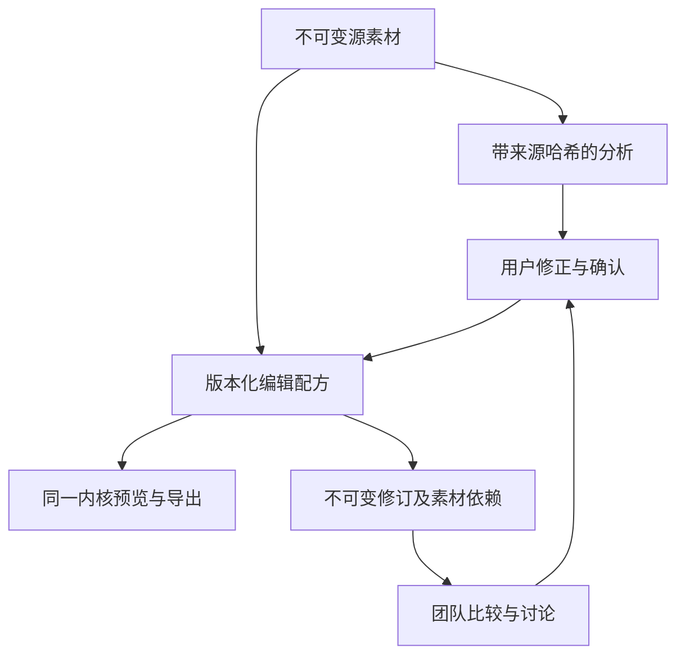
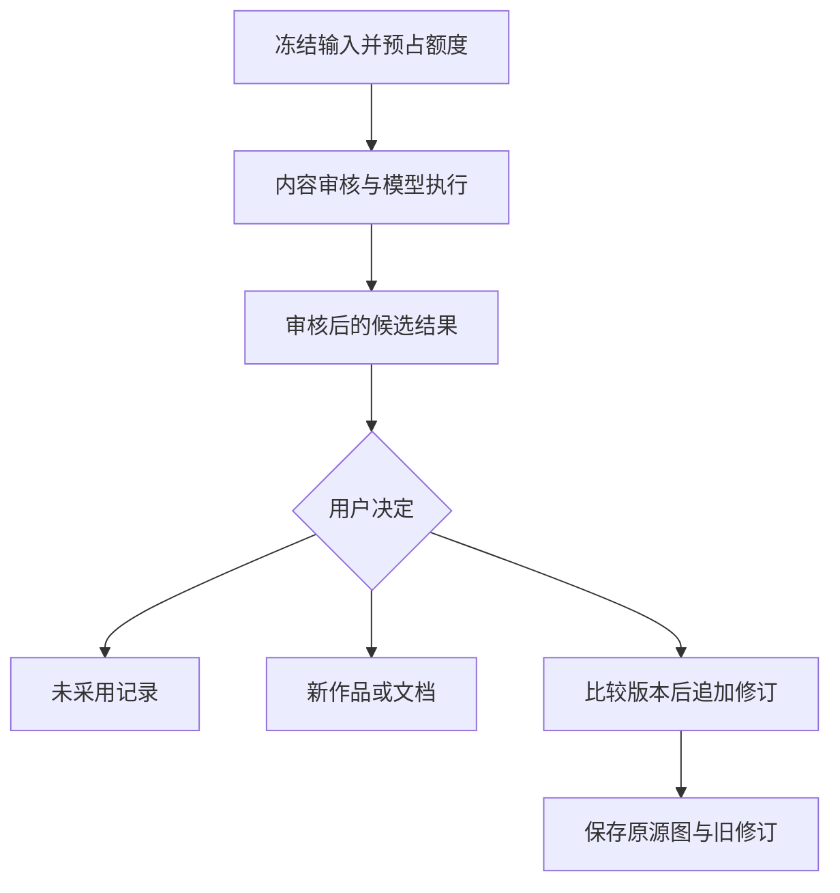

# 扩展协议、模块入口与数据联动

本文件是继续开发的入口。描述的是仓库中的实际接口和边界，能力目录会明确区分已经有执行器、需要配置适配器、以及仅定义契约的能力。未接入的专用祛瑕、皮肤分割或支付系统不会因为出现一个按钮而成为可用功能。

## 1. 先找到正确的修改位置

| 要扩展的内容                                     | 主入口                                                                                | 必须联动的内容                                                   |
| ------------------------------------------------ | ------------------------------------------------------------------------------------- | ---------------------------------------------------------------- |
| 数值调色、蒙版、曲线、几何、绘制、合成或位移算法 | `packages/editor/src` 的版本化 recipe、registry、engine                               | 校验、预览与导出、坐标映射、取消和资源预算、数值测试             |
| 人物分析或专用算法                               | `packages/portrait` 的分析与编译接口；公共协议在 `packages/contracts/src/protocol.ts` | 来源哈希、方向归一化、模型版本、多人物目标、人工修正、显式可用性 |
| 新工具或新面板                                   | `apps/web/src/editor`、`apps/web/src/workspace`                                       | 工具目录、完整状态、撤销、响应式、键盘/指针取消、动效            |
| 身份、空间、项目、团队与权限                     | `apps/api/src/auth.ts`、`spaces.ts`、`projects.ts`、`sharing.ts`                      | 数据库授权、事务、事件、运营权限隔离                             |
| 素材搜索、标签、时间或位置声明                   | `apps/api/src/asset-annotations.ts`                                                   | annotationVersion CAS、查询游标范围、私有资源 ACL                |
| 云素材跨项目复制、保留容量                       | `apps/api/src/asset-copy.ts`、`packages/db/src/schema-v7.ts`                          | 来源复制策略、目标编辑权、稳定幂等、来源审计、事务容量锁         |
| 生成模型、语音供应商或参数                       | `packages/multimodal/src`                                                             | 能力档案、真实请求验证、冻结输入、内容审核、输出上限             |
| AI任务与计费                                     | `packages/ai/src`                                                                     | 预占、审核、发送日志、未知结果核验、不能自动重试收费调用         |
| 生成结果采纳、来源替换或历史恢复                 | `apps/api/src/ai-decisions.ts`、`revision-commands.ts`                                | 模板化请求校验、幂等、版本比较、源图快照、审计                   |
| 新领域数据                                       | `packages/db/src/schema-v*.ts`                                                        | 追加迁移、旧数据迁移测试、事件和复制/删除规则                    |
| 商户支付、实时协同或高位深处理                   | 先实现相应契约的独立执行器                                                            | 不得复用人工额度调整冒充收款；不得把CAS叫作CRDT                  |

所有业务变更遵循 `AGENTS.md`。没有随意执行远程插件代码的入口，也没有浏览器提交任意供应商 URL、SQL、价格或身份权限的接口。

## 2. 公共协议包

`@ai-xiutu/contracts` 不依赖浏览器、数据库或具体模型，前后端可以共同导入：

- `ModuleManifest` / `Capability`：模块命名空间、协议版本、依赖、输入输出资源类型、执行位置、权限、确认方式、持久化方式和实际边界。
- `ModuleRegistry`：严格注册、拒绝重复 ID、检查缺失依赖和循环、封存后禁止改注册表、按运行配置解析可用性。
- `NumericParameterDescriptor`：同一标准表达范围、步长、中性点、整数限制、单位、适用配方版本和作用范围。
- `SourceFrame`：绑定素材哈希、归一化方向、宽高和源图坐标系，防止把另一张照片的分析结果套用到当前照片。
- `AnalysisAdapter<Input, Output>` / `RenderAdapter<Recipe, Pixels>`：可替换分析与渲染的接口，包含算法版本、配置状态和取消信号。
- `CommandEnvelope`、`CandidateResult`、`DomainEvent`：未来模块间命令、候选结果和事件的公共格式。当前 HTTP 端点保持文档中的明确请求体，不是假装已经全部迁移到一个通用命令 URL。
- `AiResultDecisionRequest` / `AiResultDecision`：实际用于 API 请求校验以及前端采纳流程的共享类型。
- `AssetCopyRequest` / `AssetCopyRecord` / `StorageAccountSummary`：实际用于云素材复制请求与保留容量响应的共享类型。来源、字节和权限从数据库取得，客户端只指定目标与幂等键。

版本含义不要混用：`protocolVersion: 1` 是模块与决定的传输协议；`schemaVersion: 3` 是图像配方数据格式；`engineVersion: 3.0.0` 是计算语义。新算法不应通过原地改变旧版本数学行为来上线。

### 2.1 实际发现端点

`GET /v1/modules` 返回模块及其能力。运行状态是：

| implementation                 | runtime      | 含义                                           |
| ------------------------------ | ------------ | ---------------------------------------------- |
| implemented                    | available    | 本仓库有执行器，目录所需运行门禁已满足         |
| implemented / adapter-required | unconfigured | 执行器或算法端口需要配置、模型资产或供应商能力 |
| contract-only                  | unsupported  | 接口方向已有定义，当前没有完整执行器           |

`available` 不授予用户权限，也不证明供应商账号在部署地区已完成真实验收。AI 模型还须通过具体模型目录、执行开关、审核配置与当前账号/项目权限。浏览器人像分析的同源模型资产由浏览器验证，服务器不会仅凭环境中出现一个路径就声称模型已加载成功。

`GET /v1/editor-contract` 从 `TOOLS`、`V2_TOOLS`、`V3_TOOLS` **直接派生**参数描述，不另写一份范围常量。目前包含旧13项、v2新增52条路径、v3新增15条路径。`scopeMinimumVersion` 必须与 `schemaVersions` 一起判断：例如 HSL 主调整自v2可用，而区域/分组的完整HSL需要v3；几何变换只对全局适用。

`step` 是交互增量。浮点参数的校验边界与 UI 滑条步进并非同一概念；整数粒径/随机种子则确实要求整数。消费者不能因为拿到滑条步长就把合法旧配方四舍五入改写。

### 2.2 注册新模块

注册是受信代码完成的构建期行为。`createBuiltinRegistry()` 是当前目录的单一来源。添加模块时：

1. 使用稳定命名空间，例如 `portrait.skin-segmentation`，不要使用显示名称做数据库主键。
2. 声明具体依赖；`seal()` 会发现缺失模块和环。
3. 将实际实现状态填准确。先定义了接口但没算法时，用 `contract-only`；已实现适配器但缺权重时用 `adapter-required` 和具体运行门禁。
4. 明确执行位置、权限、输入输出、持久化和是否需要用户确认。
5. 接入对应实际端点、内核或前端工具。目录不是执行器本身。
6. 加入符合该能力风险的测试；不要靠一个始终返回成功的桩让目录变绿。

注册表返回结构化副本，外部修改 `list()` 或 `capability()` 的返回值不能改变其内部定义。未知字段、重复能力、错误命名空间和任意脚本 URL 会被拒绝。

## 3. 图像数据在模块之间如何流转



### 3.1 源图与预览不要混用

源图、当前预览像素、浏览器 CSS 像素、裁切后输出是四种不同坐标与尺寸。蒙版、笔触、保护区和图层放置记录在归一化源图坐标；在画面上操作时必须通过当前几何映射转换。预览可以缩小，但整图导出不能偷偷使用缩小预览。

分析结果必须记录来源哈希、归一化方向、模型版本和尺寸。换图、换方向或换源之后，旧分析不能继续假装有效；外部传回的置信度也不能代替用户修正。在多人物场景中，每个人物有独立目标，区域、形变和笔触要能追溯到该目标。

### 3.2 v3配方与旧数据

`parseEditorRecipe()` 分发 v1/v2/v3。旧配方保持原样解码和渲染；迁移通过 `migrateRecipeToV3()` 显式完成。v3保留旧字段，再增加精细几何、光学处理、完整局部色彩块、局部分组、多图图层、绘制图层和位移场。

新增数值工具要同时更新类型、注册表、中性值、严格校验、阶段顺序、数值语义和导出。只添加一个前端滑条而没有算法，或把同一个模糊滤镜换十个美颜名字，都不符合这里的扩展标准。

AI参数建议暂时只开放已验证的65条全局数值路径。v3配方的形变、人物、图像层、笔触、局部区域和精细几何会被完整保留，却不会发给建议模型任意改写。后续开放新工具时，需要独立的工具授权、输入冻结、差异呈现与应用验证。

### 3.3 合成图层真实来源

`imageLayers[].sourceId` 是不可变素材标识，内核通过调用方提供的 `options.images` 解析像素，不进行网络请求。云端保存只接受同项目、未删除的素材 UUID；`local:*`、HTTP URL、跨项目素材和已删除素材会被拒绝。禁用图层也须通过来源验证，避免未来启用绕过授权。

本地附加图片须先上传成真实素材，然后将配方中的临时 ID 替换为服务器素材 ID，再保存。已知云端底图和图层跨项目时使用 `POST /v1/assets/:id/copy`，不得在拒绝复制后自动重新上传已下载的文件。即使设备端丢失素材所属项目缓存，云素材UUID仍走复制端点，由服务器重新授权。私有下载仍经素材 API 重新检查权限。不能把可撤销的外部引用地址直接固化到另一个项目的配方里。

`revision_image_layers` 在插入修订时保存每个图层的素材依赖；与 `revision_sources` 一起阻止删除仍被历史版本使用的素材。跨空间复制先复制素材记录，再重映射当前作品配方中所有图层 ID。完成副本拥有独立的目标空间权限，源授权撤销不改变已经明确完成的副本。

这实现的是不可变素材上的图层引用和合成。跨作品自动级联更新、多分支依赖图重算、PS文档互操作等仍需要另外实现，不能把素材引用称作已经完成这些能力。

### 3.4 跨空间素材复制与容量

一次新复制需要来源读取权、来源空间允许复制、来源owner/admin或有效copy授权，以及目标编辑权。非owner授权在首次素材复制时绑定一个目标项目，不能同时用于另一个目标或完整项目复制。各素材副本保留来源ID、项目ID和内容哈希，注解是复制时的快照，不随原素材后续修改联动。源素材和完成副本可共享同一份不可变字节，但权限属于各自项目。

`asset_copy_requests` 持久化操作身份，`asset_copies` 保留实际来源链，两者不可改写。相同操作重试不会重复创建；不同操作键遇到同一个仍有效的来源→目标素材副本也复用它。新操作持续检查来源授权；已经提交的相同操作重试只读取独立目标且仍检查目标编辑权。因此，撤销来源会阻止新复制，但不会把明确完成的副本追溯删除。目标副本已删除的旧操作重试返回冲突；若权限仍满足，用户可以用新操作明确创建新副本。

默认空间容量为1 GiB、1000条保留素材，运营可经 `GET/PUT /v1/ops/spaces/:id/storage` 带版本与原因配置。默认值属于初始运营策略，不是产品套餐价格。`space_storage_accounts` 的行级更新与素材插入处于同一事务：上传、生成结果、整项目复制和单素材复制都受同一个容量门禁约束。并发跨项目仍竞争同一空间计数；中途失败回滚计数，不会只复制半个项目。

计量口径是保留的逻辑素材记录；同一物理文件的不同副本各计一次，软删除及删除项目不释放保留容量。旧库迁移会回填全部保留记录；即使已经超限也保留现有数据，只拒绝新增。不存在自动物理垃圾回收，不能对用户承诺删除立即退容量。未来回收功能须同时检查历史修订、AI冻结引用、完成副本与实际文件引用，再通过新的迁移和记账路径实现。

AI点数、空间容量、单图片解码预算彼此独立。当前没有在收费生成之前为未来未知大小的图片预占空间；供应商已经执行而发布遇到容量不足时，必须保留实际发送证据并走原有核验路径，不可伪称免费失败或自动重试。运营容量接口已实现，专门的网页容量配置面板仍待接入。

系统能够保持已知云来源的复制权限链；无法仅从一个独立导入的本地文件判断它过去是否来自另一服务，因此不承诺绝对防复制。

## 4. AI生成不是自动覆盖：可追溯的采纳流程



### 4.1 决定端点

`POST /v1/ai-jobs/:id/decisions` 的共同字段：

```json
{
  "protocolVersion": 1,
  "idempotencyKey": "客户端为本次决定生成的 UUID",
  "action": "fork"
}
```

| action     | 额外字段                                                             | 实际行为                                                             |
| ---------- | -------------------------------------------------------------------- | -------------------------------------------------------------------- |
| reject     | 图像可传outputIndex；可传reason                                      | 记录未采用，不删素材，不修改已完成任务，不伪造退款                   |
| fork       | outputIndex、title可选                                               | 图像另存新作品；参数建议可按原来源版本另存分支                       |
| replace    | targetArtworkId、expectedVersion；outputIndex默认0                   | 将选中的生成图设为当前来源，同时追加v3中性配方的新修订               |
| layer      | targetArtworkId、expectedVersion；outputIndex默认0                   | 保留当前底图与编辑，以居中包含方式追加独立的AI候选图层，配方迁移到v3 |
| apply-plan | targetArtworkId、expectedVersion                                     | 只应用到建议原始作品与原始基线版本；发生并发变化则拒绝               |
| save-text  | title、body可选；覆盖时targetDocumentId与expectedDocumentVersion成对 | 保存或追加文档版本；用户编辑的正文保留AI来源决定并标记contentEdited  |

响应包含 `decision`、`replayed`，以及对应的 `artwork/revision/asset` 或 `document`。首次201；同一用户、同一幂等键和同一规范化请求返回200及同一快照。请求内容变化而复用键返回409，不能生成第二个分支或偷偷推进第二版。

请求正文不能自行携带用户ID、费用、任意配方或生成素材ID。服务器从已完成任务选择结果，核对当前项目权限及图像的生成来源，再执行事务。用户是运营人员也不会自动获得项目内容访问权。

### 4.2 接受图像时源图与配方一起切换

旧结构只有 Artwork 当前 `assetId`，单纯替换这个字段会使旧配方套用到新图。现在新增不可变 `revision_sources`：每个版本绑定当时的源素材。数据库在修订插入时自动快照，并保存所有合成图层引用。

`replace` 在一笔事务内完成来源切换、v3中性配方写入、head推进、决定、事件和审计。它不会把原图的裁切、皮肤蒙版或形变直接套到尺寸/内容不同的生成结果上。用户可以继续编辑新结果，也可查看并恢复旧版本。

`layer` 用于继续合成：保持底图不变，从当前已保存版本迁移配方到v3，按底图坐标居中放入已审核的候选图像，保留原色彩、局部、曲线、笔触与几何参数。新图层有独立位置、宽高、旋转、透明度、混合模式和蒙版，初始采用等比包含。服务端检查8层及16.8MP渲染预算、同项目来源和当前版本；该候选被记入不可变图层依赖，后续删去图层仍保留历史所需的素材。已有全局调整依照固定渲染顺序参与合成；并不保证AI候选视觉上不受当前配方影响。决定只追加版本，不重复扣取生成费用。

`GET /v1/artworks/:id/revisions/:revisionId` 返回 `{revision,asset}`，`revision.assetId` 必须用于历史回看。恢复使用：

```json
POST /v1/artworks/:id/restore
{ "revisionId": "历史版本 UUID", "expectedVersion": 5 }
```

恢复追加第6版，包含旧源图、旧配方与旧图层来源；不会删除第2至5版。不能继续用“把旧配方填回当前页面”冒充跨源图历史恢复。

### 4.3 建议与实际费用分开

任务已成功生成而用户不喜欢，是“未采用”，不等于供应商未收费。拒绝结果不修改已经结算的账本。真实供应商请求结果未知时，原来的hold与发送日志保持，运营人员依据实际收据核验；绝不因为用户多点一次“重试”就再次调用可能已收费的请求。

编辑后的AI文本记录 `contentEdited:true`。原始 `job.output` 保持不变；修改后的文档属于用户确认的正文，不能继续宣称它与原始审核通过的模型内容完全相同。审计只记录动作和标识，不向运营日志复制私人文案。

### 4.4 排队取消与能力停用

`ai.cancel` 是真实 API 能力，不依赖供应商是否启用。`POST /v1/ai-jobs/:id/cancel` 接受 `{reason?}`，只允许当前有项目编辑权的任务本人或空间 owner/admin。GET jobs 的 `canCancel` 为界面提供实时资格提示，API 仍重新验证并锁定任务和成员资格。成功返回 `{job,replayed,quotaReleased:true}`；原任务ID即终态幂等身份，重复取消不重复释放或记账。

只有尚未派发的安全 queued 状态可释放原批次预占，批次若已到期仍计入到期额度。running/unknown 不允许此端点取消退款。queued 若发现已有发送日志、旧lease、供应商回执、异常hold或不可读日志，持久转 unknown 后返回409，前端刷新状态并提示核验，不自动重试生成。

Worker 每轮先统一执行一次 stale 恢复，再挑选启用操作；全部供应商停用也继续执行维护。恢复保留hold与回执、删除残留音频、不自动重派，且在全局日志一致性阻断之前完成这一保守转换。队列领取也先验证旧发送证据，避免“模型停用/权限撤销”被误当成对已可能发出的请求退款的依据。新增任务类型必须使用同一维护和取消协议，不能在各自适配器里另建相互矛盾的状态机。

## 5. 个人空间与团队空间如何联动

两者共用Project、Asset、Artwork、Revision、Document、Task和Comment模型，空间只决定归属、权限与钱包。切换显示视图不会转移所有权。团队协作者可以使用同项目的已完成候选结果；采纳时重新检查其编辑权限，并用作品/文档版本锁避免相互覆盖。

当前角色与权限：owner/admin管理空间；editor编辑与调用允许的AI；reviewer查看和讨论；viewer只读。平台运营可以管理套餐、模型、额度和核验，不会因此自动可读个人图像。

单素材复制与整项目复制的重放门禁目前不同：第3.4节所述“已完成操作仅检查目标编辑权”适用于单素材复制；整项目复制端点重放时仍先检查来源读取权、复制策略和有效授权。已完成目标内容的独立可用性不受来源撤销影响，但不能据此承诺撤销后所有复制端点重放都返回成功。

跨项目引用需要显式复制或授权流程；不能在图层sourceId里塞一个外部项目UUID绕过。分享有参考与复制两个独立策略。当前复制仅包含源项目素材、当前作品及当前文档，任务、评论和完整历史不会冒充已经复制。

持久事件的典型链路：

| 变更                 | 同事务事件                          | 消费者应做什么                           |
| -------------------- | ----------------------------------- | ---------------------------------------- |
| 上传或生成素材       | asset.created / ai.completed        | 刷新有权项目内的素材和任务状态           |
| 保存、采纳、恢复作品 | artwork.created / artwork.revised   | 提示其他编辑者有新版本；保留其未保存修改 |
| AI结果决定           | ai.result-decided                   | 刷新候选结果的决定记录，不自动执行决定   |
| 安全取消或待核验     | ai.cancelled / ai.unknown            | 刷新任务和额度；未知状态不自动重试       |
| 文字采纳             | document.created / document.updated | 刷新版本；本地脏文档先提示冲突           |
| 元数据编辑           | asset.updated                       | 重取当前页，不自行推断其他过滤器结果     |

当前事件是有权限的持久通知，不是自动合并所有参数的CRDT协议。后续增加实时多人编辑，必须为可交换操作、不可交换几何、长笔触、离线冲突和同人物编辑分别定义策略。

## 6. 各领域的扩展标准

### 6.1 人像与美妆

将能力分成分析、选择、像素/几何处理、交互四层。人脸关键点不是皮肤分割、遮挡解析或专业修复模型。多人物分析至少输出稳定目标ID、来源Frame、关键点/区域、置信信息和模型版本；处理层应接受显式人物选择和用户修正。

美肤、瑕疵修复、黑眼圈、肤色、五官、发际线、身形、唇妆、眼妆等可以共享蒙版/位移/混合基础，但不能宣称共享基础已经达到每个专用算法的质量。专用算法适配器需说明输入、输出、失效情形、权重许可、处理设备、耗时/内存、来源保真、遮挡和多人物策略。达到验收标准后再把能力从contract-only/adapter-required改为implemented。

### 6.2 多图合成

图像层采用不可变素材引用。调整、位置、比例、透明度、混合和蒙版都是配方数据；预览与导出使用同一个算法。如果需要组层、文本、矢量、剪贴蒙版、智能对象或外部编辑器互操作，应增加显式层类型与迁移，不往普通imageLayer里塞任意嵌套脚本。

### 6.3 新模型

实现既有 `ImageProvider` / `SpeechProvider` / `PlanProvider` 端口。添加确切模型档案和参数验证，明确参考图数量、尺寸/像素范围、输出格式、批量数和审核限制。路由选择模型前必须完成服务端目录与运行配置校验；浏览器不是可用模型或收费单价的权威。

### 6.4 新数据库对象

追加迁移，并回答：归属哪个空间/项目；谁可以读写；版本冲突如何处理；产生什么事件；是否可复制；是否阻止源删除；保留多久；是否被AI发送；运营能看到什么。审计、对象完整内容和账本是三种不同数据，不要用一个大JSON日志混在一起。

## 7. 必须保留的测试关口

新功能至少按其实际风险验证：中性值、正反方向、边界值、非法字段、版本迁移、源数据不变、取消、内存/尺寸上限、预览导出一致、用户确认、幂等、跨空间ACL、历史来源和失败恢复。供应商测试替身只能放测试中，不能进入生产可用性判断。

本轮后端增加了实际SQL集成用例：来源背填迁移；同键并发采纳；过期建议；源图替换后查看和恢复；图层跨项目拒绝；历史素材删除保护；跨空间复制重映射；私人权限；文本修改来源标记；已结算拒绝不重复记账；单素材复制同键重放与多键复用；丢失提交回包；跨项目共享容量竞争；整项目复制容量失败回滚；来源授权撤销；容量回填含软删除记录及版本配置。完整回归和真实浏览器证据见 `docs/VERIFICATION.md`。

测试通过说明已经覆盖的断言成立，不等于证明所有图片、设备和用户行为都无缺陷。外部服务真实账户、模型权重、弱网、移动设备内存和生产故障恢复还需要在对应部署条件下验收。
