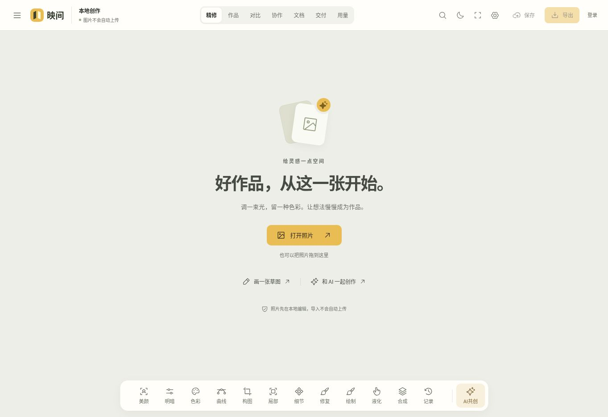
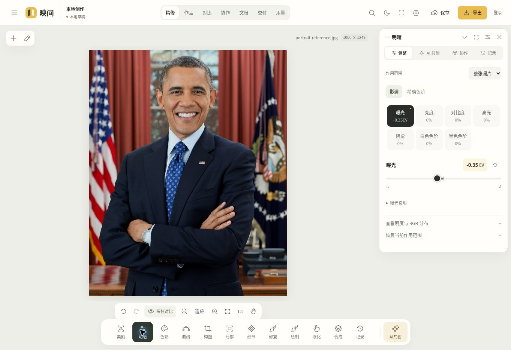
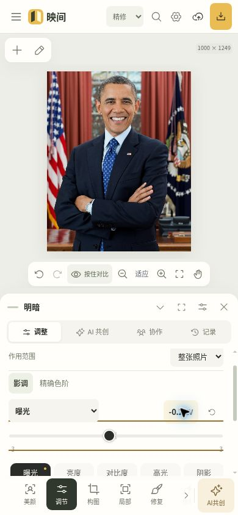
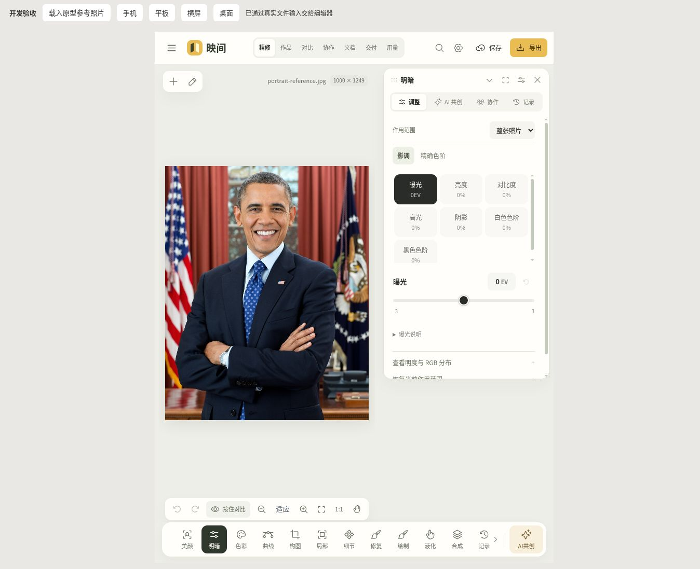
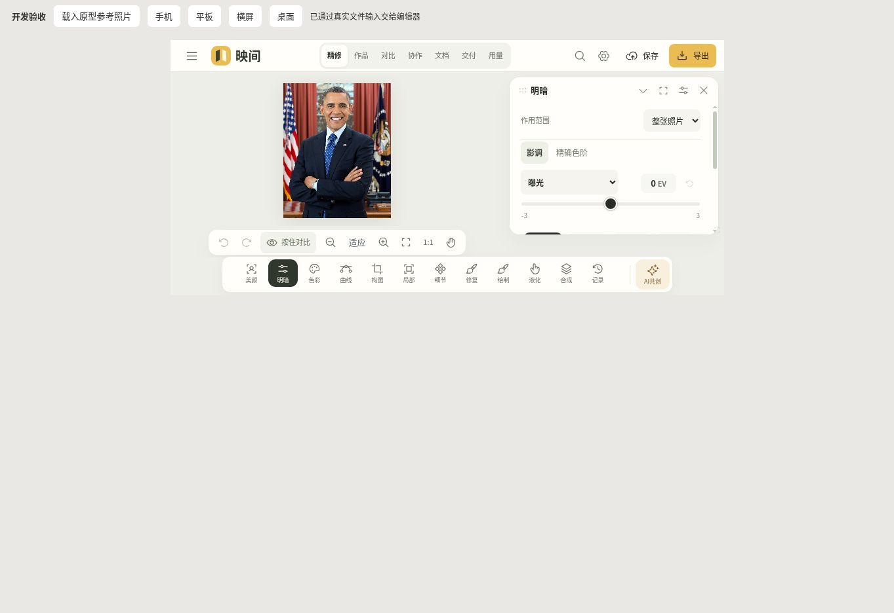
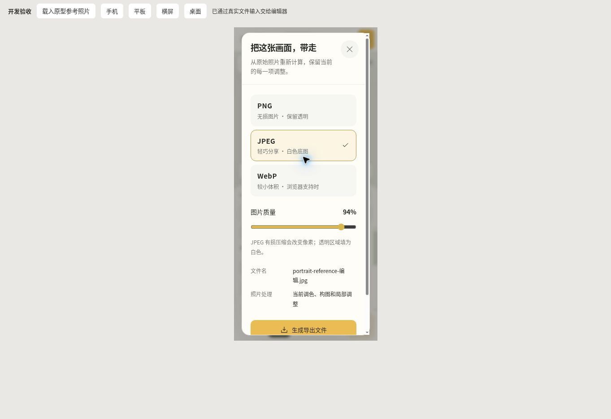
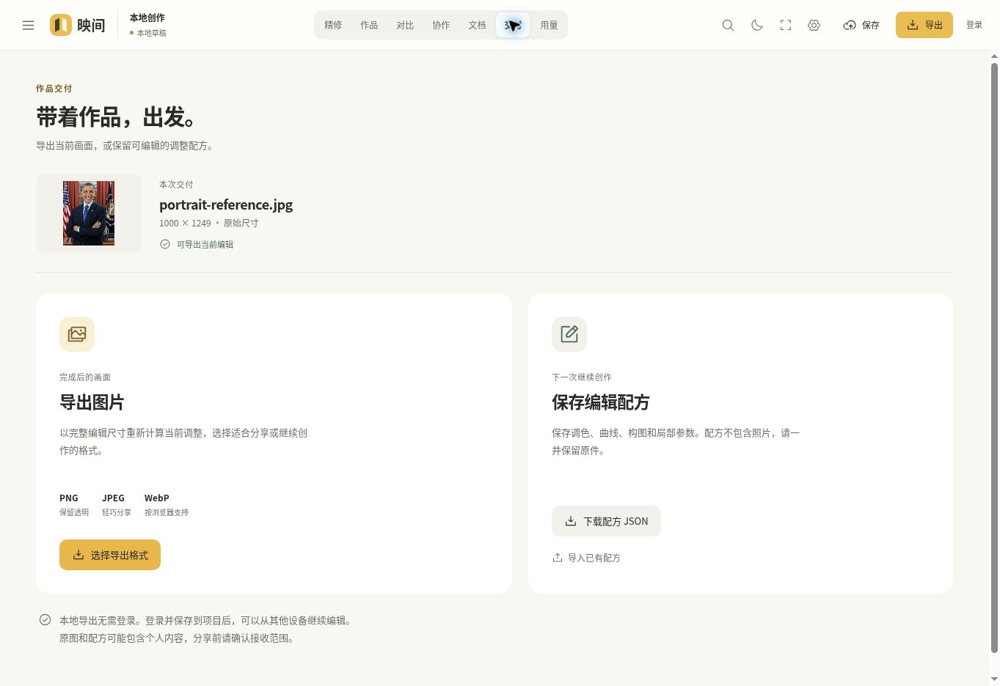

# Studio 前端改版验收记录 · 2026-11-10

本记录对应分支 `work/frontend-studio-v2`。初始开发基线为 `215e2bb0e64a4d97e0fee7fc98a45842314fdd0a`；交付前连续同步远端，先合入 `1f7e8f4f609ae95b2236cfd9077888e075ac5b82` 的团队开放麦克风与实时助手控制，再合入 `5e6c994d94a3c45e2847b4871641640d838aa375` 的助手滚动容器补丁。最终前端门槛对应源码提交 `c03a91d7fc8c1659d48a21de30b54279a66beacc`。改版使用用户提供的原型作为方向参考，保留现有 V4 图像内核、API、权限和版本语义。

合入团队语音主线后，原生 PostgreSQL 下仓库测试 **722 / 722 通过，187.78 秒**；最后的界面补丁合入后，最终源码的完整 web 测试 **215 / 215 通过，27.97 秒**，**14 个 TypeScript 项目与生产构建通过**。这两组结果对应不同但已记录边界的源码阶段：原生运行期间只有一处 CSS 调整，之后的一行助手滚动容器修正仅重跑前端门槛，**没有声称在最终提交上重新执行全部原生 SQL 测试**。详细提交、指纹与历史失败见第 4 节。真实匿名浏览器已完成编辑、导航、响应式检查和三种格式下载；该证据不包含真实登录、多账号、外部付费 AI、短信、麦克风或真机验收。

机器记录见 [frontend-studio-evidence.json](frontend-studio-evidence.json)。工作台使用与能力边界见 [apps/web/README.md](../../apps/web/README.md)。后文分别说明源码范围、浏览器证据、自动化门槛、历史失败和请求恢复限制，不将这些证据互相替代。

## 1. 交付范围与冻结基线

| 项目                         | 本次记录                                                                                                  |
| ---------------------------- | --------------------------------------------------------------------------------------------------------- |
| 分支                         | `work/frontend-studio-v2`                                                                                 |
| 初始开发基线                 | `215e2bb0e64a4d97e0fee7fc98a45842314fdd0a`                                                                |
| 最新合入主线                 | `5e6c994d94a3c45e2847b4871641640d838aa375`                                                                |
| 最终前端门槛的源码提交       | `c03a91d7fc8c1659d48a21de30b54279a66beacc`                                                                |
| Node.js                      | `v24.22.1`                                                                                                |
| 最终前端门槛记录生成时间     | `2026-11-10T14:37:33.460Z`                                                                                |
| 最终前端冻结检查覆盖         | `apps`、`packages`、`scripts` 下 TypeScript / JavaScript、CSS、JSON、SQL，加根目录包清单；合计 426 个文件 |
| 最终前端冻结源码指纹         | `5e129a779df840579c651a6ef2ab5a880a2effeeba39b25c8e8ef7e2b5b0485a`                                        |
| 最终前端门槛运行期间源码变化 | 无；`gate-synced-ui.json` 的 `changedDuringRun` 为空。之前的原生门槛有一处 CSS 变化，另行记录             |
| 相对最新主线的后端与依赖变化 | `apps/api`、`packages`、`infra`、根依赖无差异                                                             |
| 脚本变化                     | 仅 `scripts/qa/team-voice.browser.mjs`；只做 `node --check` 与静态审查，未执行该浏览器剧本                |
| 本文与截图                   | 源码冻结后整理的交付资料；不把文档整理当作再次修改产品源码                                                |

源码指纹是本次受检查文件集合的冻结标识，不是最终提交号，也不是把所有文档、截图和外部服务纳入的全系统保证。分支后续合并或后端更新后，应重新检查受影响的接口与操作链路。

### 1.1 界面与交互变化

| 区域             | 本次交付内容                                                                     | 保留的真实语义                                                          |
| ---------------- | -------------------------------------------------------------------------------- | ----------------------------------------------------------------------- |
| 工作台与初始状态 | 暖白、炭黑、琥珀色；更清晰的画布、工具、项目与交付层级；照片导入入口与真实空态   | 不内置用户、项目、模型结果或私人照片；品牌仍由配置与公开接口决定        |
| 导航与命令搜索   | 中文关键词查找工具 / 视图 / 操作；专注、面板收起与恢复；手机和短横屏导航适配     | 未满足条件的操作保持禁用；页面切换继续遵守未保存状态保护                |
| 参数与曲线       | 当前参数主滑条、精确数值、手机紧凑选择器；修正细调、取消手势与参数显示边界       | 仍使用内核实际参数范围、配方与预览；撤销以已确认操作为单位              |
| 素材与作品       | 筛选清除、显示密度、真实已载入数量、完整构图缩略图、失败与空态                   | 素材原图与作品版本区分；查询范围、分页、标注版本校验不变                |
| 讨论、任务、文档 | 信息层级、实际任务进度、讨论筛选、只读状态、文档选择 / 新建 / 冲突提示           | 共享、编辑和评论入口跟随角色；服务端 ACL、`expectedVersion` 继续生效    |
| AI 共创          | 任务与能力状态、草稿保留、不可用模型禁用、提交前冻结与未决请求恢复               | 不伪造模型可用性或结果；原 key 与请求体保持绑定；未知结果不自动另起请求 |
| 交付与弹窗       | 真实当前预览、格式 / 质量与准备状态分层、移动端弹窗和实际文件下载                | 来源未就绪时禁用导出；输出使用现有引擎与真实编码结果                    |
| 同作品协作连接   | 连接状态与真实会话就绪情况对齐                                                   | 不把仅已打开页面或尚未完成握手当作已连接                                |
| 最新主线团队语音 | 保留开放麦克风、人声通话、逐轮 AI 收音同意及上下文同步；补上团队付费邀请恢复保护 | 房间邀请 ID 不冒充计费会话 ID；个人 / 团队未决记录互相阻止新付费邀请    |

原型中的示例数据、静态成功提示和展示性能力未移植为产品事实。本次前端定制没有改写最新主线的共享算法、后端任务受理、计费、数据库迁移或 API schema。远端自身新增的团队语音后端与协议随主线合入，不能把它们记成此次前端自行变更的服务端契约。

团队通话离开编辑视图时有持续可见的通话条，保留麦克风、离开与返回编辑入口。切换视图不会静默结束连接，返回编辑仍通过未保存文档保护；不是直接绕过文档脏状态切换。QA 剧本相应加入跨视图入口检查，并把个人语音场景放到未发起团队付费邀请的独立 editor 账号，避免为旧剧本解除主机离开后的未决保护。该剧本尚未运行，修改本身不构成浏览器验证通过。

### 1.2 权限入口的代码与自动化核对

| 操作                  | owner / admin | editor | reviewer，包括 API 映射的引用共享 | viewer |
| --------------------- | ------------- | ------ | --------------------------------- | ------ |
| 管理项目共享          | 可用          | 隐藏   | 隐藏                              | 隐藏   |
| 新建 / 修改任务、文档 | 可用          | 可用   | 只读                              | 只读   |
| 发表评论              | 可用          | 可用   | 可用                              | 不开放 |
| 处理自己的评论        | 可用          | 可用   | 可用                              | 不开放 |
| 处理他人的评论        | 可用          | 可用   | 不开放                            | 不开放 |

未知角色按无写入权限处理。事件处理函数保留权限检查，界面隐藏不能替代后端检查。文档仍使用原版本做并发校验，列表刷新不覆盖正在编辑的文字；读取最新版本是显式操作，读取期间阻止新输入被返回结果覆盖。相关测试包括 `apps/web/test/workspace-permissions.test.ts`。此处是代码、接口与自动化核对，**不是浏览器多账号实测结果**。

## 2. 真实浏览器操作

### 2.1 环境与素材

本轮使用真实应用的匿名开发预览，没有为验收制造用户、默认登录、模型、项目或账单。导入素材来自用户提供原型的 `assets/photo.jpg`，包含公开人物肖像，仅用作此次 QA 输入与截图内容；没有将其添加为产品内置照片。

浏览器操作覆盖正常的本地编辑与下载路径。响应式检查使用浏览器视口，不能代表实际手机的内存、触摸精度、麦克风、网络或系统文件交互性能。

### 2.2 操作记录

| 操作           | 实际观察与结果                                                         |
| -------------- | ---------------------------------------------------------------------- |
| 导入照片       | 从用户提供的 QA 素材打开真实图片，进入编辑画布                         |
| 曝光调整       | 将曝光设为 `-0.35`，检查数值与画面变化；后续导出记录保留该曝光设定     |
| 撤销 / 重做    | 在真实画布操作中检查撤销与重做后数值 / 画面的返回                      |
| 曲线数值       | 操作曲线中点并输入数值 `144`，检查数值控件与曲线交互                   |
| 中文命令搜索   | 使用 `Ctrl K` 搜索中文工具名称并跳转到相应功能                         |
| 专注与面板恢复 | 进入 / 退出专注，折叠与恢复面板，确认画布和工具可继续使用              |
| AI 草稿        | 在 AI 任务切换中检查已输入草稿的保留                                   |
| AI 不可用状态  | 未配置可用模型时显示真实状态并禁用提交，没有产生假任务结果             |
| 移动端弹窗     | 在 320px 窄屏检查登录与导出弹窗的内容、布局和操作入口；未实际登录      |
| 实际下载       | 通过产品导出入口分别下载 PNG、JPEG、WebP，并解码检查尺寸与像素统计     |
| 最终页面复核   | 再次查看桌面、390px 手机、768px 平板、844px 短横屏、交付页与空状态截图 |

曲线交互和导出像素检查是分别记录的操作；不将曝光导出的统计结果解释为已逐像素验证所有曲线、修复、美颜或图层功能。

### 2.3 视口与溢出

| 视口（CSS px） | 检查场景                         | 结果                                                                   |
| -------------- | -------------------------------- | ---------------------------------------------------------------------- |
| 320 × 700      | 窄手机、参数入口、登录与导出弹窗 | 未观察到根页面溢出                                                     |
| 390 × 844      | 手机竖屏工作台与面板             | 未观察到根页面溢出                                                     |
| 768 × 1024     | 平板竖屏工作台                   | 未观察到根页面溢出                                                     |
| 844 × 390      | 短横屏导航、工具与画布           | 未观察到根页面溢出                                                     |
| 1024 × 768     | 平板横屏 / 紧凑桌面              | 未观察到根页面溢出                                                     |
| 1440 × 900     | 桌面完整工作台                   | 未观察到根页面溢出；最终 `html` 的 client / scroll 读数均为 1440 × 900 |

检查过程中修正了手机参数选择器与短横屏导航。局部列表、参数区和导航自身的受控滚动是预期行为；“无根页面溢出”不表示所有内容都同时铺在首屏，也不等于完成全设备触达验收。各视口读数与截图文件校验见 [机器证据](frontend-studio-evidence.json)。

最终顶层应用日志检查最多收集 1000 条 warn / error，过滤明确来自 `chrome-extension://` 的条目后结果为 `[]`。它只说明此次匿名操作期间未观察到应用 warn / error，不是所有页面、登录状态或生产环境的无错误保证。

团队语音主线与窄屏 CSS 合入后，在 `79b0fab` 再次对真实匿名应用执行基础复核：导入 1000 × 1249 的同一 QA 照片，输入曝光 `-0.35EV`，检查实时助手在未登录时显示“登录后开始”，应用 warn / error 记录为空。此后 `c03a91d7` 的一行助手滚动容器补丁重新通过完整 web 测试、14 项类型检查与构建；没有把该匿名基础复核表述为新版真实登录或语音链路验收。

### 2.4 合入后的团队语音组件布局夹具

另外检查了明确标注为静态组件夹具的团队语音面板。该夹具不登录账号，不打开麦克风，不调用外部供应商，也不是多人语音房间。它仅验证新组件在窄屏和短横屏中的尺寸、按钮与滚动可达性。

| 视口      | 画布底边 `canvasBottom` | 详情底边 `detailBottom` | 详情可视高度 / 内容高度     | 观察                                                 |
| --------- | ----------------------- | ----------------------- | --------------------------- | ---------------------------------------------------- |
| 320 × 700 | 345                     | 333                     | `client=218` / `scroll=749` | 面板在画布范围内，内部可滚动；手机实际滚动至内容末尾 |
| 844 × 390 | 310                     | 298                     | `client=185` / `scroll=680` | 短横屏保留受控内部滚动，详情不越出画布底边           |

详情面板的两个通话操作按钮测得高度均为 44px。调整 `studio.css` 后，又在 320px 夹具中核对持续通话条的麦克风、离开、返回三个按钮均为 44px 高，布局保持在窄屏可用范围；这是另一组控件，不将它与详情面板的两个按钮混计。上述数据只说明组件布局与滚动，不代表麦克风权限、音频传输、跨账号邀请、供应商回执或账单核验已经成功。`scripts/qa/team-voice.browser.mjs` 只完成本地语法与静态检查，未执行；不得将其剧本步骤列为已完成的真实语音操作。

## 3. 实际导出文件检查

`browser-exports.json` 记录了实际下载文件的解码结果。输入图像的 RGB 均值为 **92.539 / 69.869 / 71.774**，本次导出调整记录为曝光 **-0.35 EV**。

| 实际下载格式 | 解码后格式 | 尺寸        | 通道数 | 导出 RGB 均值            |
| ------------ | ---------- | ----------- | ------ | ------------------------ |
| PNG          | `png`      | 1000 × 1249 | 4      | 82.344 / 61.852 / 63.542 |
| JPEG         | `jpeg`     | 1000 × 1249 | 3      | 82.315 / 61.798 / 63.525 |
| WebP         | `webp`     | 1000 × 1249 | 3      | 82.383 / 61.948 / 63.468 |

三个文件均真实下载、可解码、尺寸符合输入，像素统计与原图不同，说明本次修改进入了导出结果。该检查不是仅观察下载按钮或文件扩展名。均值差异本身不能证明每个算法与色彩管理场景正确，也不扩展为 RAW、HDR、高位深或所有大图尺寸的导出验收。完整数值收录于 [机器证据](frontend-studio-evidence.json)。

## 4. 自动化门槛与历史失败

### 4.1 最终结果与对应源码

| 检查                       | 对应源码与实际执行条件                                                                                                 | 结果                                                             |
| -------------------------- | ---------------------------------------------------------------------------------------------------------------------- | ---------------------------------------------------------------- |
| 仓库完整测试               | 从 `70359f9` 启动；独立临时原生 PostgreSQL **18.6**、`DB_POOL_MAX=8`，执行 `npm test`。运行期间只有下节记录的 CSS 调整 | **722 / 722 通过**；失败、取消、跳过、待办均为 0；187.78 秒      |
| 最终完整 web 测试          | `c03a91d7`；`node --import tsx --test --test-concurrency=1 apps/web/test/*.test.ts`                                    | **215 / 215 通过**；失败、取消、跳过、待办均为 0；27.97 秒       |
| 最终 TypeScript 与构建     | `c03a91d7`；`npm run build`，该脚本先执行仓库 typecheck                                                                | **14 个 TypeScript 项目通过**，Vite 生产构建通过                 |
| 最终补丁格式               | `git diff --check`                                                                                                     | 通过                                                             |
| 团队语音浏览器剧本         | `node --check scripts/qa/team-voice.browser.mjs` 与静态审查                                                            | 语法检查通过；**没有执行该剧本**                                 |
| 最终前端运行期间源码一致性 | `c03a91d7` 的起止文件集合与指纹对照                                                                                    | 426 个受检查文件一致，`changedDuringRun` 为空                    |
| 后端与依赖范围             | 对照最新主线 `5e6c994`，并核对两个晚期上游基线之间的后端差异                                                           | `apps/api`、`packages`、`infra`、根依赖无差异；脚本例外见第 1 节 |

完整 web 检查用于单独复核前端。它与仓库测试存在覆盖重叠，**不能将 722 与 215 相加，宣称通过了 937 个互不重复测试**。最后一轮前端检查发生在最新 UI 补丁合入后；原生 SQL 测试没有为这一行 UI 调整再次执行。

原生完整测试的记录时间为 `2026-11-10T14:28:03.501Z` 至 `2026-11-10T14:31:13.002Z`；测试框架耗时为 `187778.649853 ms`。运行器使用独立随机本地端口和临时数据库目录，核对实际 `data_directory`，结束后确认集群已停止、临时目录已删除。没有复用开发数据库，也没有为这次门槛停止或重配正在使用的开发预览。原生 SQL 与本地协议 / 编码夹具测试不证明已部署基础设施或外部供应商的实际质量。

### 4.2 源码阶段与指纹

| 阶段                       | 源码与变化                                                                                                    | 证据边界                                                                                                                                                                                                |
| -------------------------- | ------------------------------------------------------------------------------------------------------------- | ------------------------------------------------------------------------------------------------------------------------------------------------------------------------------------------------------- |
| 团队语音主线合入           | 主线 `1f7e8f4f609ae95b2236cfd9077888e075ac5b82` 合入提交 `70359f9446ba8a2ed06a9fa660a532d43f93387a`           | 从此启动 722 项原生测试、215 项 web 测试与根构建                                                                                                                                                        |
| 320px 通话条修正           | `79b0fab538fc56a7292ed5b5aa280afa6b99b0c2` 只调整 `apps/web/src/workspace/studio.css`，发生于上述门槛运行期间 | TypeScript / JavaScript、API、包与测试逻辑未改；不能称整个源码完全不变。CSS 调整后单独重做生产构建，并做窄屏布局复核                                                                                    |
| 最新主线补丁与最终前端复验 | 主线 `5e6c994d94a3c45e2847b4871641640d838aa375` 合入 `c03a91d7fc8c1659d48a21de30b54279a66beacc`               | 相对此前门槛，只有 `LiveAssistant.tsx` 的连接时滚动容器从 `.ai-scroll` 改为 `.ai-workbench`，以及既有团队 QA 剧本的挂断命中断言；重新执行全部 web 测试、14 个 TypeScript 项目与生产构建，未重跑原生 SQL |

| 快照                        | 受检查文件数 | SHA-256 源码指纹                                                   |
| --------------------------- | ------------ | ------------------------------------------------------------------ |
| `70359f9` 原生门槛起点      | 426          | `808aa2459d0efc6cf1d20328b231e2169b1ff8ad367a960983373e1f8079d292` |
| `79b0fab` CSS 补构建完成    | 426          | `ba407cb208ae2712d736e642023651eddf9d17a79fa09572aac8d3f5050a2c70` |
| `c03a91d7` 最终前端门槛起止 | 426          | `5e129a779df840579c651a6ef2ab5a880a2effeeba39b25c8e8ef7e2b5b0485a` |

最终前端指纹在该轮检查内保持一致；这一结论只适用于该轮的文件集合。原生与最终前端结果按上述边界分别引用，不能合并写成“所有门槛都运行在同一个未变化的源码快照”。最后补丁没有更改后端、共享契约或数据库测试输入，这也是仅重跑受影响前端门槛的依据。

### 4.3 历史失败与处理过程

| 轮次                     | 结果                                                            | 失败原因与后续处理                                                                                                                                                                           |
| ------------------------ | --------------------------------------------------------------- | -------------------------------------------------------------------------------------------------------------------------------------------------------------------------------------------- |
| PGlite / lite 运行       | 658 / 669 通过，11 个失败，147.36 秒                            | lite 运行器固定 `DB_POOL_MAX=1`；数据库阻塞中的 WebSocket 握手还需要另一个池连接，产生等待超时并留下影响后续语音测试的状态。记录为 10 个子测试失败及其父测试失败；没有把失败删除或改写成通过 |
| 首次原生完整运行         | 669 / 669 通过，128.86 秒                                       | 使用原生 PostgreSQL 与连接池 8，相关并发场景通过；该轮发生在最后的前端恢复修改之前，不作为最终源码的单独证明                                                                                 |
| 后续原生运行             | 701 / 702 通过，1 个失败，130.14 秒                             | 唯一失败为 `ParameterShelf` 可访问分组名称仍断言旧标签。根据最终产品标签修正断言，并补充折叠 / 提示不重复以及紧凑原生选择器语义一致性检查                                                    |
| 同步前完整原生运行       | **710 / 710 通过，130.93 秒**                                   | 对应初始主线 `215e2bb` 上的前端改版；该轮冻结期间源码未变化，先前失败已通过                                                                                                                  |
| 同步前完整 web 复核      | **206 / 206 通过，27.30 秒**                                    | 对应同一旧基线；后续团队语音合入后已重跑，不以这组数量代替新版本覆盖                                                                                                                         |
| 团队语音合入后的完整门槛 | **722 / 722 原生通过，187.78 秒；215 / 215 web 通过，66.45 秒** | 从 `70359f9` 启动，期间只有 CSS 变化；详细边界见上节。最新 UI 补丁后 web 又在 `c03a91d7` 单独复验为 27.97 秒                                                                                 |

同步前 `gate-final.json` 记录生成于 `2026-11-10T13:55:53.540Z`，覆盖 403 个文件，指纹为 `b65ba845142371e1595c7374c2907b5529457e5f8c918a8fc8f4891e6bef7bed`；它只标识旧基线上的那轮结果。不同轮次的测试数量随新增检查增加，不能将之前 669、702 或 710 项当作后来 722 项的等价覆盖。lite 的失败说明其单连接并发局限；原生通过不会把 lite 记录本身变成成功，也不修改现有脚本来掩盖该差异。

### 4.4 最终构建提示

最终 `c03a91d7` 构建处理 4830 个模块。主 JavaScript 为 1072.41 kB，gzip 后 314.04 kB；主 CSS 为 343.97 kB，gzip 后 58.72 kB。Vite 仍提示主分块超过 500 kB，没有提高告警阈值来隐藏提示。npm 的 `http-proxy` 环境配置提示也保留，未造成命令失败。

构建通过不等于首屏性能预算达标。此次没有执行真实移动网络、低内存手机或生产 CDN 性能验收；分块与加载性能仍可作为后续前端优化事项。

### 4.5 复核入口与原始记录

在独立测试数据库上设置 `TEST_DATABASE_URL` 与 `DB_POOL_MAX=8` 后，可从仓库根目录运行：

```sh
npm test
node --import tsx --test --test-concurrency=1 apps/web/test/*.test.ts
npm run build
git diff --check
node --check scripts/qa/team-voice.browser.mjs
```

本次工作目录的原始资料集中于 `artifacts/verification/frontend-studio/`；可交付摘要合并至 [frontend-studio-evidence.json](frontend-studio-evidence.json)。最终前端记录为 `gate-synced-ui.json`，合入团队语音后的原生门槛为 `gate-synced.json` 与 `native-test-run-synced.json`；旧 `gate-final.json`、`native-test-run-complete.json` 保留为同步前历史。`browser-exports.json`、各源码起止快照与日志共同说明具体运行。以下校验值用于核对原始记录，不用一次成功终端输出替代完整证据。

| 合入主线后的日志             | SHA-256                                                            |
| ---------------------------- | ------------------------------------------------------------------ |
| `test-native-synced.log`     | `70224969943218ce653b697f5d2fa21a2f82d87a40db552b14a2027d77f9291e` |
| `test-web-synced.log`        | `73c23fa38683f5ca1a7855efe2be17568e03c8addd0d1ecef1299fb5de0a8a5a` |
| `build-synced.log`           | `93fb11fe9dbbfdc243a45bd24b370b98bfa44d255829808f848a0bf82cc9926d` |
| `build-synced-final-css.log` | `e88997de8d16110df8cc266cdcd5a80649a184ccf24a85e09c31f32e233e21b8` |
| `test-web-synced-ui.log`     | `0d4f028f0e69cdf3022baa7754a22a745c2ca2721876c638abe73d448c3233a9` |
| `build-synced-ui.log`        | `b8c21a99d2e5869d473813375ee14d91db1a4ab3b658c27b77a0c3cf67c7cb48` |

| 同步前历史日志             | SHA-256                                                            |
| -------------------------- | ------------------------------------------------------------------ |
| `test-lite.log`            | `7b53381c78a524f8c4ee6533512494337be8c6d17fcac5c6922dfe0d4fcbcc16` |
| `test-native.log`          | `e037f2b22560af45d0ff2398d8cebe9dc0a3ecf4ec67df37df131323f0b4ca91` |
| `test-native-final.log`    | `f1d85ec733545ac8339b87a05f8bd7a9536c5d197c839a0e9cc5450b2277a5ad` |
| `test-native-complete.log` | `3b36f2c4e2d8e980452970148843c869928fbef9ed9878a83dcf6591a9b4a0d9` |
| `test-web-complete.log`    | `ac7a829a0206987d62817ff4b259481cf5a3cf8f8994e6bf2761bf4275d83831` |
| `build-complete.log`       | `d1e26e64b73c42c20ff7f42003bef491175ec24a79b0525129bd2baff76f11d2` |

## 5. 请求恢复、数据范围与后端交接

### 5.1 已实现的提交规则

普通 AI 任务与文字 Agent 在 POST 前冻结请求体、原 key 和请求哈希，并按账号保存恢复资料。App 按账号 / 项目重建 AI 面板，恢复操作仍要求回到原项目。图像、模型、素材引用、授权或编辑起点的后续变化，不会被重新抓取后拼进原 key。

| 路径         | 未知编号时                                                       | 已知编号时                                                                 | 结果未知时                                                      |
| ------------ | ---------------------------------------------------------------- | -------------------------------------------------------------------------- | --------------------------------------------------------------- |
| 普通 AI 任务 | 完整原请求仍在时，用户明确选择才按原 key POST 核对 / 继续        | GET `/projects/:id/ai-jobs`，在最近 100 条结果中定位原 `jobId`             | 保留 checkpoint，不自动另起 key；原任务不在列表中也不伪造新任务 |
| 文字 Agent   | 完整原请求仍在时，用户明确选择才按原 key POST 核对 / 继续        | GET `/assistant-turns/:id`，必要时观察该轮的只读事件流                     | 保留 checkpoint，等原轮次状态明确；通用错误不当作未受理证明     |
| 个人实时语音 | 保留原准备请求身份；仅在界面明确允许且仍有完整原请求时核对原 key | 绑定原会话与连接回执；当前没有用户只读会话状态接口                         | 保留原身份，阻止新拨号；不重新发放 ticket，不自动重拨           |
| 团队 AI 邀请 | POST 前冻结严格团队请求及原 key；当前不提供邀请重试入口          | POST 只有状态；通过原连接的房间事件观察原邀请，不把邀请 ID 当成计费会话 ID | 保留原请求；断线、换邀请、未知结果使原连接证明失效              |

首次请求的明确前置拒绝与运输失败区分处理，拒绝名单按各条路由实际受理顺序核对。普通任务、文字助手和个人语音的特定未配置 / 停用错误可在确认发生于首次受理前时释放记录；不能把这一规则直接套到团队邀请。例如团队路径的 `ASSISTANT_MODEL_UNAVAILABLE` 可能发生于预占之后，仍按未决处理。同一请求重试时的拒绝也不能证明第一次未被受理。通用 503、超时、无法解析的响应与未知结果保留恢复记录。相关测试见 `assistant-submission.test.ts`、`job-submission.test.ts`、`voice-submission.test.ts` 与 `team-voice-submission.test.ts`。

关闭面板后，旧回执仍只对应原账号与原 key；旧请求不能清除另一把 key 的恢复记录。已受理任务的恢复不转成另一笔付费任务。上述机制降低当前浏览器工作流中的重复派发风险，**不是全账号、跨标签页或跨设备的全局去重承诺**。

### 5.2 实际保存了什么

| 资料                         | 位置                            | 持久化范围与生命周期                                                                                                                                                                |
| ---------------------------- | ------------------------------- | ----------------------------------------------------------------------------------------------------------------------------------------------------------------------------------- |
| 普通 AI 任务 checkpoint      | `sessionStorage`，按 actor 分槽 | 原 key、哈希、状态、项目、提示词、`recipeSnapshot` 等；无原始媒体时还保存完整请求体，含模型、参数、引用 ID、授权等。当前标签页刷新 / 面板重开可读；关闭标签页或另一标签页不保证恢复 |
| 文字 Agent checkpoint        | `sessionStorage`，按 actor 分槽 | 原 key、哈希、轮次 / 会话 ID、状态、项目、提示词、`editorKey` 等；无原始媒体时还保存包含配方、scope、授权的非媒体请求体。生命周期同上                                               |
| 个人实时语音 checkpoint      | `localStorage`，按 actor 分槽   | 请求 / 会话 ID、状态、哈希、项目、`editorKey` 及可持久化的非媒体请求体。它可能包含模型、音色、上下文配方和 scope，并非字面上的“只保存编号”。同源其他标签页可收到存储变化事件        |
| 团队 AI 邀请 checkpoint      | `localStorage`，按 actor 分槽   | 原 key、作品 ID、模型、哈希、状态、时间及可观察到的房间 invitationId；无原始媒体时保留严格团队 schema 的请求体。和个人语音互查，同一页面也通过通知事件同步                          |
| 含共享画面或录音的完整请求体 | 当前页面内存 Map                | 识别到 `imageDataUrl`、`imageBase64`、`audioBase64` 或相关 data URL 后，整个请求体不进入上述存储；同页关面板后可恢复，刷新 / 关页后丢失                                             |
| 语音 ticket、麦克风流        | 连接与运行时内存                | ticket 不进入 checkpoint；原始录音和画面不因恢复功能写入浏览器持久存储                                                                                                              |
| AI 未发送草稿                | 页内内存，按账号 / 项目区分     | 文本与选择项可在面板切换 / 重开间保留；没有实现跨设备或浏览器重启后的离线草稿同步                                                                                                   |
| 布局偏好                     | 设备侧 `localStorage`           | 面板位置、尺寸、状态等布局信息，与照片配方和云端版本分离                                                                                                                            |

上述浏览器存储中可能含提示词、编辑配方、范围与授权 ID 等非媒体恢复资料，不能把它描述成完全无内容的数据。它们也不是供应商凭据。原始媒体离开页内内存后，若尚未取得可只读查询的任务编号，界面会保守阻止重放，不用当前照片或新录音替代原请求。

`localStorage` 的共享与存储事件不是原子受理机制；两个标签页或两台设备仍需服务端协调。`sessionStorage` 的任务恢复记录也不是跨标签共享。清除浏览器数据不是业务结果核验，不能因此推断原请求未计费。

### 5.3 当前无法由前端独立完成的恢复

**语音是明确的限制。**当前后端没有用户侧只读语音状态或按原 key 查询接口；相同 key 再次准备返回 `409 VOICE_ALREADY_PREPARED`，不会返回旧连接 ticket。已准备或未知的会话因此不能由前端自动重连 / 重放。管理员可在运营端执行 reconciliation，但前端没有对应的用户只读状态出口，**即使后台已核验，也无法自动知道结果并释放本机语音锁定**。

团队邀请还需区分三种标识：客户端原 key、进程内房间 `invitationId` 和数据库中的语音会话 ID。团队 POST 只返回 `{ state }`；非 off 的 roster 带邀请 ID、邀请者 speaker slot 与模型，off 只带 `lastOutcome`，没有原邀请 ID、key、服务器时间或事件序号。房间清空或服务重启后，进程内记录也不构成历史核验资料。

原 key 被拒绝准备时，后端可能先创建新的房间 lease 并广播 connecting，再返回 `VOICE_ALREADY_PREPARED`，最后广播 off / failed。这个失败不能代表旧未知请求已释放。前端为每次首次受理建立仅属于当前连接的观察证明：必须连续看到自身原邀请 active，随后明确 closed / failed，且中间没有换邀请、未知结果、断线、账号或作品切换，才可自动清除记录。证明不从持久化状态恢复，不用 POST 状态、本地时间或超时猜测终态。

付费 POST 与房间事件可以先后交错。迟到 HTTP 回执仅更新仍存在的同 key 未确认记录，不复活已由明确终态清除的记录，也不删除新请求。协作详情面板关闭不卸载 App 中的连接 hook；账号或作品切换保留原账号的未决记录，同时释放旧界面操作锁，避免旧请求阻挡另一账号。`DELETE` 成功只表示请求结束，不能直接清除付费记录。个人与团队入口在实际保存和发送前互查另一类未决记录，仍不把本浏览器的互锁当作全账号原子保障。

普通 AI 任务的已知 ID 恢复依赖最近 100 条项目记录。高频项目中，旧任务可能离开该窗口；前端会保留记录并提示核对，不因“本次列表未找到”推断任务不存在或重新收费。

### 5.4 给后端并行开发的交接建议

| 建议能力                          | 需要解决的实际问题                                                     | 应维持的契约                                                                                        |
| --------------------------------- | ---------------------------------------------------------------------- | --------------------------------------------------------------------------------------------------- |
| 用户侧个人 / 团队语音只读状态查询 | 前端在连接丢失、刷新或运营核验后读回原会话结果，并按权威终态解除恢复锁 | 校验 actor、项目及当前授权；团队终态明确绑定原请求 / 计费会话；只读查询不能启动供应商连接或新增预占 |
| 按 actor + 原 key 查询已受理请求  | 回执丢失且原始媒体不再在内存时，仍能找到原任务 / 轮次 / 会话           | 不要求重传原始画面或录音；不返回可重复使用的旧语音 ticket                                           |
| 普通 AI 任务单项查询或游标分页    | 已知任务离开最近 100 条窗口时仍能读回                                  | 继续执行当前 ACL，返回原任务状态，不创建新任务                                                      |
| 账号未终态请求读回                | 标签页重开、另一设备或跨标签协作时建立一致的未决请求视图               | 服务端是状态与收费权威；本机 checkpoint 仅辅助恢复，不能承担全账号原子锁                            |

这些是后续接口协作建议，**没有作为本次前端已实现能力交付**。不应仅为解除前端提示而允许未知状态换 key 重发。

## 6. 真实应用截图

以下主要截图来自本次真实应用匿名预览，包含真实导入的 QA 照片与真实空态；不是原型页面、静态视觉稿或伪造已登录数据。截图主要说明布局与可见状态，不能证明云端写入、外部模型调用或真实手机性能。文件校验记录见 [机器证据](frontend-studio-evidence.json)。

### 初始状态与桌面工作台





### 手机、平板与短横屏







### 导出与交付





## 7. 尚未完成的生产验收

本轮浏览器没有真实登录或切换多个账号，因此没有在真实登录态中完成邀请、多人租约竞争、云端保存、共享撤销、文档冲突、权限降级或运营核验的整条浏览器流程。相关接口、权限和并发由源码核对与自动化覆盖提供证据，不能据此写成浏览器全流程已验收。

本轮没有调用外部付费 AI 供应商、发送真实短信、使用真实麦克风或在真机上运行；也没有验证生产域名 / Cookie / TLS、跨地区网络、部署迁移、全部专业媒体格式、高分辨率移动端资源或外部模型质量。模型不可用时的真实禁用行为已检查，供应商成功结果没有伪造。

后端并行开发继续推进时，应优先联调第 5 节的只读恢复接口，再在真实账号与明确服务配置下验收登录、云端写入、多人协作和付费任务的受理 / 终态 / 对账。任何合并导致接口、状态机或权限语义变化，都应针对受影响路径重新运行检查；本次冻结通过不能自动覆盖后续提交。
